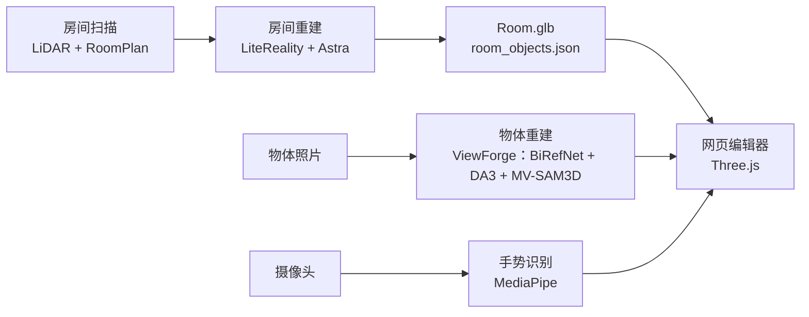

<div align="center">


# RoomCanvas

**扫描你的房间，在浏览器里按真实尺寸重新布置。**

[快速开始](#快速开始) · [怎么做的](#怎么做的) · [文档](#文档)

</div>


用 iPhone（LiDAR + RoomPlan）扫一遍房间，RoomCanvas 把它重建成带纹理、尺寸真实的三维模型，每件家具都是单独的、可以挪动的物体。再拍几张照片把新东西加进来，用鼠标或摄像头手势摆放，看放不放得下、好不好看。

## 功能

- **真实尺寸的房间**：LiteReality 从扫描重建房间和家具，Agent 用 GPT-6 Astra 审图、建模、摆放；小物件逐件判断是舍弃、程序化建模还是用 TRELLIS 重建。
- **每件家具都能动**：移动、旋转、贴墙、收进仓库、一键清空或还原；碰撞和是否放稳实时检查；可撤销，布局自动保存。
- **门和柜门能打开**：切到“预览”，点一下门、柜门或窗。
- **拍照添加物体**：在仓库里传 3 张以上照片，服务器抠图、重建，填一条实测边长就按真实大小放进房间。
- **手势操作**：打开摄像头，左手比 1 / 2 / 3 切换移动、旋转、观察，右手捏合抓取；识别在本机浏览器里完成，画面不上传。

## 快速开始

只看网页不需要安装任何东西，有 Python 3 就行：

```bash
git clone https://github.com/innovationasuna/RoomCanvas.git
cd RoomCanvas
python3 web/scripts/serve.py
```

打开 <http://127.0.0.1:7880/web/>，选一个示例房间（卧室 `room3`、办公室 `office`）开始布置。

“添加物体”和“导入物体”需要连接 ViewForge 后端（物体重建服务，跑在 GPU 服务器上），默认通过 SSH 隧道 `127.0.0.1:7865`，见 [物体重建说明](docs/OBJECT_RECONSTRUCTION.md)。

## 怎么做的



| 目录 | 做什么 |
|---|---|
| [`room-reconstruction/`](room-reconstruction/) | 房间重建：[LiteReality-Agent](https://github.com/LiteReality/LiteReality-Agent) 官方代码，Agent 改用 Codex（GPT-6 Astra），加了 3090 运行脚本和小物件这一步 |
| [`object-reconstruction/`](object-reconstruction/) | 物体重建（ViewForge）：照片 → 抠图 → 多视角重建 → 尺寸标定，及其后端和单物体预览 |
| [`web/`](web/) | RoomCanvas 网站：房间主页、编辑器、本机服务 `serve.py` |
| [`gesture/`](gesture/) | 浏览器手势识别；编辑器内置的识别代码从这里打包 |
| [`samples/`](samples/) | 两个示例房间：`room3`（手机扫描的卧室）、`office`（LiteReality 官方样例） |

## 文档

- [网页说明](web/README.md)：编辑器的操作、手势、导入和添加物体，开发和测试
- [房间重建](docs/ROOM_RECONSTRUCTION.md)：在 3090 上重建一个房间、小物件这一步、接到网页
- [物体重建与手势](docs/OBJECT_RECONSTRUCTION.md)：ViewForge 物体后端、标定接口、SSH 隧道和 RoomCanvas 手势
- [光影增强](web/README.md#通用光影增强)：光照档位、环境光、静态 AO 和验收；[光影调研](web/README.md#光影调研)：开源方案、版本兼容性、低耦合接入方式和实验任务
- [参与开发](CONTRIBUTING.md)：分支、检查、合并流程
- [交接文档](docs/HANDOFF.md)：当前进度、服务器目录和待办

## 对 LiteReality-Agent 改了什么

基线是官方 `28ffe1f4`（2026-10-03），即本仓库的第一个提交，原样放在 `room-reconstruction/`。之后：

- **所有 Agent 改用 Codex**：默认 provider 从 claude 改为 codex（`models.env`、`settings.py`、`agent/providers/base.py`）；Codex 会话支持附图（`providers/codex.py`）；新增 `agent/providers/vision.py`，在建模路线分类、椅子分组、程序化完整性检查、布局 Agent 四处看图。provider 设回 claude 时仍走官方原来的代码。
- **新增、不改官方文件**：3090 运行脚本 `room-reconstruction/server/`；小物件这一步 `pipeline/realism_authoring/small_objects/`（复用官方的证据图、参考图、TRELLIS 启动器和看图问答）。
- **CI**：`.github/workflows/ci.yml` 先用 gitleaks 扫描全部历史里的密钥，再跑官方测试和网页测试。

逐行改动看提交 2。

## 隐私

仓库是私有的。**`samples/room3` 是私人卧室**，`Room.glb` 和缩略图来自实拍照片，只给协作者用，不要转发；仓库要公开前必须先从历史里删掉它。原始扫描、照片、含相机轨迹的 `room_layout.json` 都不进仓库。

## 致谢与许可

RoomCanvas 以 [Apache License 2.0](LICENSE) 发布，署名见 [NOTICE](NOTICE)。它建立在这些项目之上，各自保留原有许可：

- [LiteReality-Agent](https://github.com/LiteReality/LiteReality-Agent)：房间重建，研究使用请引用 [citation.bib](room-reconstruction/citation.bib)
- ViewForge / MV-SAM3D 及其依赖：见 [`object-reconstruction/LICENSE`](object-reconstruction/LICENSE)
- [TRELLIS.2](https://github.com/microsoft/TRELLIS.2)：小物件重建
- [MediaPipe Tasks Vision](https://ai.google.dev/edge/mediapipe)（Apache-2.0）：手势识别，见 [`gesture/README.md`](gesture/README.md)、[`gesture/docs/sources.md`](gesture/docs/sources.md) 和 [`web/vendor/gesture/README.md`](web/vendor/gesture/README.md)
- [Three.js](https://threejs.org/)（MIT）：网页渲染，在 `web/vendor/`
