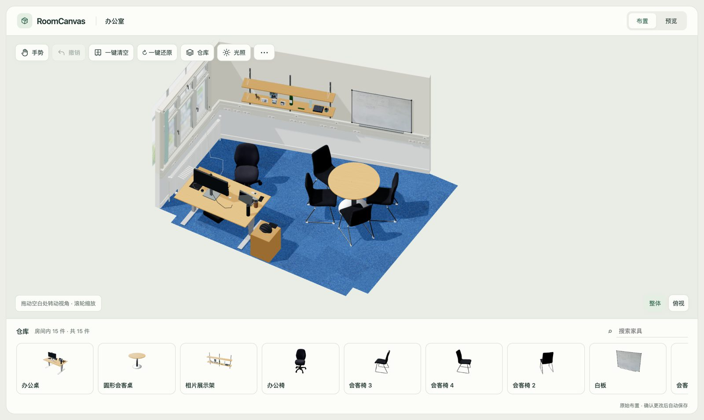
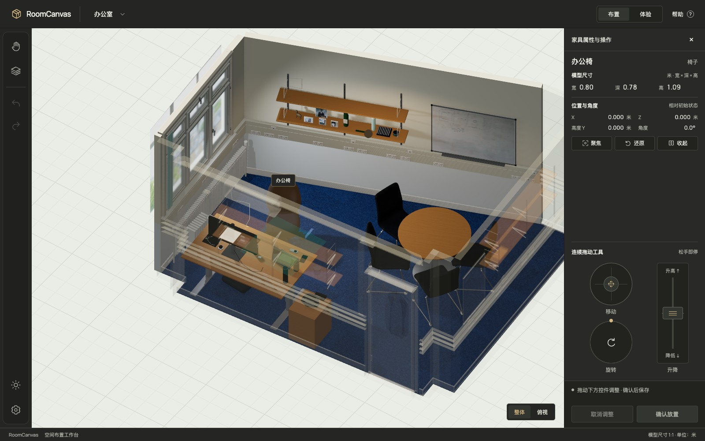
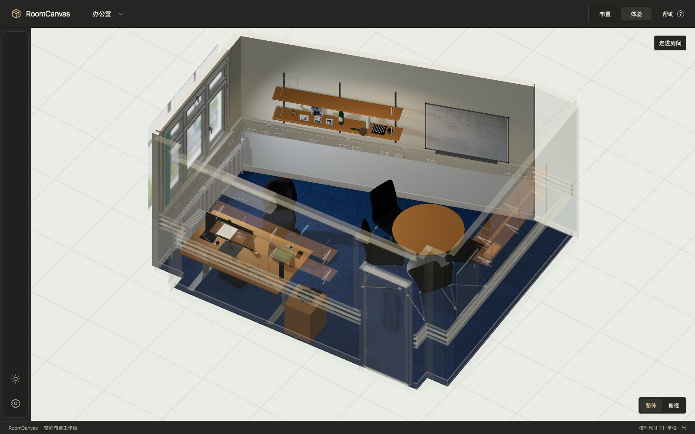
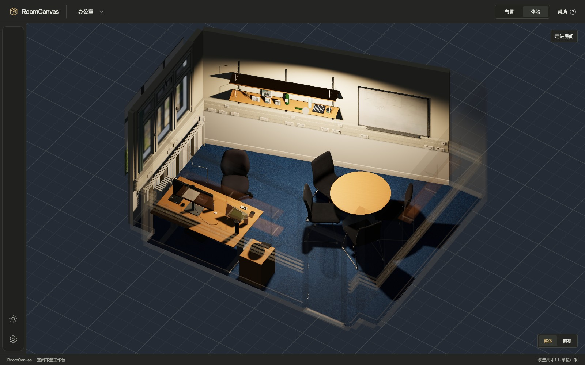
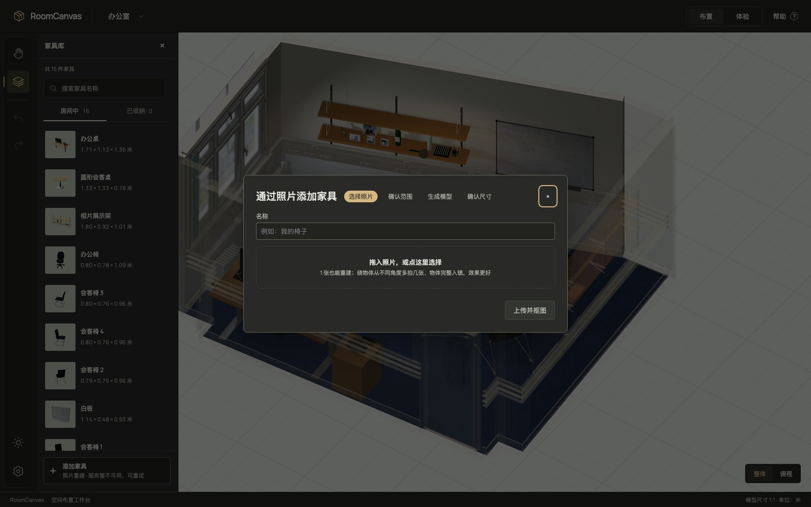
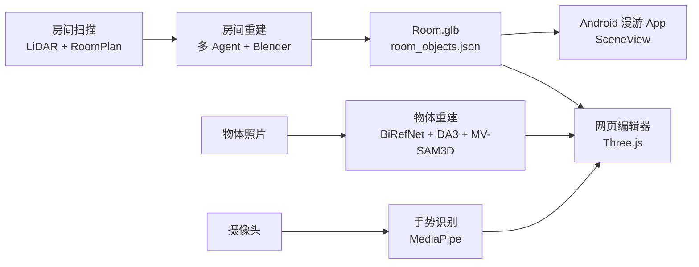

<div align="center">


# RoomCanvas

**扫描你的房间，在浏览器里按真实尺寸重新布置。**

[](LICENSE) [](https://threejs.org/) [](https://www.python.org/) [](https://nodejs.org/) [](#快速开始)

[功能](#功能) · [截图](#截图) · [快速开始](#快速开始) · [怎么用](#怎么用) · [工作原理](#工作原理) · [开发](#开发与测试) · [路线图](#路线图) · [文档](#文档)

</div>



用 iPhone（LiDAR + RoomPlan）扫一遍房间，RoomCanvas 把它重建成带纹理、尺寸真实的三维模型，每件家具都是独立、可以挪动的物体。想买的新东西拍几张照片就能按真实大小加进来；用鼠标或摄像头手势摆放，碰撞和是否放稳实时检查，看放不放得下、好不好看。

- **真实尺寸**：房间和家具来自扫描重建，新物品按一条实测边长标定，摆进去的就是真实大小。
- **开箱即用**：网页编辑器是纯前端，没有构建步骤，有 Python 就能打开两个示例房间。
- **双手操作**：浏览器里用摄像头识别手势，画面只在本机处理，不上传。
- **一个仓库，从扫描到手机**：房间重建、物体重建、网页编辑器、手势、Android 漫游 App 都在这里。

## 功能

<table>
<tr><td width="50%" valign="top">

**🏠 房间重建**

- 从扫描重建房间结构和家具，多个 Agent（GPT-6 Astra）分工审图、建模、摆放
- 小物件逐件判断：舍弃、程序化建模，或用 TRELLIS 重建
- 门、柜门、窗、升降桌带关节，能打开；其他东西由 Astra 看照片判断有没有能开的抽屉、门、盖子，自动切出来装上滑轨或合页

</td><td width="50%" valign="top">

**🪑 布置编辑器**

- 选中家具：移动、旋转、升降、换墙、收进仓库再放回
- 逐三角面的碰撞和支撑检测，重网格的检查在后台线程
- 一键清空 / 一键还原，撤销重做，布局自动保存，可导入导出 JSON
- 近侧墙和挡视线的高家具自动变半透明，也可以整个隐藏或保持实心
- 漫游：第一人称在房间里走，拖动转头、WASD 走动、Q / E 升降视线，撞到墙和家具会停下
- 鼠标指到门、柜门、抽屉、窗上提示是什么、点一下会怎样，点一下就开合

</td></tr>
<tr><td valign="top">

**📷 拍照添加物品**

- 仓库里“添加物品”：上传照片（1 张也行）→ 抠图确认 → 服务器重建
- 结果旁的箭头指出建议补拍的方向，“补拍”加照片后在原结果上重建
- 预览里看 X / Y / Z 坐标轴，填一条实测边长就按真实大小放进房间
- 重建在 GPU 服务器上跑，关掉对话框、刷新页面都不影响

</td><td valign="top">

**💡 光照**

- 普通光照，以及早晨 / 中午 / 下午 / 夜间时段
- 中央顶灯可开关、调照射角度，按房间记住
- 环境光、阴影和静态环境遮蔽（AO），静止时才补算
- 曝光、白平衡、对比度、饱和度调色（实验）

</td></tr>
<tr><td valign="top">

**✋ 手势**

- 左手比 1 / 2 / 3 / 4 切换移动、抬高、缩放、旋转
- 右手捏住家具拖动，竖起大拇指确认放下
- 左手捏合环绕视角，双手捏合缩放场景
- 编辑器内置，不用额外安装

</td><td valign="top">

**📱 Android 漫游**

- 导入房间模型，横屏第一人称在房间里走一圈
- 方向键移动、滑屏转向，0.5× / 1× / 2× 速度
- 点柜门、窗、门开关

</td></tr>
</table>

## 截图

<table>
<tr>
<td width="50%"><br><sub><b>摆放</b>：选中办公椅，悬浮预览、摇杆移动、圆盘旋转，标出落点</sub></td>
<td width="50%"><br><sub><b>预览</b>：点一下就打开窗户、升起升降桌，桌上的东西跟着动</sub></td>
</tr>
<tr>
<td><br><sub><b>夜间</b>：日光关掉，中央顶灯照亮房间</sub></td>
<td><br><sub><b>添加物品</b>：照片 → 抠图 → 重建 → 尺寸，四步放进房间</sub></td>
</tr>
</table>

截图均来自示例房间 `office`。

## 快速开始

### 1. 打开网页（只需要 Python 3）

```bash
git clone https://github.com/innovationasuna/RoomCanvas.git
cd RoomCanvas
python3 web/scripts/serve.py
```

打开 <http://127.0.0.1:7880/web/>，选一个示例房间：卧室 `room3` 或办公室 `office`。房间原有物品的布局自动保存在浏览器里，刷新不会丢；照片重建的物品可以从“导入物品”重新添加。

### 2. 连接物体重建服务（可选）

“添加物品”和“导入物品”需要连接物体重建服务（运行在 GPU 服务器上）。`serve.py` 默认把这些请求转给本机 `127.0.0.1:7865`，用 SSH 隧道接过去：

```bash
ssh -N -L 127.0.0.1:7865:<后端监听地址>:7862 <SSH 主机>
```

服务的部署见 [物体重建](docs/OBJECT_RECONSTRUCTION.md)。不连接时，房间原有家具的布置不受影响。

### 3. 手势

在编辑器工具栏点 **手势**，允许摄像头即可，识别代码已经打包在 `web/vendor/gesture/`。要调试独立的识别页：

```bash
sh scripts/gesture.sh install   # 第一次，需要 Node.js 22.12+
sh scripts/gesture.sh dev       # 打开 http://127.0.0.1:8800/roomcanvas.html
```

### 4. Android App

```bash
cd android-app
./gradlew :app:assembleDebug    # JDK 17 + Android SDK，产出 app/build/outputs/apk/debug/
```

装到手机上，导入 `samples/office/Room.glb` 之类的房间模型即可。华为手机可用 AR Engine 的运动跟踪；其他手机提示一次后照常用方向键漫游。

### 5. 重建自己的房间

在 GPU 服务器上重建手机扫描，得到 `Room.glb`，再用 `web/scripts/room_objects.py` 生成物品清单。完整步骤见 [房间重建](docs/ROOM_RECONSTRUCTION.md)。

## 怎么用

### 鼠标和键盘

| 操作 | 作用 |
|---|---|
| 拖动空白处 / 滚轮 | 转动视角 / 缩放 |
| 点家具或仓库卡片 | 选中，开始摆放：跟着鼠标走，单击锁定后用摇杆、圆盘、升高 / 降低微调 |
| `R` | 摆放时旋转 |
| 方向键、`PageUp` / `PageDown` | 选中的家具逐步挪动、升降 |
| `Enter` / `Esc` | 放置并落下 / 取消 |
| `Ctrl`/`⌘` + `Z`，加 `Shift` | 撤销，重做 |
| `/` | 打开仓库并搜索家具 |
| 右上角“预览” | 点门、柜门、抽屉、窗开合（鼠标指上去会提示）；回“布置”全部关上 |
| 右上角“漫游” | 第一人称走动，按键见下表 |
| “•••” → 近侧墙 | 实心 / 半透明 / 隐藏：靠镜头一侧的墙和挡视线的高家具怎么显示 |
| 右下角“整体” / “俯视” | 切换视角 |

漫游时：

| 操作 | 作用 |
|---|---|
| 拖动画面 | 转头（上下左右） |
| `W` `A` `S` `D` / 方向键，按住 `Shift` | 走动，快走 |
| `Q` / `E` | 升高 / 降低视线（离地 0.5–2.2 米） |
| 点门、柜门、抽屉、窗 | 开合 |
| `Esc` | 退出，回到进入漫游前的模式 |

### 手势

| 手 | 动作 | 作用 |
|---|---|---|
| 左手 | 比 1 / 2 / 3 / 4 | 切换模式：移动 / 抬高 / 场景缩放 / 旋转 |
| 左手 | 捏合拖动 | 环绕视角，可以和右手同时进行 |
| 右手 | 捏住家具或仓库卡片拖动 | 移动、抬高或旋转；松手后家具停成预览 |
| 右手 | 竖起大拇指约 0.5 秒 | 确认放置（放置按钮和 `Enter` 也可以） |
| 双手 | 缩放模式下同时捏合，拉开 / 靠近 | 放大 / 缩小场景 |

手指向按钮捏合就是点击。仓库默认收起，要先捏顶部的“仓库”按钮再拖卡片。手跟丢时操作冻结，回来后松手重新抓。完整说明见 [手势接入](gesture/docs/roomcanvas-integration.md)。

### 网址参数

| 参数 | 作用 |
|---|---|
| `?room=<id>` | 打开 `web/rooms.json` 里的房间；`?scene=<目录>` 打开任意房间目录 |
| `&time=balanced\|morning\|noon\|afternoon\|night` | 光照时段，默认 `noon` |
| `&lighting=off` | 完整的原始光照，用来对比 |
| `&ao=off` / `&ao=n8ao` | 关闭环境遮蔽 / 改用 N8AO |
| `&indoor=off` | 打开时关掉顶灯 |

## 工作原理



每个房间就是一个目录里的两个文件：`Room.glb`（重建出的模型）和 `room_objects.json`（哪些是墙、门窗、固定设施，哪些是能挪的家具，哪些东西一起动，哪些部件能打开）。编辑器只读这两个文件，所以任何按同样格式导出的房间都能打开。

| 模块 | 做什么 | 技术 |
|---|---|---|
| [`room-reconstruction/`](room-reconstruction/) | 房间重建：扫描 → 房间结构与家具 → 小物件重建 → 可动部件识别 | Codex（GPT-6 Astra）、Blender、TRELLIS.2 |
| [`object-reconstruction/`](object-reconstruction/) | 物体重建（ViewForge）：照片 → 抠图 → 多视角重建 → 尺寸标定，以 API 形式提供 | Starlette、BiRefNet、DA3、MV-SAM3D |
| [`web/`](web/) | 主页、布置编辑器、本机服务 `serve.py` | Three.js r180，无构建 |
| [`gesture/`](gesture/) | 浏览器手势识别，编辑器内置的识别代码从这里打包 | TypeScript、Vite、MediaPipe |
| [`android-app/`](android-app/) | Android 房间漫游 | Kotlin、SceneView / Filament、华为 AR Engine |
| [`samples/`](samples/) | 示例房间：`room3`（卧室）、`office`（办公室） | |

## 开发与测试

网页不用装依赖（Node 24、Python 3）：

```bash
node --test 'web/editor/tests/*.mjs'                         # 编辑器单测
python3 -m unittest discover -s web/scripts                  # 本机服务、物品清单
node web/scripts/check_room.mjs --scene-dir samples/office   # 用真实模型检查碰撞、支撑、关节
```

手势、物体重建 API、房间重建和 Android 的检查命令，以及分支和合并流程，见 [参与开发](CONTRIBUTING.md)。CI 会扫描全部历史里的密钥，再跑房间重建、网页、物体 API 和手势四组检查。

## 路线图

- [x] 扫描 → 真实尺寸的房间
- [x] 网页里布置家具：碰撞、支撑、撤销、自动保存
- [x] 一键清空房间，家具收进仓库再按需摆回
- [x] 门、柜门、窗能打开
- [x] 自动判断哪些东西能打开，切出抽屉、盖子装上滑轨或合页
- [x] 拍几张照片添加物品，按实测尺寸放进房间
- [x] 补拍：按建议方向补照片，在原结果上重建
- [x] 摄像头双手手势
- [x] 时段光照、顶灯和环境遮蔽
- [x] Android 第一人称漫游
- [x] 网页第一人称漫游（键盘鼠标）
- [ ] 给一个商品链接，找多视角图和尺寸重建
- [ ] 手机 App 直接扫描房间

## 文档

| 文档 | 内容 |
|---|---|
| [网页编辑器](web/README.md) | 编辑器的全部操作、房间文件格式、光照、代码结构、测试和已知限制 |
| [房间重建](docs/ROOM_RECONSTRUCTION.md) | 在 GPU 服务器上重建房间、小物件和可动部件，并接入网页 |
| [物体重建](docs/OBJECT_RECONSTRUCTION.md) | 物体重建服务的部署、接口和本机连接 |
| [手势接入](gesture/docs/roomcanvas-integration.md) | 手势识别、协议和操作细节 |
| [参与开发](CONTRIBUTING.md) | 分支、检查、合并流程 |

## 数据与隐私

- `samples/room3` 是真实住宅的扫描，模型和缩略图来自实拍照片，仅供项目成员使用，请勿转发。
- 原始扫描、照片、含相机轨迹的 `room_layout.json` 不进入仓库。
- 手势识别只在本机浏览器中进行，摄像头画面不上传。

## 贡献者

<table>
<tr>
<td align="center"><a href="https://github.com/innovationasuna"><br><sub>innovationasuna</sub></a></td>
<td align="center"><a href="https://github.com/jbykkk"><br><sub>jbykkk</sub></a></td>
<td align="center"><a href="https://github.com/AWHYhuh"><br><sub>AWHYhuh</sub></a></td>
<td align="center"><a href="https://github.com/HausenWu"><br><sub>HausenWu</sub></a></td>
</tr>
</table>

## 致谢

- LiteReality-Agent - https://github.com/LiteReality/LiteReality-Agent
- MV-SAM3D - https://github.com/devinli123/MV-SAM3D
- SAM 3D Objects - https://github.com/facebookresearch/sam-3d-objects
- Depth Anything 3 - https://github.com/ByteDance-Seed/Depth-Anything-3
- BiRefNet - https://github.com/ZhengPeng7/BiRefNet
- NBV-Gym - https://github.com/chengine/nbv_gym
- TRELLIS.2 - https://github.com/microsoft/TRELLIS.2
- MediaPipe - https://github.com/google-ai-edge/mediapipe
- Three.js - https://github.com/mrdoob/three.js
- SceneView - https://github.com/SceneView/sceneview-android

## 许可

[Apache License 2.0](LICENSE)
