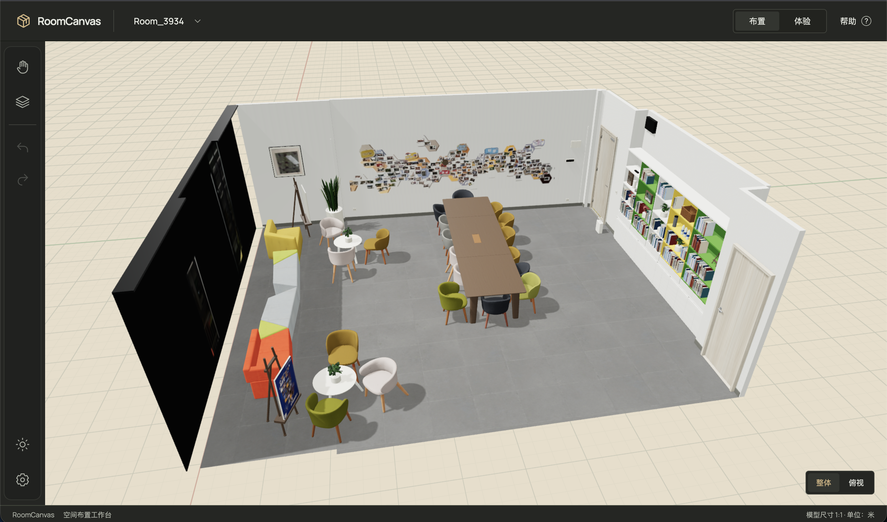
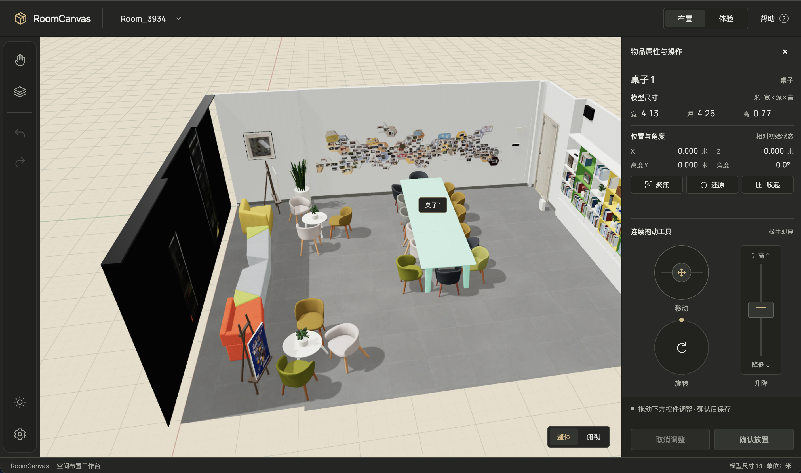
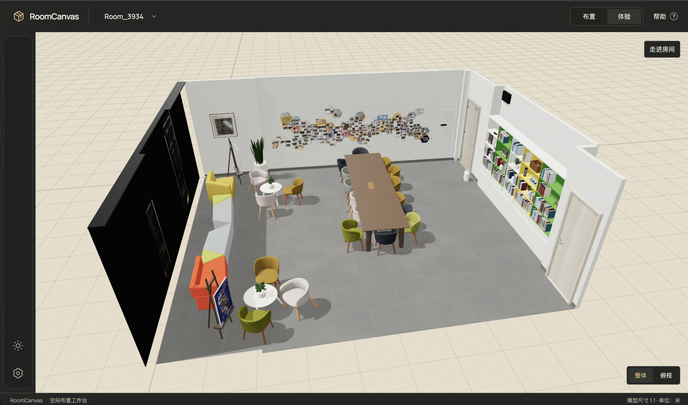
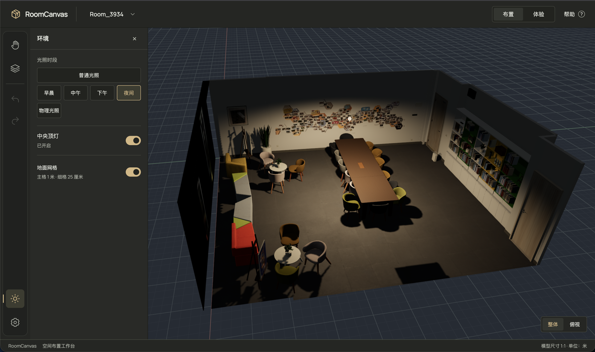
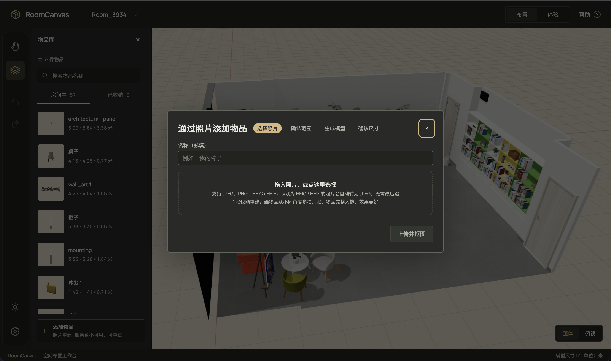
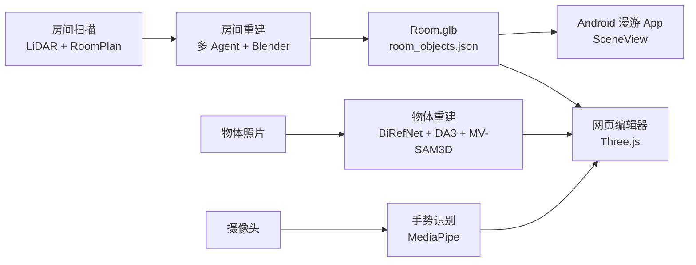

<div align="center">


# RoomCanvas

**扫描你的房间，在浏览器里按真实尺寸重新布置。**

[](LICENSE) [](https://threejs.org/) [](https://www.python.org/) [](https://nodejs.org/) [](#快速开始)

[功能](#功能) · [截图](#截图) · [快速开始](#快速开始) · [怎么用](#怎么用) · [工作原理](#工作原理) · [开发](#开发与测试) · [路线图](#路线图) · [文档](#文档)

</div>



用 iPhone（LiDAR + RoomPlan）扫一遍房间，RoomCanvas 把它重建成带纹理、尺寸真实的三维模型，每件家具都是独立、可以挪动的物体。想买的新东西拍几张照片就能按真实大小加进来；用鼠标或摄像头手势摆放，碰撞和是否放稳实时检查，看放不放得下、好不好看。

- **真实尺寸**：房间和家具来自扫描重建，新物品按一条实测边长标定，摆进去的就是真实大小。
- **开箱即用**：网页编辑器是纯前端，没有构建步骤，有 Python 就能打开三个示例房间。
- **双手操作**：浏览器里用摄像头识别手势，画面只在本机处理，不上传。
- **一个仓库，从扫描到手机**：房间重建、物体重建、网页编辑器、手势、Android 漫游 App 都在这里。

## 功能

<table>
<tr><td width="50%" valign="top">

**🏠 房间重建**

- 从扫描重建房间结构和家具，多个 Agent（GPT-6 Astra）分工审图、建模、摆放
- 小物件逐件判断：舍弃、程序化建模，或用 TRELLIS 重建
- 门、柜门、窗、升降桌带关节，能打开；其他东西由 Astra 看照片判断有没有能开的抽屉、门、盖子，自动切出来装上滑轨或合页

</td><td width="50%" valign="top">

**🪑 布置编辑器**

- 单击物品查看尺寸与位置；拖动已选物品，或用摇杆、转盘、升降拉杆调整，确认后放置
- 左侧物品库支持搜索、实物缩略图和“房间中／已收纳”筛选；设置可切换简洁／完整工具
- 逐三角面的碰撞和支撑检测，重网格的检查在后台线程
- 收起全部物品 / 恢复原始布置，撤销重做；布局保存在当前浏览器，可继续上次布置或导入导出 JSON
- 近侧墙和挡视线的高家具（连同放在上面的东西）默认自动隐藏，也可以改成半透明或保持实心
- “体验”内走进房间：中键拖动转头、WASD 走动、Q / E 升降视线，撞到墙和家具会停下
- 鼠标指到门、柜门、抽屉、窗上提示是什么、点一下会怎样，点一下就开合

</td></tr>
<tr><td valign="top">

**📷 拍照添加物品**

- 物品库里“添加物品”：上传照片（1 张也行）→ 抠图确认 → 服务器重建
- 结果旁的箭头指出建议补拍的方向，“补拍”加照片后在原结果上重建
- 预览里看 X / Y / Z 坐标轴，填一条实测边长就按真实大小放进房间
- 重建在 GPU 服务器上跑，关掉对话框、刷新页面都不影响

</td><td valign="top">

**💡 光照**

- 普通光照，以及早晨 / 中午 / 下午 / 夜间时段
- 室内灯来自房间里的顶灯（没有顶灯时为一盏中央顶灯），可开关、调照射角度，按房间记住
- 环境光、阴影和静态环境遮蔽（AO），静止时才补算
- 完整工具模式提供曝光、白平衡、对比度、饱和度调色（实验）
- 地面网格可开关：主格 1 米、细格 25 厘米，辅助判断比例

</td></tr>
<tr><td valign="top">

**✋ 手势**

- 左手比 1 / 2 / 3 / 4 切换移动、抬高、缩放、旋转
- 右手捏住物品拖动，竖起大拇指确认放下
- 左手捏合环绕视角，双手捏合缩放场景
- 编辑器内置，不用额外安装

</td><td valign="top">

**📱 Android 漫游**

- 导入房间模型，横屏第一人称在房间里走一圈
- 方向键移动、滑屏转向，0.5× / 1× / 2× 速度
- 点柜门、窗、门开关

</td></tr>
</table>

## 截图

<table>
<tr>
<td width="50%"><br><sub><b>摆放</b>：选中长桌，查看尺寸与位置，通过移动、旋转和升降工具调整摆放</sub></td>
<td width="50%"><br><sub><b>体验</b>：收起物品编辑面板，查看长桌、会客区与书柜布局，点击“走进房间”进入漫游</sub></td>
</tr>
<tr>
<td><br><sub><b>夜间</b>：在环境面板切换夜间时段，开启中央顶灯，查看家具与墙面的照明和阴影</sub></td>
<td><br><sub><b>添加物品</b>：从物品库打开照片添加入口，填写名称并选择照片；后续依次确认范围、生成模型和确认尺寸</sub></td>
</tr>
</table>

当前展示为 2026-11-16 更新的重建场景 `Room_3934`，五张截图保存在 [`docs/images/room-3934-2026-11-16/`](docs/images/room-3934-2026-11-16/)。旧版 `office` 场景展示保留在 [`docs/images/office-v1/`](docs/images/office-v1/)。

## 快速开始

### 1. 启动

网页跑在本机，房间重建和物体重建跑在 Linux GPU 服务器上。

**服务器上**：克隆仓库，一个脚本装好两套重建环境和模型权重，再启动物体重建服务。

先准备：

- Linux x86_64 + NVIDIA GPU 和可用驱动，Git、Python 3、Conda 或 Mamba、uv ≥ 0.9.17。
- Debian/Ubuntu 的 apt；缺少系统包时需要 sudo（或 root）。没有 sudo 时，`ffmpeg`、`git-lfs` 可以用 Conda 装好并加入 PATH。
- 模型权重默认从 ModelScope 下载，不需要 Hugging Face 令牌；改用 Hugging Face 需要已获 `facebook/sam-3d-objects` 访问权限的令牌，见下方说明。
- 房间重建还需要已登录的 Codex CLI，并在 `.env` 填写 API 密钥。

```bash
GIT_TRACE=1 GIT_TRANSFER_TRACE=1 git clone https://github.com/innovationasuna/RoomCanvas.git
cd RoomCanvas
sh scripts/setup_server.sh            # 可先加 --dry-run 只看步骤；已装好的部分会跳过
```

脚本结束后只需要在 `room-reconstruction/.env` 里填 `OPENAI_API_KEY`（房间重建的参考图生成用），并登录 Codex CLI；其余配置（GPU、锁文件、编译架构、数据目录）都有默认值，不用填。然后运行 `bash scripts/start_server.sh` 启动服务器。

SAM 3D、TRELLIS.2、DA3 等模型默认从 ModelScope 下载（`MODEL_SOURCE=modelscope`，仓库名相同，不需要 HF 令牌）。要改用 Hugging Face 时 `export MODEL_SOURCE=huggingface HF_TOKEN='<已获 SAM 3D 访问权限的令牌>'`。GitHub、PyTorch 和少数只在 Hugging Face 上的模型仍要外网，需要时设置 `https_proxy`。

**本机**：克隆仓库，一条命令启动网页并连上服务器。

```bash
GIT_TRACE=1 GIT_TRANSFER_TRACE=1 git clone https://github.com/innovationasuna/RoomCanvas.git
cd RoomCanvas
# 自动下载服务器上已经重建好的资源（可能会比较大），运行：
python3 web/scripts/serve.py --ssh <SSH 主机>

# 不自动下载资源，随用随下，运行：
python3 web/scripts/serve.py --ssh <SSH 主机> --no-download
```

打开 <http://127.0.0.1:7880/web/>，选卧室 `room3`、办公室 `office`、`Room_3934` 或 `Activity Classroom`。`--ssh` 用一条 SSH 连接转发服务器上的网关（本机 `7865`，服务器 `127.0.0.1:7870`），网关再把物体重建和房间重建请求分给各自的服务，按 `Ctrl-C` 停止时一起关闭。服务器上要先启动网关，命令见下方“服务器启动命令速查”；不用网关时，给 `--remote <监听地址>:7862`（和 `--room-remote <地址>:<端口>`）就回到两条隧道；只用编辑器、不连服务器时去掉 `--ssh`。安装细节、更新和重启见 [物体重建](docs/OBJECT_RECONSTRUCTION.md#部署) 和 [房间重建](docs/ROOM_RECONSTRUCTION.md)。

示例房间的模型（`samples/*/Room.glb`，四个共约 459 MB：office 36 MB、room3 70 MB、room-3934 89 MB、activity-classroom 264 MB）不在 Git 里，是本仓库 [`sample-rooms` release](https://github.com/innovationasuna/RoomCanvas/releases/tag/sample-rooms) 的附件。`serve.py` 启动时在后台下载缺少的模型，下载完刷新页面即可；也可以先运行 `python3 scripts/fetch_samples.py`。仓库是私有的，下载前要先 `gh auth login`，或把能读本仓库的令牌放进 `GH_TOKEN`；两样都没有时，终端会列出缺少的文件和下载地址，在浏览器里登录 GitHub 下载后放到对应路径。详见 [示例房间的模型](web/README.md#示例房间的模型)。

**服务器启动**：安装完成后，一条命令启动房间服务、物体服务和网关（已在运行的会跳过）；`status` 只查看状态。

```bash
bash scripts/start_server.sh                    # 服务器上，在仓库根目录（服务器重启后再运行一次即可）
python3 web/scripts/serve.py --ssh <SSH 主机>         # 本机，在仓库根目录
python3 web/scripts/serve.py --ssh <SSH 主机> --cpa   # 本机；服务器的 Codex 用本机 CLIProxyAPI（自己的订阅）时
python3 web/scripts/serve.py --ssh <SSH 主机> --server-dir <服务器仓库目录>   # 本机；同一条连接顺带运行上面的 start_server.sh
```

- **本机一条命令**：加 `--server-dir`（如 AutoDL 上的 `/root/autodl-tmp/RoomCanvas`）后，`serve.py` 用同一条 SSH 连接在服务器上运行 `scripts/start_server.sh`（已在运行的服务不动），只输一次密码。
- **已完成的房间和重建回放存到本机**：`serve.py --ssh` 在后台把服务器上已完成任务的回放（点云、各版房间模型、配图）和房间文件下载到本机 `runs/room-cache/`（终端显示进度，每 5 分钟检查一次新任务），页面优先读本机副本，不再经隧道。之后不加 `--ssh` 启动，或服务器关机时，这些房间和回放照样能打开。还在重建的任务不缓存；任务重试后旧副本会删掉重新下载。加 `--no-download` 关闭后台下载；打开示例房间时，缺少的模型仍会按需获取，`--cache <目录>` 换位置。
- **下载多少**：不连服务器（不加 `--ssh`）时只下载示例房间的模型，约 459 MB。连服务器时先下载示例模型，再下载已完成任务的回放和房间；相同内容的文件只下载一次：下载前向房间服务要文件的大小和 sha256，本机已有相同的文件（缓存里的，或示例模型）就用硬链接放到对应位置（跨磁盘时复制），不再下载；下载的文件核对 sha256 后才保存。以服务器上现有的两个已完成任务为例（2026-11-21 测量，1 MB 按 10⁶ 字节）：回放和房间文件共 418 个、2839 MB（Activity Classroom 2380 MB，Room_3934 459 MB），其中重复的内容（各任务最后一版模型就是发布的房间，也是示例模型；部分配图相同）去掉后为 2386 MB，与示例模型相同的又占 353 MB，所以首次启动合计下载约 2.49 GB（示例模型 459 MB + 服务器 2033 MB），去重前约 3.30 GB。示例模型下载不了时，服务器部分为 2386 MB。`--no-download` 关闭后台预下载，打开房间时仍可按需获取缺少的模型。去重需要服务器上的房间服务是支持 sha256 的版本，旧版本照常全部下载。

- 房间服务监听 `127.0.0.1:7866`，物体服务默认 `127.0.0.1:7862`，网关 `127.0.0.1:7870`。物体服务要绑别的地址（如容器 IP）时加 `--object-host <地址>`，网关会跟着指向它。
- 日志：房间服务和网关在 `runs/web-room-jobs/`，物体服务在 `$VIEWFORGE_ROOT/logs/web.log`。
- 机器有自己的环境设置（缓存和临时文件放哪、下载镜像）时，写进 `runtime/server-env.sh`（不进 Git），`start_server.sh` 启动前会先加载它；手动运行 `run_room.py` 前也先 `source` 它。
- 本机想用两条隧道、不经网关时，给 `serve.py` 加 `--remote <地址>:7862`（可再加 `--room-remote`）。
- 隧道断开（如 AutoDL 网关掉线）时 `serve.py` 会自动重连；用密码登录的主机每次重连都要再输一次密码，建议配好密钥。
- `--cpa` 把服务器的 `127.0.0.1:8317` 转回本机的 CLIProxyAPI，服务器上的 `runtime/bin/codex` 默认用它（`ROOMCANVAS_CODEX_PROFILE=api` 改用 `.env.astra` 的接口）；本机关掉 `serve.py`，服务器上的 agent 精修和回放概括就调不了模型。
- 重启物体服务会丢内存中的任务，3090 上有其他人的任务时先确认；脚本不会重启已在运行的服务。
- **没有 GPU 的机器**（如 AutoDL 无卡模式）：脚本检测不到显卡时自动进入预览模式，也可以手动加 `--preview`。预览模式下可以浏览房间、物品库和重建回放，保存物品尺寸也照常；“重建房间”会提示这台服务器没有 GPU，“添加物品”会被拒绝并说明原因。没有 `configs/local.env` 时物体服务用默认目录 `runtime/object-reconstruction`。已在运行的服务不会被切换，要换模式先停掉再启动。

每次进入先显示原始布置；已确认的布局保存在当前浏览器，点击房间名 → **继续上次布置** 恢复。需要备份或换设备时，从同一菜单导出布局 JSON。照片重建的物品可以在物品库的“从已生成的模型添加”里重新加入。

### 2. 手势

在编辑器左侧点击 **手势** 打开面板，再点击 **开启手势与摄像头** 并允许摄像头。收起面板会保留识别，需在面板内点击 **关闭手势与摄像头** 才停止。识别代码已经打包在 `web/vendor/gesture/`。要调试独立的识别页：

**本机**，从 `RoomCanvas/` 仓库根目录执行：

```bash
sh scripts/gesture.sh install   # 第一次，需要 Node.js 22.12+
sh scripts/gesture.sh dev       # 打开 http://127.0.0.1:8800/roomcanvas.html
```

### 3. Android App

**本机**，从 `RoomCanvas/` 仓库根目录执行：

```bash
cd android-app
./gradlew :app:assembleDebug    # JDK 17 + Android SDK，产出 app/build/outputs/apk/debug/
```

装到手机上，导入 `samples/office/Room.glb` 之类的房间模型即可（示例模型先用 `python3 scripts/fetch_samples.py` 取回）。华为手机可用 AR Engine 的运动跟踪；其他手机提示一次后照常用方向键漫游。

### 4. 重建自己的房间

在“选择房间”页点击 **重建房间**，上传 LiteReality Scanner 导出的完整扫描包（tar 直接传，也可以是 ZIP），可以查看进度、失败后重试，完成的新房间自动加入列表。服务器上需要先启动房间重建服务（监听 `127.0.0.1:7866`），本机 `serve.py --ssh` 会一起转发。需要整屋扫描数据，普通照片不行。步骤见 [从网页重建房间](docs/ROOM_RECONSTRUCTION.md#从网页重建房间)；也可以在服务器上用命令行重建，见 [房间重建](docs/ROOM_RECONSTRUCTION.md#运行)。

## 怎么用

### 鼠标和键盘

| 操作 | 作用 |
|---|---|
| 中键拖动 / 右键拖动 / 滚轮 | 旋转镜头 / 平移 / 缩放；左键拖动空白处不转动镜头 |
| 单击场景中的物品 | 查看尺寸、偏移和旋转角度，不改变位置 |
| 拖动已选物品 / 拖动属性面板控件 | 开始调整；左上摇杆移动、左下转盘旋转、右侧拉杆升降，松手后等待确认 |
| `R` | 摆放时旋转 |
| 方向键、`PageUp` / `PageDown` | 选中的物品逐步挪动、升降 |
| `Enter` / `Esc` | 放置并落下 / 取消 |
| `Ctrl`/`⌘` + `Z`，加 `Shift` | 撤销，重做 |
| `/` | 打开物品库并搜索物品 |
| 顶部“体验” | 点门、柜门、抽屉、窗开合（鼠标指上去会提示）；回“布置”全部关上 |
| “体验” → “走进房间” | 第一人称走动，按键见下表 |
| “设置” → “完整”，再打开“环境” → 近侧墙 | 实心 / 半透明 / 隐藏：控制近侧墙和挡视线的高家具 |
| 右下角“整体” / “俯视” | 切换视角 |

漫游时：

| 操作 | 作用 |
|---|---|
| 中键拖动画面（触屏直接拖动） | 转头（上下左右） |
| `W` `A` `S` `D` / 方向键，按住 `Shift` | 走动，快走 |
| `Q` / `E` | 升高 / 降低视线（离地 0.5–2.2 米） |
| 点门、柜门、抽屉、窗 | 开合 |
| `Esc` | 退出，回到进入漫游前的模式 |

### 手势

| 手 | 动作 | 作用 |
|---|---|---|
| 左手 | 比 1 / 2 / 3 / 4 | 切换模式：移动 / 抬高 / 场景缩放 / 旋转 |
| 左手 | 捏合拖动 | 环绕视角，可以和右手同时进行 |
| 右手 | 捏住物品或物品库卡片拖动 | 移动、抬高或旋转；松手后物品停成预览 |
| 右手 | 竖起大拇指约 0.5 秒 | 确认放置（放置按钮和 `Enter` 也可以） |
| 双手 | 缩放模式下同时捏合，拉开 / 靠近 | 放大 / 缩小场景 |

手指向按钮捏合就是点击。物品库默认收起，要先捏左侧的物品库按钮再拖卡片。手势、物品库、环境和设置面板一次只展开一个，收起手势面板不停止识别。手跟丢时操作冻结，回来后松手重新抓。完整说明见 [手势接入](gesture/docs/roomcanvas-integration.md)。

### 网址参数

| 参数 | 作用 |
|---|---|
| `?room=<id>` | 打开 `web/rooms.json` 里的房间；`?scene=<目录>` 打开任意房间目录 |
| `&time=balanced\|morning\|noon\|afternoon\|night` | 光照时段，默认 `noon` |
| `&lighting=off` | 完整的原始光照，用来对比 |
| `&ao=off` / `&ao=n8ao` | 关闭环境遮蔽 / 改用 N8AO |
| `&indoor=off` | 打开时关掉顶灯 |

## 工作原理



每个房间就是一个目录里的两个文件：`Room.glb`（重建出的模型）和 `room_objects.json`（哪些是墙、门窗、固定设施，哪些是能挪的家具，哪些东西一起动，哪些部件能打开）。编辑器只读这两个文件，所以任何按同样格式导出的房间都能打开。

| 模块 | 做什么 | 技术 |
|---|---|---|
| [`room-reconstruction/`](room-reconstruction/) | 房间重建：扫描 → 房间结构与家具 → 小物件重建 → 可动部件识别 | Codex（GPT-6 Astra）、Blender、TRELLIS.2 |
| [`object-reconstruction/`](object-reconstruction/) | 物体重建（ViewForge）：照片 → 抠图 → 多视角重建 → 尺寸标定，以 API 形式提供 | Starlette、BiRefNet、DA3、MV-SAM3D |
| [`web/`](web/) | 房间选择、布置编辑器、本机代理与房间重建 API | Three.js r180、Python，无前端构建 |
| [`gesture/`](gesture/) | 浏览器手势识别，编辑器内置的识别代码从这里打包 | TypeScript、Vite、MediaPipe |
| [`android-app/`](android-app/) | Android 房间漫游 | Kotlin、SceneView / Filament、华为 AR Engine |
| [`samples/`](samples/) | 示例房间：`room3`（卧室）、`office`（办公室）、`room-3934`（上方截图里的 Room_3934）、`activity-classroom`（同一间活动室重新扫描后的重建）；模型在 `sample-rooms` release，清单是 `samples/models.json` | |

## 开发与测试

以下网页基础检查使用 Node.js 24 和 Python 3，无需安装前端依赖：

```bash
node --test 'web/editor/tests/*.mjs' 'web/scripts/test_*.mjs'  # 编辑器与网页流程
python3 -m unittest discover -s web/scripts                  # 本机服务、物品清单
python3 scripts/fetch_samples.py                             # 取回示例房间的模型（已有的不重复下载）
node web/scripts/check_room.mjs --scene-dir samples/office   # 用真实模型检查碰撞、支撑、关节
```

手势、物体重建 API、房间重建和 Android 的检查命令，以及分支和合并流程，见 [参与开发](CONTRIBUTING.md)。CI 会扫描全部历史里的密钥，再跑房间重建、网页、物体 API 和手势四组检查。

## 路线图

- [x] 扫描 → 真实尺寸的房间
- [x] 网页里布置家具：碰撞、支撑、撤销、自动保存
- [x] 一键收起全部物品，收进物品库再按需摆回
- [x] 门、柜门、窗能打开
- [x] 自动判断哪些东西能打开，切出抽屉、盖子装上滑轨或合页
- [x] 拍几张照片添加物品，按实测尺寸放进房间
- [x] 补拍：按建议方向补照片，在原结果上重建
- [x] 摄像头双手手势
- [x] 时段光照、顶灯和环境遮蔽
- [x] Android 第一人称漫游
- [x] 网页第一人称漫游（键盘鼠标）
- [ ] 给一个商品链接，找多视角图和尺寸重建
- [x] 网页上传扫描，服务器排队重建房间
- [ ] 继续降低房间重建成本
- [ ] 手机 App 直接扫描房间

## 文档

| 文档 | 内容 |
|---|---|
| [网页编辑器](web/README.md) | 编辑器的全部操作、房间文件格式、光照、代码结构、测试和已知限制 |
| [房间重建](docs/ROOM_RECONSTRUCTION.md) | 在 GPU 服务器上重建房间、小物件和可动部件，并接入网页 |
| [物体重建](docs/OBJECT_RECONSTRUCTION.md) | 物体重建服务的部署、接口和本机连接 |
| [手势接入](gesture/docs/roomcanvas-integration.md) | 手势识别、协议和操作细节 |
| [参与开发](CONTRIBUTING.md) | 分支、检查、合并流程 |
| [本次重构说明](docs/refactor/README.md) | 主要改动、实施计划、验收证据与维护契约 |

## 数据与隐私

- `samples/room3` 是真实住宅的扫描，模型和缩略图来自实拍照片，仅供项目成员使用，请勿转发。
- `samples/room-3934` 是真实房间的扫描（2026-11-12 重建），`samples/activity-classroom` 是同一间房间的重新扫描（2026-11-21 重建），模型和缩略图同样来自实拍照片，仅供项目成员使用，请勿转发。
- 原始扫描、照片、含相机轨迹的 `room_layout.json` 不进入仓库。
- 手势识别只在本机浏览器中进行，摄像头画面不上传。

## 致谢

- LiteReality-Agent - https://github.com/LiteReality/LiteReality-Agent
- MV-SAM3D - https://github.com/devinli123/MV-SAM3D
- SAM 3D Objects - https://github.com/facebookresearch/sam-3d-objects
- Depth Anything 3 - https://github.com/ByteDance-Seed/Depth-Anything-3
- BiRefNet - https://github.com/ZhengPeng7/BiRefNet
- NBV-Gym - https://github.com/chengine/nbv_gym
- TRELLIS.2 - https://github.com/microsoft/TRELLIS.2
- MediaPipe - https://github.com/google-ai-edge/mediapipe
- Three.js - https://github.com/mrdoob/three.js
- SceneView - https://github.com/SceneView/sceneview-android

## 许可

[Apache License 2.0](LICENSE)

## 服务器验证记录

| 字段 | 内容 |
| --- | --- |
| 验证目标与状态 | 在 Activity Classroom 上试跑 #96 的新流程一次：author 会话 → 小物品 → 可开合部件 → 检查 → 修复并重跑两步 → publish。尽量复用已有成果，少用 GPU 和模型调用。状态：**已完成，跑通**（`trial.exit` 为 0）。更新：2026-11-21 14:10 |
| 分支与基线 | worktree `/home/data1/lyk/RoomCanvas-validate-before-check`，分支 `feat/room-small-objects-before-check`，起始提交 `c9f61ed`（`9463395` 加上 run_room.py 的修复预算透传） |
| 改动内容 | 相对正式版本：#96 的全部改动（小物品和部件移到检查之前、检查读完整房间、发布已检查的房间、按接触去碎块等），以及 `run_room.py --repair-steps/--repair-seconds`。验证目录里没有改源码 |
| 运行方式 | 环境：`runtime/server-env.sh`（`ROOMCANVAS_GPU=1`、`ROOMCANVAS_GPU_SHARED_MIB=8192`）。<br>准备：`runs/activity-classroom-trial/prepare.sh`，从已发布的场景复制，只读部分用硬链接，旧记录移到 `traces.before-trial/`；`seed_passes.py`，用旧的小物品和部件结果作两步的起点，依赖记录按新代码重算、只差代码。<br>会话说明：`operator/README.md`，要求不改房间。<br>运行：`bash runs/activity-classroom-trial/trial.sh`，即 `--from author --through publish --revise`，会话最多 6 步/600 秒，修复最多 3 步/300 秒，`--wait-gpu`；其余 `--set` 同 `phase-resume.sh` / `after_publish2.sh`。<br>GPU 1 显存由 `gpu-watch.sh` 每分钟记一次（`logs/gpu.log`）。<br>输出：`runs/activity-classroom-trial/run/`，日志在 `logs/`，核对产物在 `checks/`。不用任何服务端口 |
| 验证效果 | 见下方"试跑结果" |
| 改动去向 | 代码改动都在 PR #96，已合入 `main`（`54f6699`），服务器正式目录已部署到该提交；本记录随该分支提交 |
| 是否保留 | **已清理**（2026-11-21，用户同意）：worktree 和服务器本地分支 `feat/room-small-objects-before-check` 已删除，试跑目录 `runs/activity-classroom-trial/` 已删除（释放约 14 GB）。下文路径仅作历史记录，已不存在。没有仍在运行的验证进程 |

### 试跑结果（2026-11-21 13:43–14:05）

- 新顺序跑通（各步时间为起止时刻）：
  - author 会话 57 秒，1 次工具调用，房间不变。
  - 搭建前准备约 3 分钟（复制并清理 18 个现成模型）。
  - 编译 2 分钟（13:47–13:49）。
  - 小物品约 5.5 分钟（–13:54）：59 件判断全部沿用，ShelfC0R1B、ShelfC3R2B 去掉碎块。
  - 部件约 1 分钟（–13:55）：只有 ShelfC3R2B 重新规划，CardboardBox0 的检查沿用。
  - 检查约 4.5 分钟：读的是部件房间，validate **通过**（support 0），`render_vs_capture --blend` 出了 6 组对照图；视觉复核没通过，指出地面、墙面、电视、画、纸箱的外观问题。
  - 修复约 1 分钟：3 步预算用完，只读了文件。
  - 重新编译 1.5 分钟，两步重跑共约 1.5 分钟（全部沿用）。
  - publish 2 分钟：没有重新编译，另存了 blend 并烘焙，贴图 343 张缺失 0 张。
- 模型调用：
  - author 会话 1 次（Codex，2 条回复）；
  - 视觉复核 1 次；
  - 部件规划 1 次；
  - 修复会话 1 次（3 次工具调用）；
  - 小物品 0 次。
  - 合计 4 次调用、约 8 次请求。
- GPU：
  - 只用 GPU 1，锁持有 22.1 分钟；实际用 GPU 的是渲染和烘焙，约 6–8 分钟。
  - 每分钟采样里 GPU 1 总用量最高 7192 MiB（主要是别人的任务），没有接近上限。
  - 渲染时间很短，1 分钟采样没能测出本次的显存峰值。
- 产物：
  - 发布的 `room_preview/Room.glb` 能被 `room_objects.py` 处理：可移动组 87 个，用 `joints-fixed` 时关节 22 个，与已发布的 Activity Classroom 完全一致。
  - 默认关节目录下关节 12 个，与旧房间用同一目录生成的结果相同。
- 回放：
  - `room_replay.py` 只读算出的阶段为 …搭建完整房间 → 装上可开合部件 → 检查房间 → 按检查修改；
  - 没有"重做小物品"阶段，没有"沿用/复用"字样。
- 遇到的问题：
  - 复制的 `scene.json` 里 `roots` 仍指向原运行，author 会话的记录（`authoring_trace.author*.jsonl`、`trace.html` 和 5 张 `img/author_0004_*`）因此写进了原运行目录。
  - 已处理：试跑的 `roots` 改指向试跑目录；原运行的两份 author 记录从 `history/` 放回原名，试跑自己的记录移进试跑目录；原 `trace.html` 已从恢复后的记录重建，大小与之前一致。
  - 无法还原：那 5 张配图与试跑副本是硬链接，旧内容被同名覆盖。
