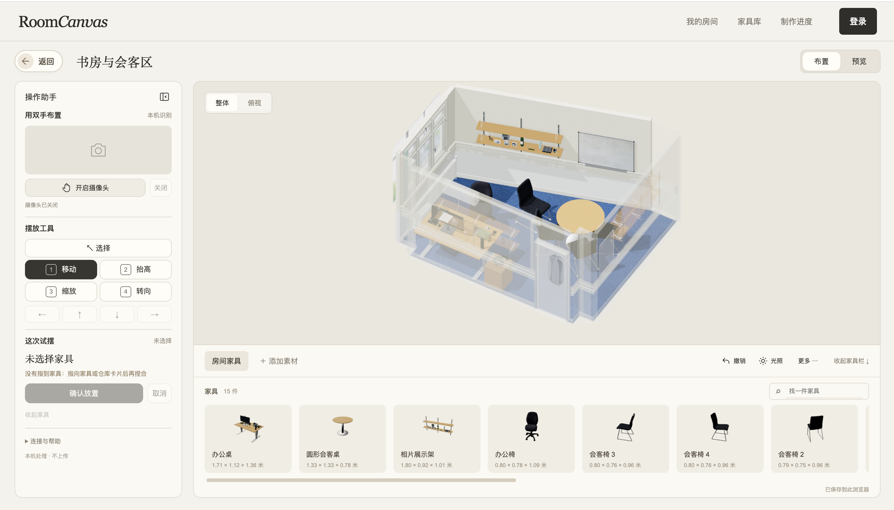
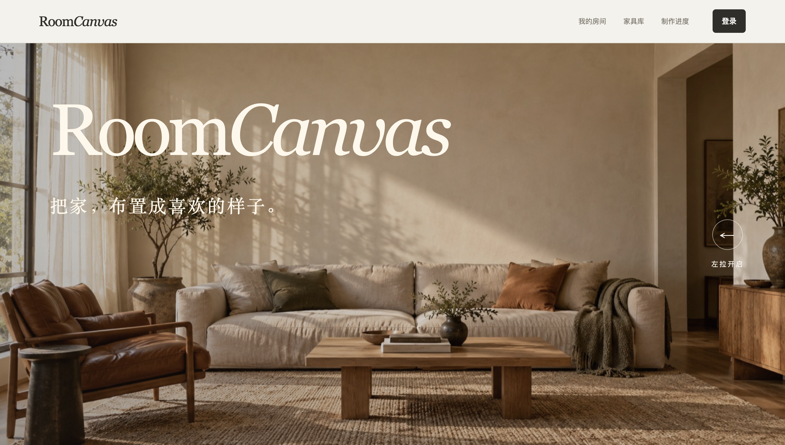
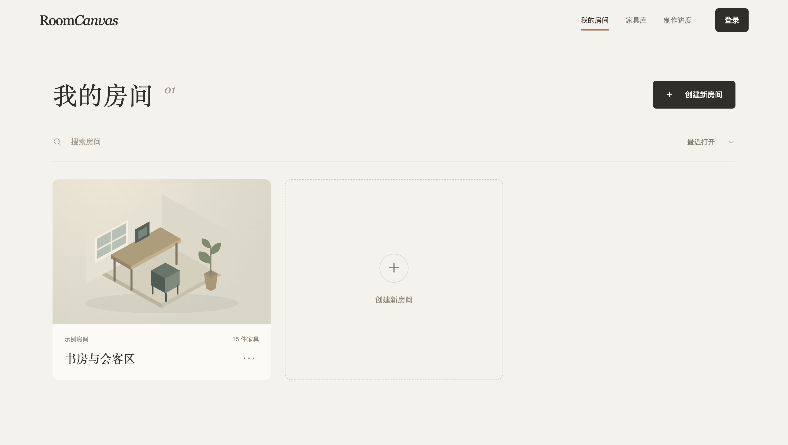
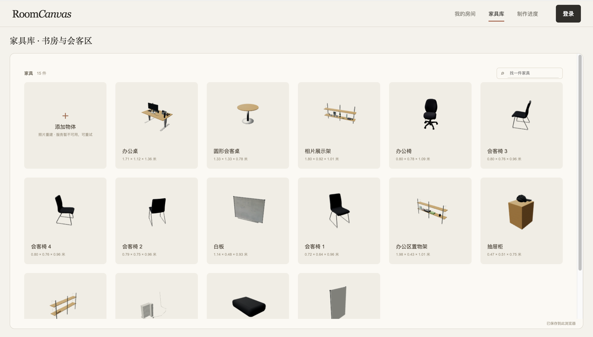
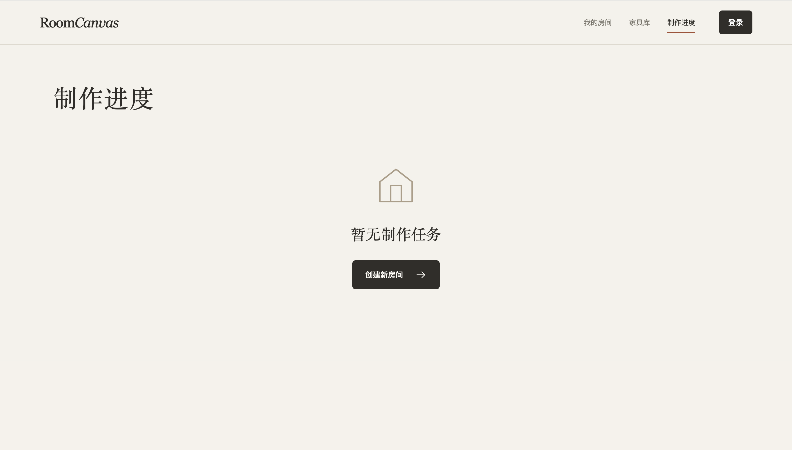
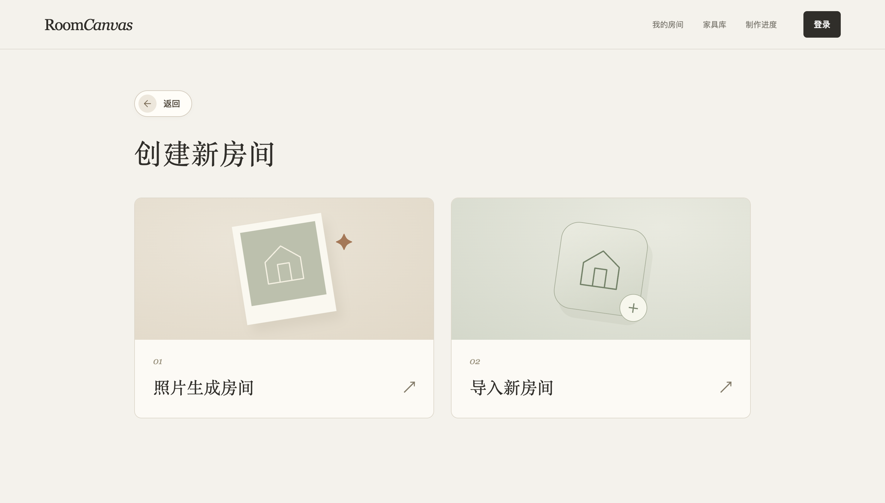
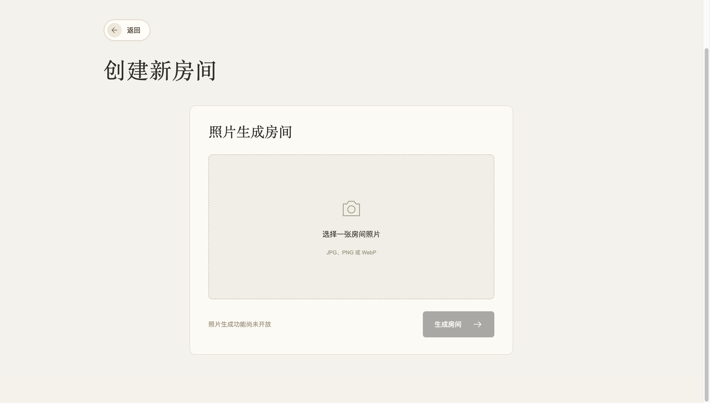
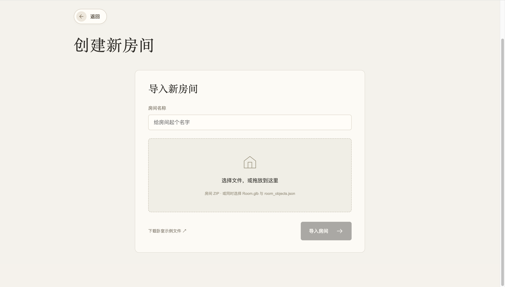
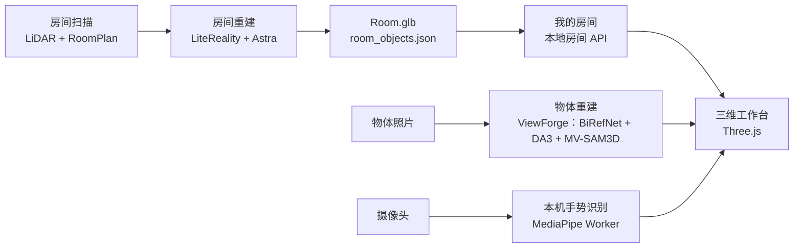

<div align="center">


# RoomCanvas

**把家，布置成喜欢的样子。**

[快速开始](#快速开始) · [当前功能与边界](#当前功能与边界) · [开发与验证](#开发与验证) · [文档](#文档)

</div>



RoomCanvas 是一个在浏览器中使用的三维房间布置工作台。导入房间，用鼠标或双手调整家具的位置、高度和朝向，在真实尺寸下尝试新的摆法。

网站把封面、我的房间、创建房间、登录、家具库和三维工作台连在一起。需要新家具时，可以连接物体重建服务，用多张照片生成模型，标定尺寸后放入房间。

<details>
<summary>展开查看其他界面（7 张截图）</summary>

以下截图拍摄于 2026-10-20；工作台与家具库使用 LiteReality 官方办公室示例。

**封面**



**我的房间**



**家具库**



**制作进度**



**创建新房间**



**照片生成房间（尚未开放）**



**导入新房间**



</details>

## 可以做什么

- **管理多个房间**：文件导入、搜索、排序、重命名、删除与撤销；每次导入都有独立的房间和布局。
- **重新摆放家具**：移动、抬高、旋转、壁挂、收起与重新放回；检查碰撞、承托和落点，确认后保存，可撤销或导出布局。
- **用双手操作**：左手数字 1 / 2 / 3 / 4 分别选择移动、抬高、双手缩放视角和旋转；右手捏合操作、竖拇指确认，左手可同时环绕视角。
- **拍照添加物体**：上传 3–40 张物体照片，确认抠图后重建；通过 X/Y/Z 三轴预览填写一条实测边长，按真实尺寸导入。可以删除单个导入实例，保留源重建结果。
- **查看空间效果**：整体与俯视视角、日光与暖光、环境光和静态环境遮蔽；近侧墙与高家具可变淡，带关节数据的门、窗和柜门可在预览模式开合。

工作台左侧集中放置摄像头、操作工具和放置确认，下方是房间家具与添加素材，两栏均可收起。封面支持左拉开启和点击进入，页面切换与房间加载保留过渡动画。

## 快速开始

完整网站需要 **Python 3、Node.js 22.12+ 和 npm**；当前使用 Node.js 24 验证。体验示例房间、导入房间和本机手势无需 GPU，也无需先登录。

首次获取工程并安装网站依赖：

```bash
git clone https://github.com/innovationasuna/RoomCanvas.git
cd RoomCanvas
sh scripts/gesture.sh install
```

之后在两个终端中分别启动服务，命令都从仓库根目录运行。

终端一：三维编辑器与模型服务。

```bash
python3 web/scripts/serve.py --port 7870
```

终端二：网站与本地房间 API。

```bash
sh scripts/gesture.sh dev
```

打开 **[RoomCanvas](http://127.0.0.1:8800/RoomCanvas.html)**。进入“我的房间”后，点击默认的“书房与会客区”，或选择“创建新房间 → 导入新房间”。

导入支持包含 `Room.glb` 和 `room_objects.json` 的 ZIP，也可同时选择这两个配套文件。GLB 必须包含全部模型与纹理数据；创建页提供卧室示例 ZIP，方便试用导入、改名和删除。

| 服务 | 默认地址 | 用途 |
| --- | --- | --- |
| 完整网站 | `http://127.0.0.1:8800/RoomCanvas.html` | 页面、房间管理、登录与手势 |
| 三维编辑器 | `http://127.0.0.1:7870` | 场景渲染、模型与物体 API 转发 |
| 物体服务隧道（可选） | `http://127.0.0.1:7865` | 连接 GPU 物体重建服务 |

完整网站只维护一个 HTML 入口；根地址、旧书签及 `web/` 入口引导到该网站。独立编辑器也可直接打开，例如 [办公室](http://127.0.0.1:7870/web/editor/?room=office)。两个终端保持运行，停止时分别按 `Ctrl+C`。

## 当前功能与边界

| 功能 | 当前状态 |
| --- | --- |
| 房间文件导入与管理 | 可用；默认只初始化一个办公室示例 |
| 鼠标与摄像头手势布置 | 可用；摄像头需主动开启，松手保留预览，丢手冻结 |
| 多照片**物体**重建 | 界面与 API 已接入，需要配置物体服务、模型权重和 GPU |
| 创建页的“照片生成**房间**” | 仅支持选图预览，生成按钮尚未开放 |
| Google 登录 | 登录界面与服务端验证已接入；需要自行配置 Web Client ID 和授权来源 |
| 布局保存 | 房间原有家具的布局保存在当前浏览器；新重建并导入的物体暂不随布局保存 |
| 云同步与公网部署 | 尚未提供；当前面向本机运行 |

创建页的整间房照片生成，与工作台的单个物体重建是两个独立流程。房间扫描重建由 `room-reconstruction/` 中的 LiteReality + Astra 流水线完成，运行后再把房间文件导入网站，见 [房间重建说明](docs/ROOM_RECONSTRUCTION.md)。

“添加物体”和“导入物体”需要连接 ViewForge 后端（物体重建服务，跑在 GPU 服务器上），默认通过 SSH 隧道 `127.0.0.1:7865`，见 [物体重建说明](docs/OBJECT_RECONSTRUCTION.md)。

Google 登录配置放在被忽略的 `gesture/.env.local` 中，只需 Web Client ID，不把 Client Secret 写入前端。操作步骤见 [登录与房间管理](gesture/docs/google-login.md)。登录不会开启云同步。

## 数据保存

房间清单、上传的房间文件和会话保存在仓库旁的 `.roomcanvas-local/`；布局按房间实例分别保存在浏览器中。房间删除支持撤销，采用软删除，不会立即永久清除模型文件。

摄像头视频与完整关键点只在本机识别，不录制或上传。只有主动使用物体重建时，所选物体照片才会上传到配置的物体服务。

`localhost` 与 `127.0.0.1` 使用不同的浏览器存储，请固定使用一个地址。另开测试环境时，可通过 `gesture/.env.local` 中的 `VITE_ROOMCANVAS_EDITOR_ORIGIN` 和 `ROOMCANVAS_DATA_ROOT` 指定编辑器与独立数据目录，见 [.env.example](gesture/.env.example)。

## 怎么做的



| 目录 | 做什么 |
|---|---|
| [`gesture/`](gesture/) | 完整网站、房间管理与登录 API、浏览器手势识别；编辑器内置识别包也从这里构建 |
| [`web/`](web/) | 三维编辑器、物体重建界面、物理校验、本机服务 `serve.py` |
| [`room-reconstruction/`](room-reconstruction/) | 房间重建：[LiteReality-Agent](https://github.com/LiteReality/LiteReality-Agent) 官方代码，Agent 改用 Codex（GPT-6 Astra），加了 3090 运行脚本和小物件这一步 |
| [`object-reconstruction/`](object-reconstruction/) | 无界面的物体重建与尺寸标定 API；旧 Gradio / Babylon 界面在 `legacy/` 归档，不参与正式运行 |
| [`samples/`](samples/) | 两个示例房间：`room3`（手机扫描的卧室）、`office`（LiteReality 官方样例） |

## 开发与验证

从仓库根目录运行网站与编辑器检查：

```bash
npm --prefix gesture run typecheck
npm --prefix gesture test
npm --prefix gesture run check:resources
npm --prefix gesture run build
node --test 'web/editor/tests/*.mjs'
python3 -m unittest discover -s web/scripts
node web/scripts/check_room.mjs --scene-dir samples/office
node web/scripts/check_room.mjs --scene-dir samples/room3
```

网站构建生成 `gesture/dist/RoomCanvas.html` 和资源；`dist/` 不加入版本控制。停止开发服务后，可用 `sh scripts/gesture.sh preview` 预览构建结果，仍需保持 7870 编辑器服务运行。仅复制 `dist/` 到静态服务器不会提供房间与登录 API。

更改手势识别运行时后，还需在 `gesture/` 中执行 `npx vite build --config vite.embed.config.ts`，同步提交 `web/vendor/gesture/` 内的运行时文件。它供独立编辑器使用，与完整网站共用手势逻辑。

物体 API 的 CPU 检查及房间重建模块的离线检查见 [CI 配置](.github/workflows/ci.yml)。界面改动还需实际打开页面检查；合成手势和 CPU API 测试不代替真人摄像头、真实 Google 登录或 GPU 重建验收。

## 文档

- [网站与双手工作台](gesture/README.md)：完整入口、操作、环境配置和构建
- [登录与房间管理](gesture/docs/google-login.md)：Google 配置、导入格式和数据归属
- [网页说明](web/README.md)：编辑器的操作、手势、导入和添加物体，开发和测试
- [房间重建](docs/ROOM_RECONSTRUCTION.md)：在 3090 上重建一个房间、小物件这一步、接到网页
- [物体重建与手势](docs/OBJECT_RECONSTRUCTION.md)：ViewForge 物体后端、标定接口、SSH 隧道和 RoomCanvas 手势
- [光影增强](web/README.md#通用光影增强)：光照档位、环境光、静态 AO 和验收；[光影调研](web/README.md#光影调研)：开源方案、版本兼容性、低耦合接入方式和实验任务
- [参与开发](CONTRIBUTING.md)：分支、检查、合并流程
- [交接文档](docs/HANDOFF.md)：当前进度、服务器目录和待办

## 对 LiteReality-Agent 改了什么

基线是官方 `28ffe1f4`（2026-10-03），即本仓库的第一个提交，原样放在 `room-reconstruction/`。之后：

- **所有 Agent 改用 Codex**：默认 provider 从 claude 改为 codex（`models.env`、`settings.py`、`agent/providers/base.py`）；Codex 会话支持附图（`providers/codex.py`）；新增 `agent/providers/vision.py`，在建模路线分类、椅子分组、程序化完整性检查、布局 Agent 四处看图。provider 设回 claude 时仍走官方原来的代码。
- **新增、不改官方文件**：3090 运行脚本 `room-reconstruction/server/`；小物件这一步 `pipeline/realism_authoring/small_objects/`（复用官方的证据图、参考图、TRELLIS 启动器和看图问答）。
- **CI**：`.github/workflows/ci.yml` 覆盖历史密钥扫描、房间重建离线测试、网页编辑器、手势网站和物体 API 的 CPU 检查。

## 隐私

仓库是私有的。**`samples/room3` 是私人卧室**，`Room.glb` 和缩略图来自实拍照片，只给协作者用，不要转发；仓库要公开前必须先从历史里删掉它。原始扫描、照片、含相机轨迹的 `room_layout.json` 都不进仓库。

## 致谢与许可

RoomCanvas 以 [Apache License 2.0](LICENSE) 发布，署名见 [NOTICE](NOTICE)。它建立在这些项目之上，各自保留原有许可：

- [LiteReality-Agent](https://github.com/LiteReality/LiteReality-Agent)：房间重建，研究使用请引用 [citation.bib](room-reconstruction/citation.bib)
- ViewForge / MV-SAM3D 及其依赖：见 [`object-reconstruction/LICENSE`](object-reconstruction/LICENSE)
- [TRELLIS.2](https://github.com/microsoft/TRELLIS.2)：小物件重建
- [MediaPipe Tasks Vision](https://ai.google.dev/edge/mediapipe)（Apache-2.0）：手势识别，见 [`gesture/README.md`](gesture/README.md)、[`gesture/docs/sources.md`](gesture/docs/sources.md) 和 [`web/vendor/gesture/README.md`](web/vendor/gesture/README.md)
- [Three.js](https://threejs.org/)（MIT）：网页渲染，在 `web/vendor/`
