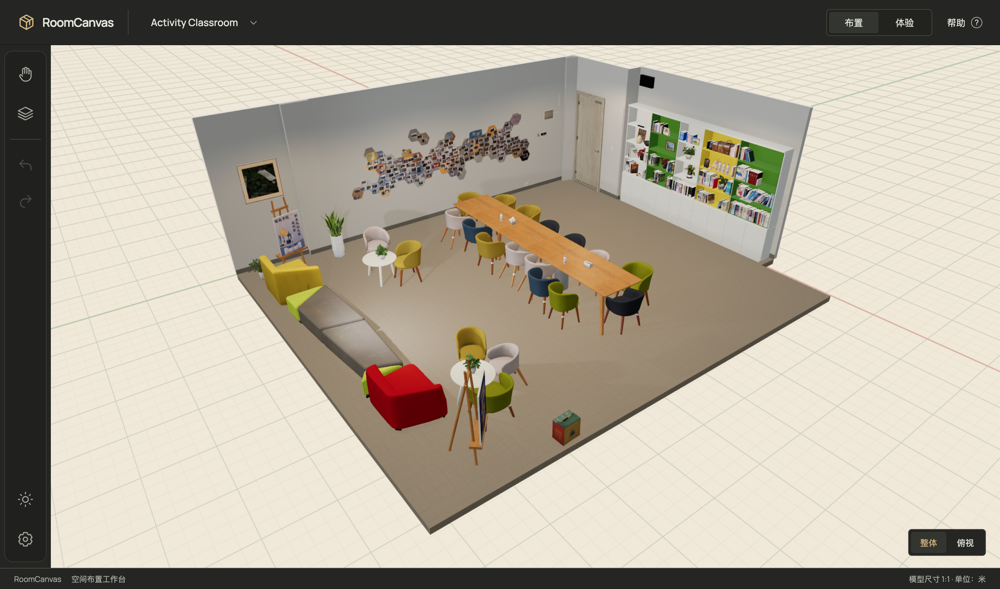
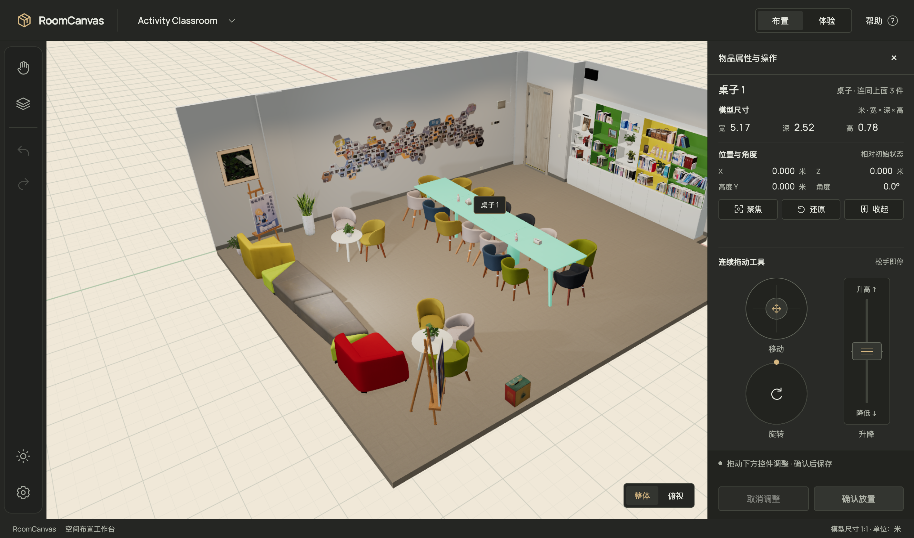
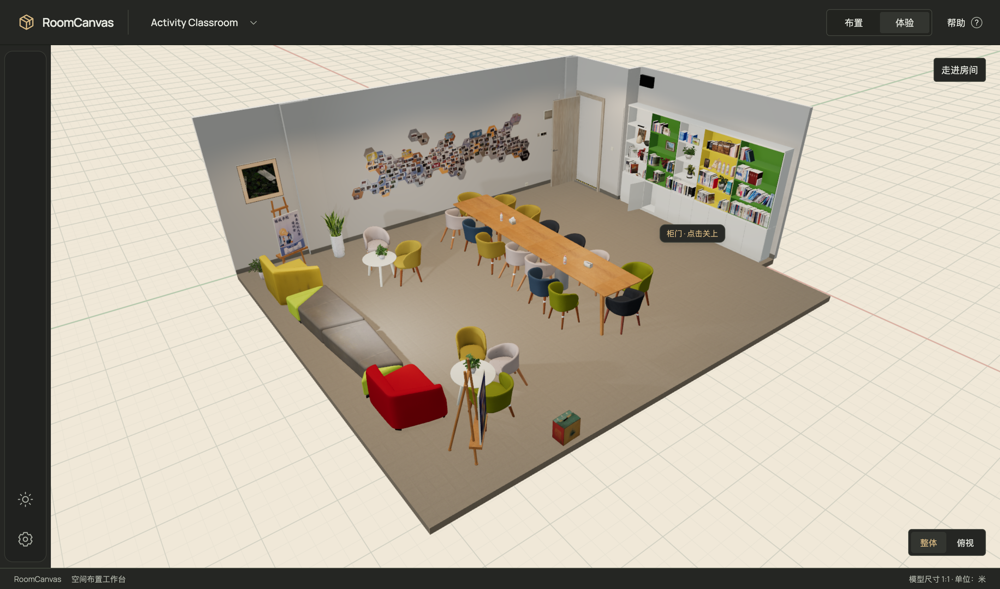
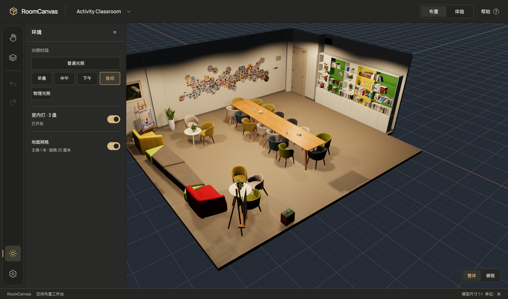
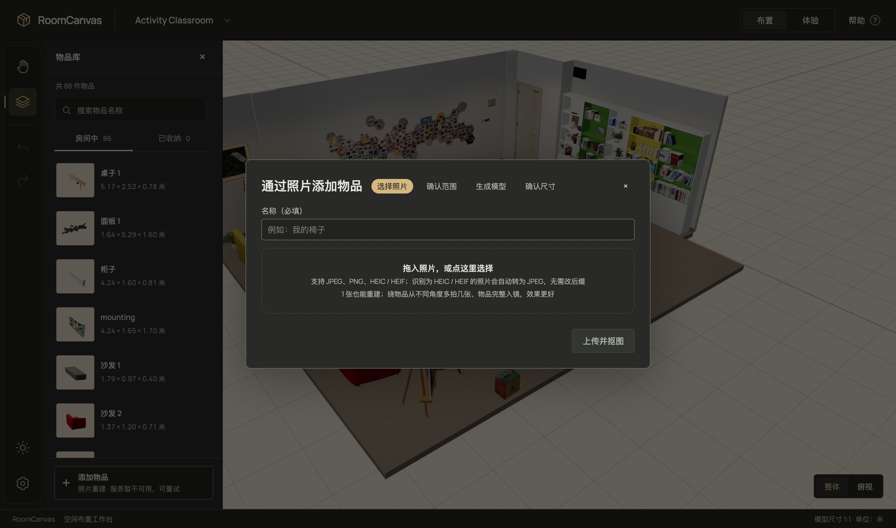
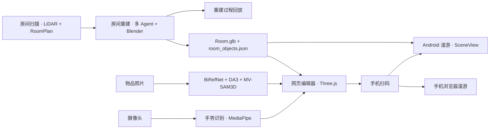

<div align="center">


# RoomCanvas

**扫描你的房间，在浏览器里按真实尺寸重新布置。**

[](LICENSE) [](https://threejs.org/) [](https://www.python.org/) [](https://nodejs.org/) [](#快速开始)

[快速开始](#快速开始) · [功能](#功能) · [截图](#截图) · [怎么用](#怎么用) · [工作原理](#工作原理) · [开发](#开发与测试) · [路线图](#路线图) · [文档](#文档)

</div>



- **按实测尺寸摆放。** 用带 LiDAR 的 iPhone 扫描房间，在带纹理的模型里挪动桌椅，检查是否碰撞、能否放稳。
- **先试四个示例房间。** 网页无需构建；用 Python 3 启动本机服务，模型下载好就能开始布置。
- **拍照添物。** 给新物品拍照，量一条边，按真实大小放进房间看效果。
- **用双手调整。** 摄像头在本机识别手势，一只手转动视角，另一只手摆放物品。
- **把布置带到手机。** 扫码就能走进摆好的房间。在电脑上还能回看扫描如何一步步变成房间模型。

## 功能

<table>
<tr><td width="50%" valign="top">

**整屋扫描重建**

从完整扫描包恢复房间结构、纹理与独立物品。重建时点“实时查看”看进度。遇到可恢复的错误，在任务列表点“重试”。若输入有误，修正后重新提交。完成后点“查看过程”，回看点云、物品与整屋模型的成形过程。

</td><td width="50%" valign="top">

**浏览器布置**

在物品库按“房间中／已收纳”筛选，按名称搜索，再从缩略图选桌椅。摆放时会检查碰撞和支撑。可以撤销、收起全部物品或恢复原始布置。房间选择页可管理本地缓存，也可以从回收站恢复房间。

</td></tr>
<tr><td valign="top">

**拍照添加物品**

一张照片即可开始。iPhone 的 HEIC 照片会在本机转换。确认抠图范围后生成模型，按 X、Y 或 Z 轴填入实测边长。模型有缺面时，按橙色箭头指的方向补拍。

</td><td valign="top">

**时段光照与室内灯**

在普通光照和早晨、中午、下午、夜间比较同一份布置。有顶灯的房间可开关灯光、调整照射角度。还可切换到物理光照作对照。地面网格大格为 1 米，小格为 25 厘米。

</td></tr>
<tr><td valign="top">

**摄像头手势**

左手选移动、抬高、缩放或旋转，右手捏住物品调整。松手后还能预览，右手拇指向上确认，向下取消。识别已内置在编辑器中。

</td><td valign="top">

**手机扫码与 Android 漫游**

在电脑上点“在手机中打开”，生成二维码。同一 Wi-Fi 下，手机扫码即可在浏览器里查看或漫游。Android 用户也能将布置导入 App，离线重开。

</td></tr>
</table>

## 截图

<table>
<tr><td width="50%"><br><b>摆放</b> · 移动长桌时，桌上的物品一起移动。</td>
<td width="50%"><br><b>体验</b> · 点门和柜门试开合，再走进房间看动线。</td></tr>
<tr><td><br><b>夜间</b> · 在环境面板切换时段，看灯光和阴影。</td>
<td><br><b>添加物品</b> · 从物品库选择照片，生成模型后确认尺寸。</td></tr></table>

更多场景截图见 [Activity Classroom](docs/images/activity-classroom-2026-11-23/) · [Room_3934](docs/images/room-3934-2026-11-16/) · [办公室](docs/images/office-v1/)。

<a id="1-启动"></a>

## 快速开始

### A. 在本机试玩四个示例房间

在 macOS 或 Linux 上准备 Git、Python 3.8 或更高版本和可读取本仓库的 GitHub 账号。Windows 用户可在 WSL 的 Linux 环境中运行。以下命令使用 GitHub CLI（`gh`）登录，请先安装它。

```bash
gh auth login
git clone https://github.com/innovationasuna/RoomCanvas.git
cd RoomCanvas
python3 web/scripts/serve.py
```

模型随私有仓库的 [sample-rooms Release](https://github.com/innovationasuna/RoomCanvas/releases/tag/sample-rooms) 分发，四个共约 458.6 MB。获取模型可使用已登录的 GitHub CLI，或可读仓库的 `GH_TOKEN`。如已通过 Git 凭证克隆并设好令牌，直接运行最后一条命令。

打开 <http://127.0.0.1:7880/web/>，选卧室、办公室、Room_3934 或 Activity Classroom。缺少的模型会在后台下载。下载完成后刷新；若终端提示缺少凭证，可登录 GitHub 后按提示手动下载。[模型获取说明](web/README.md#示例房间的模型)

### B. 连接已有 GPU 服务器

在本机仓库根目录运行以下命令，把 `gpu-host` 换成自己的 SSH 主机名。服务器需已启动项目网关和两项重建服务。浏览器地址与方式 A 相同。

```bash
python3 web/scripts/serve.py --ssh gpu-host
```

默认会在后台下载缺少的示例模型，并缓存已完成的房间和回放。加 `--no-download` 可关闭这两类预下载；打开示例时，仍可从本机缓存或已连接的房间服务按需获取模型。

- **重建自己的房间。** 在房间选择页点“重建房间”，上传 LiteReality Scanner 的完整扫描包（ZIP、TAR、TAR.GZ 或 TGZ）。完成后新房间出现在列表里。[网页重建步骤](docs/ROOM_RECONSTRUCTION.md#从网页重建房间)
- **添加新物品。** 在物品库点“添加物品”，填写物品名称，选择照片并上传，确认抠图后生成模型，最后填一条实测边长。关闭对话框或刷新后，服务器仍会继续重建。[物品重建与补拍](docs/OBJECT_RECONSTRUCTION.md#在编辑器中使用)

### C. 自行部署或构建模块

**部署重建服务。** 在配有 NVIDIA GPU 和可用驱动的 Debian/Ubuntu x86_64 服务器上克隆仓库。安装脚本需要 `dpkg-query` 和 `apt-get`，仅在需要安装缺少的系统包时使用 sudo 或 root。准备好依赖后，从仓库根目录安装和启动。[房间安装说明](docs/ROOM_RECONSTRUCTION.md#安装) · [物品部署说明](docs/OBJECT_RECONSTRUCTION.md#部署)

```bash
sh scripts/setup_server.sh
# 填写环境与数据目录下 .env 中的 OPENAI_API_KEY，并登录 Codex CLI
bash scripts/start_server.sh
```

环境与数据目录默认是仓库根目录，可用 `ROOMCANVAS_HOME` 指定。服务启动后按方式 B 连接。[服务凭证](web/README.md#共享服务器的服务凭证) · [进阶连接参数与缓存用量记录](docs/history/README_DEPLOYMENT_NOTES.md)

**构建 Android App。** 使用 JDK 21、Android SDK 35。Java/Kotlin 源码目标为 17。从仓库根目录进入 `android-app/`，再运行 `./gradlew :app:assembleDebug`。[安装、导入与模拟器](android-app/README.md)

**调试手势识别。** 使用 Node.js 22.12 或更高版本，并保持方式 A 或 B 的编辑器服务运行。在仓库根目录运行 `sh scripts/gesture.sh install`，再运行 `sh scripts/gesture.sh dev`，打开[手势调试页](http://127.0.0.1:8800/roomcanvas.html)。

## 怎么用

进入房间时先看到原始布置。点击房间名，选“继续上次布置”可恢复当前浏览器保存的布局，也可从同一菜单导入或导出布局 JSON。两种存档都只保存房间原有物品已确认的布置。刷新后，要放回用照片重建的物品，请在物品库点“从已生成的模型添加”，重新摆放。

### 鼠标和键盘

| 操作 | 效果 |
| --- | --- |
| Shift＋左键拖动空白处或未选中的物品 / 右键拖动 / 滚轮 | 旋转视角 / 平移 / 缩放。仅左键拖动空白处时镜头保持不动 |
| 单击 / 双击物品 | 查看尺寸、偏移和角度 / 聚焦物品 |
| 拖动已选物品或属性面板控件 | 摇杆移动、转盘旋转、拉杆升降，松手保留预览 |
| 方向键、PageUp / PageDown、R | 微调位置、升降、在摆放时旋转 |
| Enter / Esc | 确认放置并落下 / 取消本次摆放 |
| Ctrl＋Z / ⌘＋Z；加 Shift | 撤销 / 重做 |
| / | 打开物品库并搜索 |
| “体验” / “布置” | 指向门窗查看提示，点击开合；回到布置时关闭 |
| “设置”中选“完整”，打开“环境” | 将近侧墙和遮挡视线的高家具设为实心、半透明或隐藏 |
| 右下角“整体” / “俯视” | 切换视角 |

### 室内漫游

在“体验”中点“走进房间”。向墙或家具走时，碰撞检测会挡住移动。

| 操作 | 效果 |
| --- | --- |
| Shift＋左键拖动，或触屏拖动 | 左右、上下转头 |
| WASD 或方向键，按住 Shift | 走动、快走 |
| Q / E | 升高 / 降低视线，离地范围 0.5–2.2 米 |
| 点门、柜门、抽屉或窗 | 开合对应部件 |
| Esc | 退出漫游，回到进入前的模式 |

### 手势

点击编辑器左侧“手势” → “开启手势与摄像头”，允许使用摄像头。收起面板仍会识别，要停止请点“关闭手势与摄像头”。

| 动作 | 效果 |
| --- | --- |
| 左手比 1 / 2 / 3 / 4 | 切换移动 / 抬高 / 场景缩放 / 旋转 |
| 左手捏合拖动 | 环绕视角，可同时用右手摆放物品 |
| 右手捏住物品或物品库卡片并拖动 | 移动、抬高或旋转；松手后保留预览 |
| 右手拇指向上，保持约 0.5 秒 | 确认放置，也可点放置按钮或按 Enter |
| 右手四指收拢、拇指向下，保持约 0.5 秒 | 取消当前预览，物品回到调整前的位置或物品库 |
| 缩放模式下双手捏合并拉开 / 靠近 | 放大 / 缩小场景 |

指向按钮再捏合即可点击。先捏左侧物品库按钮，再从中拖出卡片。手跟丢时动作冻结，重新识别后先松手再抓取。[手势操作指南](gesture/docs/roomcanvas-integration.md)

要直达指定房间，可在编辑器地址后加 `?room=<id>`，如[直接打开办公室](http://127.0.0.1:7880/web/editor/?room=office)。[房间列表](web/rooms.json) · [光照对比等网址参数](web/README.md#网址参数)

## 工作原理



| 模块 | 负责什么 |
| --- | --- |
| [房间重建](room-reconstruction/) | GPT-6 Astra 审图、建模与摆放，按件选择舍弃、程序化建模或 TRELLIS.2 重建；为门、抽屉、盖子等装配滑轨或合页 |
| [物品重建](object-reconstruction/) | 通过 Starlette API 将照片抠图、多视角重建后的模型按实测尺寸标定 |
| [网页](web/) | 房间选择、布置、回放、本机代理与房间重建 API |
| [手势](gesture/) · [Android](android-app/) | 手势运行时打包进编辑器。Android 用 SceneView / Filament 渲染，按方向键移动、滑屏转向。兼容设备可用华为 AR Engine 采集位姿，当前版本的漫游视角不随手机移动或转动 |
| [示例数据](samples/) | 同格式的房间目录都可打开：`Room.glb` 保存模型，`room_objects.json` 标记结构、可移动组和开合部件。[模型清单](samples/models.json) |

## 开发与测试

从仓库根目录运行，网页检查使用 Node.js 24 和 Python 3：

```bash
node --test 'web/editor/tests/*.mjs' 'web/scripts/test_*.mjs' 'web/mobile/tests/*.mjs'
python3 -m unittest discover -s web/scripts
python3 scripts/fetch_samples.py
node web/scripts/check_room.mjs --scene-dir samples/office
```

CI 扫描提交历史中的密钥，并检查房间重建、网页、物品 API 和手势。各模块命令见[参与开发](CONTRIBUTING.md)。

## 路线图

**已支持**　整屋扫描重建、网页排队与回放、物品收纳和恢复、按真实尺寸摆放、开合部件、拍照添物与补拍、双手手势、时段光照，以及网页和 Android 第一人称漫游。

**后续计划**

- 从商品链接获取多视角照片和尺寸，用于重建物品。
- 继续降低房间重建成本。
- 支持从手机 App 直接扫描房间。

## 文档

| 我想…… | 从这里开始 |
| --- | --- |
| 使用编辑器或在手机上看房间 | [网页操作](web/README.md) · [手机扫码与导入](docs/MOBILE_HANDOFF.md) · [Android App](android-app/README.md) |
| 部署与运行重建服务 | [房间命令行重建](docs/ROOM_RECONSTRUCTION.md#运行) · [物品重建](docs/OBJECT_RECONSTRUCTION.md) |
| 参与开发、查找验证记录 | [贡献指南](CONTRIBUTING.md) · [重构记录](docs/refactor/README.md) · [文档总索引](docs/README.md) |

## 数据与隐私

卧室（`room3`）、Room_3934 和 Activity Classroom 的模型及缩略图来自实拍，仅供项目成员使用，请勿转发。后两个示例来自同一房间的两次扫描。

原始扫描、照片和含相机轨迹的 `room_layout.json` 不提交到 Git。默认部署会将上传的扫描解包到仓库根目录下的 `runs/web-room-jobs/<任务 ID>/capture/`。设置 `ROOMCANVAS_HOME` 可更改运行目录。`/runs/` 已列入 `.gitignore`。

编辑器内置手势只在本机浏览器处理摄像头画面。独立手势演示默认也在本机识别。选择远程模式并点击“开启摄像头并发送画面”后，才会将 JPEG 帧发送到指定的局域网后端。

## 致谢

[LiteReality-Agent](https://github.com/LiteReality/LiteReality-Agent) · [MV-SAM3D](https://github.com/devinli123/MV-SAM3D) · [SAM 3D Objects](https://github.com/facebookresearch/sam-3d-objects) · [Depth Anything 3](https://github.com/ByteDance-Seed/Depth-Anything-3) · [BiRefNet](https://github.com/ZhengPeng7/BiRefNet) · [NBV-Gym](https://github.com/chengine/nbv_gym) · [TRELLIS.2](https://github.com/microsoft/TRELLIS.2) · [MediaPipe](https://github.com/google-ai-edge/mediapipe) · [Three.js](https://github.com/mrdoob/three.js) · [SceneView](https://github.com/SceneView/sceneview-android)

## 许可

[Apache License 2.0](LICENSE)
