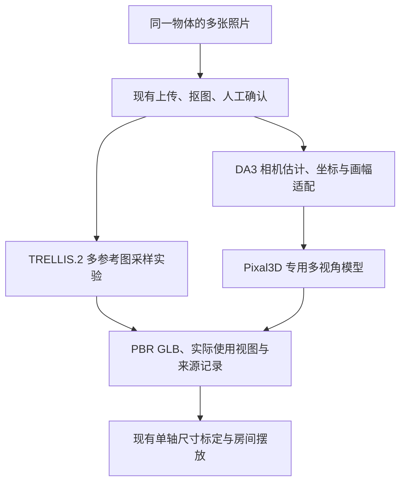

# TRELLIS 多图物体重建：能力核对与接入方案

**状态：已停用（2026-10-28，按用户决定）。** 本文保留当时的设计、实现与 GPU 结果。多图未显示稳定质量收益、平均融合明显增加耗时，当前新任务只支持 `trellis` 单图和 `mvsam3d`。以下多图启用命令／配置仅作历史记录，现已拒绝启动；已完成资产仍可读取，能力标记 `retired=true`。当前比较见 [单图 TRELLIS 与 MV 烘焙](OBJECT_SINGLE_IMAGE_COMPARISON.md)。

历史核对日期：2026-10-28。基线为 `feat/objects-trellis@75998bb`。路线 A 当时实现为可选实验后端 `trellis_multi`，支持 2–4 张确认照片，无须新权重或相机参数。

## 结论

可以增加多图方案，同时保留 PBR GLB、现有尺寸标定和摆放入口。建议分两步：先在现有 TRELLIS.2 权重上做小规模多图条件融合实验，验证额外照片是否改善本项目资产；需要更严格的相机与几何约束时，再接入 Pixal3D 的专用多视角路径。两者都需要对照，不能承诺输入图越多越好。

当前单图选择是首版实验边界，并不意味着整个 TRELLIS 系列无法使用多张图。

## 1. 当时的项目和官方接口

| 位置 | 实际状态 |
| --- | --- |
| [`run_trellis.py`](../object-reconstruction/scripts/run_trellis.py) | 实验时曾有 `prepare_references()`；当前已恢复单图适配，不再导入或启动多图采样器 |
| [`reconstruction_backends.py`](../object-reconstruction/scripts/reconstruction_backends.py) | 当前只为历史 `trellis_multi` 结果保留多图能力与 `retired=true`，拒绝新任务 |
| 场景侧 [`inference.py`](../room-reconstruction/src/litereality_agent/models/trellis/inference.py) | `generate()` 调用单张 `pipeline.run(image)`；目录模式是每张图各生成一个 GLB，不是多图生成一个物体 |
| 微软原版 TRELLIS | 官方有 `run_multi_image()`，用轮换或融合多图条件的方式采样；不能把该接口直接视为 TRELLIS.2 已有能力 |
| 微软 TRELLIS.2 当前主线 | `run()` 仍接收单张图；底层 `get_cond()` 能编码图片列表，不等于主流程已经完成多图融合 |
| TRELLIS.2 多图社区补丁 | 官方仓库 PR #104 提供采样器注入方案；核对时仍为 open、未合并 |

官方依据：[TRELLIS 原版多图代码](https://github.com/microsoft/TRELLIS/blob/193e0502b5cb3eb5997ec457d5340e95d09b158e/trellis/pipelines/trellis_image_to_3d.py)、[TRELLIS.2 当前推理代码](https://github.com/microsoft/TRELLIS.2/blob/75fbf0183001ed9876c8dbb35de6b68552ee08bd/trellis2/pipelines/trellis2_image_to_3d.py)、[PR #104](https://github.com/microsoft/TRELLIS.2/pull/104)。

## 2. 两条可以落地的路线

### A. 复用现有 TRELLIS.2 权重，增加多图条件融合

目标是让多张照片共同影响同一个物体的生成，保留现有模型、运行环境与 PBR 导出。它没有显式相机／三角化约束，属于多参考图生成。

可参考原版接口和 PR #104 的两种策略：

- `stochastic`：采样步骤轮流使用不同照片，作为较低计算成本的起点。
- `multidiffusion`：同一步分别计算各图条件下的预测，再融合；计算量随视图数增加，实际显存取决于串行计算和缓存方式。

接入要覆盖稀疏结构、粗／细几何和纹理各阶段。原版与第二代的 guidance 参数及重标定不同，不能照搬原版方法；社区补丁也不是现有 `run()` 的一个现成多图开关。应在本项目独立适配，不直接覆盖服务器的官方模型目录。

关键实现要求：

1. 每张图用原 RGB 与确认 alpha，分别保存处理记录；首轮明确选择 2 或 4 张，不能在允许上传 40 张的同时静默只使用前几张。
2. 先验证单图走原入口的兼容性，再验证多图影响了几何及纹理；图片数量和批量生成样本数保持不同含义。
3. 采样器适配需覆盖稠密／稀疏表示、512→1024 级联，以及各阶段的图像轮换；异常时用 `finally` 恢复采样器，避免失败后保留临时状态。
4. 导出继续使用同一个 PBR GLB 通道约定与 2048 贴图、50,000 面基准，复用双 GPU 锁、实测标定和网页材质层。

限制：单图权重没有因此变成经过专门多视角训练的模型。PR 讨论中已经有人报告比例变胖／变薄，作者认为多视图预测平均可能是原因之一。这是选择做实验的理由，不能把补丁说明中的“更高质量”直接当作本项目结论。[补丁与讨论](https://github.com/microsoft/TRELLIS.2/pull/104)

### B. 接入 Pixal3D 的带相机多视角路径

Pixal3D 当前实现基于 TRELLIS.2，官方发布了 `inference_mv.py`／`run_mv()`；多视图提供相机后，图像特征可按投影关系共同约束生成，最终仍能输出带 PBR 的 GLB。这是比无位姿条件融合更值得验证的几何约束路线，不代表本项目已经证明其效果更好。[官方多视角说明](https://github.com/TencentARC/Pixal3D#multi-view-inference)

它需要额外的专用多视角权重；`pipeline_mv.json` 指向多个 `*_mv` flow 模型，不能直接使用现有微软单图权重代替。[官方权重配置](https://huggingface.co/TencentARC/Pixal3D/blob/main/pipeline_mv.json)

输入为图片目录和 `transforms.json`，包含逐视图相机到世界矩阵与水平 FOV。原有 DA3 runner 已导出内参、外参、深度和 pointmap，可作为适配起点，但仍需：

- 验证 DA3 外参含义和相机轴方向，转为 Pixal3D 的 Blender／NeRF 相机约定；确定物体中心、尺度及首视图坐标系。
- 保证相机参数对应实际输入的画幅。现有 `prepare_reference()` 会逐图裁前景、居中和缩放，**不能原样用于该路径后仍沿用原相机**。
- 记录裁图／缩放变换并更新内参；该官方入口主要接受 FOV，非中心主点等情况还需重整画幅或适配投影，不能只换文件名。
- 先用官方带已知相机的样例验证，再接 DA3 相机的实拍图。不能把任意手持拍摄的 4 张图都假定成固定 90°环绕、固定 FOV。
- 在独立环境验证额外依赖与单张 3090 的低显存模式；本轮只读取配置和源码，没有下载权重或证明 24 GB 下多图峰值显存。

上述画幅、相机与导出规则依据 [官方多图入口](https://github.com/TencentARC/Pixal3D/blob/f7cf38429b0bd264f1995f0f8743a88b1c728b94/inference_mv.py)，本项目现有相机产物见 [`run_da3.py`](../object-reconstruction/scripts/run_da3.py)。

## 3. 项目接入形态

已增加独立可选后端 `trellis_multi`；`pixal3d_mv` 仍属于后续设计，没有加入 `BACKENDS`。现有单图入口和默认后端不变。



当前适配与后续位姿路线的边界：

| 部分 | 必要变化 |
| --- | --- |
| 后端契约与调度 | A 已增加显式多图策略、2–4 张校验和实际使用次数；B 仍需增加相机准备阶段 |
| 输入准备 | 输出选中的全部 RGBA 与 ID；位姿路线额外输出相机及每图画幅变换，保持对应顺序 |
| 推理与导出 | A 使用独立多图采样适配器，B 使用新环境及多视角权重；共享后续 PBR、尺寸与摆放契约 |
| 来源记录 | 保存使用／排除视图及原因、融合策略、相机来源与指纹、模型／权重版本、seed、面数和贴图预算 |
| 网页 | 明确显示“实际使用 N 张”；区分多图重建、追加照片重新生成、下一拍摄方向推荐这几种能力 |

多图输出不一定包含 Gaussian，所以现有 COVER 不能自动恢复。追加照片可以设计成“旧图＋新图全量重建新结果”，而不是承诺增量更新；补拍建议需另行设计。

### 已实现的路线 A

- [`trellis_multi.py`](../object-reconstruction/scripts/trellis_multi.py) 临时适配原生条件编码和三个采样器；原生 `run()` 继续负责稀疏结构、512→1024 几何级联、纹理和解码。异常退出也恢复方法，单图流程不受残留状态影响。
- 图片逐张编码，模型前向同样逐图进行，每次 batch=1。`stochastic` 按采样步骤轮换视图；`multidiffusion` 每步对各视图的**原生引导预测**取均值。后者保留每个视图原有 CFG interval／rescale，区别于 PR #104 先平均再做 CFG rescale 的实现；实验来源记录明确保存 `fusion_order`，不能将两者结果混同。
- [`trellis_multi_worker.py`](../object-reconstruction/scripts/trellis_multi_worker.py) 包装共享场景启动器的 `generate()`，沿用模型加载、低显存模式、网格简化和 PBR 导出。服务器官方模型源码不变。
- `generation.json`、`references/references.json` 和 `multiview.json` 保存全部来源 ID、策略、适配器指纹、各分辨率编码次数以及三个采样阶段每图前向次数。仅有 GLB 不算成功：任何阶段有选中图使用次数为 0 时，任务报错。
- 网页由能力接口读取 2–4 张限制，在上传和抠图确认两个步骤校验；明确提示全部保留照片参与生成。尺寸标定、PBR 预览和房间摆放沿用现有入口，不提供 Gaussian、COVER 或补拍续建。

命令行在原有单卡环境和共享锁设置下使用：

```bash
python object-reconstruction/scripts/run.py --backend trellis_multi \
  --object your_object --images 1 2 --attempt multi_a01
```

`configs/default.yaml` 中 `trellis.multi_image_mode` 默认 `multidiffusion`，可在独立配置中改为 `stochastic`，并通过 `--config /path/to/config.yaml` 传入。网页实验实例设置 `VIEWFORGE_BACKEND=trellis_multi` 即可启用默认平均策略。不要为试验直接修改正在运行的正式服务。

另一条独立路线是保留 MV-SAM3D 多图几何，再做 PBR 材质增强，适合隔离材质收益；它与上述直接生成新几何的多图实验分开评价。

## 4. 首轮实验与更好效果的判断

建议先做 A：复用当前权重，加入单独的实验模式，比较 1 张、2 张和少量完整视图；若几何漂移明显，再进入 B 的相机和专用权重适配。

| 样本 | 可用图与实验方式 | 主要观察 |
| --- | --- | --- |
| 毛绒玩具 | 已有 `1…8`，先比较 `1` 与 `1+2`，再选 4 张互补图 | 背面、耳朵、红心和身体比例；多视角是否反而变胖／变薄 |
| Cody | 已有 `IMG_6147/6148/6149/6152`，做 1／2／4 图 | 手指、头顶叶片、底座文字及背面衣服 |
| GT3 | 已有 `001/002/003`，做 1／2／3 图 | 车灯、轮胎、尾翼与前后外观；不虚构第四张照片 |
| 沙发 | 当前已核对的样本只有一张图 | 保留单图基线；取得新实拍视角后再纳入多图实验，不把生成的新视角算作新增实拍证据 |

固定首图、蒙版、采样配置、统一面数／贴图导出预算和渲染方式，保留所有结果。先用 seed 42 完成小规模筛选，再用额外 seed 检查方向是否稳定。旧 MV-SAM3D 使用相同的照片子集作对照，避免再次把 1 图与 3／4 图混在一起评价。

多图可能减少未见面的猜测，也可能受模糊、曝光、形变或错误相机影响。成功判据应包括：额外照片对应的结构更接近、未见面更自洽、整体比例不退化、PBR 不丢失、单卡资源可承受。没有扫描真值时只报告定性对照和运行成本，不把生成成功等同于精度提升，也不保证文字和反光一定被修好。

## 5. 本轮核对记录

- TRELLIS.2：`75fbf0183001ed9876c8dbb35de6b68552ee08bd`，单图 `run()`。
- 原版 TRELLIS：`193e0502b5cb3eb5997ec457d5340e95d09b158e`，有 `run_multi_image()`。
- TRELLIS.2 PR #104：open、未合并；补丁 head `fe7b90c376cb2ed2fb48582d1b376b56e1e16c44`。
- Pixal3D：`f7cf38429b0bd264f1995f0f8743a88b1c728b94`，确认多图入口及独立权重配置可读取。
- 公开源码及指纹保存在仓库外 `/tmp/roomcanvas-multiview-research-20261028/`。未安装新依赖、下载新权重或直接执行社区补丁；适配器已通过 CPU 契约测试及服务器已安装原生 dense／SparseTensor 引导采样器测试。

## 6. 2026-10-28 项目实测

独立目录为 `/workspace/geyinuo/roomcanvas-trellis-multi-20261028-5p1hzja4/`；使用已有毛绒玩具照片和确认蒙版的副本，权重和环境仍来自现有场景运行目录。全部任务串行使用 GPU 1，每次都先确认空闲、取得物体全局锁和场景对应 GPU 锁，不等待或停止其他任务。正式服务和正式输入未修改。

固定 seed 42、`1024_cascade`、2048 贴图及 50,000 面简化目标。各次启动均重新加载模型，端到端耗时包含加载和导出；原生生成耗时包含采样及 PBR 导出。以下是单样本、单 seed 的实验，不代表重复运行稳定性或其他物体的结论。

| 运行标签 | 图片／策略 | 结果 | 端到端／原生生成 | 三角面数 | 显存采样最大值 |
| --- | --- | --- | --- | --- | --- |
| `single` | `1`，原生单图 | 成功 | 258.3／105.9 秒 | 46,898 | 8,312 MiB |
| `two_stochastic` | `1+2`，逐步轮换 | 成功 | 265.4／118.8 秒 | 47,916 | 9,754 MiB |
| `two_average` | `1+2`，每步平均 | 成功 | 342.8／195.2 秒 | 48,423 | 9,648 MiB |
| `four_average` | `1+2+3+4`，每步平均 | 成功 | 494.5／335.5 秒 | 47,515 | 9,510 MiB |

显存是每两秒查询的整卡使用量最大值，可能漏掉瞬时峰值；本实验运行时该卡没有其他任务，不能据此降低生产显存门槛。四组运行名均为 `20261028_multiview_plush_<标签>_a01`，保留在上述独立目录的 `viewforge/runs/`。批次已完成，GPU 已释放，没有后台排队任务。

三份多图记录均确认所选照片全部参与，而非首图回退：

| 策略 | 结构阶段每图次数 | 几何阶段每图次数（含两级） | 纹理阶段每图次数 |
| --- | --- | --- | --- |
| 双图轮换 | `[6,6]` | `[12,12]` | `[6,6]` |
| 双图平均 | `[12,12]` | `[24,24]` | `[12,12]` |
| 四图平均 | `[12,12,12,12]` | `[24,24,24,24]` | `[12,12,12,12]` |

全部 GLB 均有 UV、法线以及基础色和金属度／粗糙度两张贴图，没有 Gaussian。运行实际使用的采样适配器 SHA-256 为 `9a0570cbbe9eb99c77f4a68efaa837509f801fc810b4c7fce92edd75a63ff455`，与当前本机实现一致。

本机 CPU 测试共 68 项后端用例、224 项编辑器用例、14 项网页服务用例，以及六组样例房间验收通过。另在服务器用已安装的原生引导采样器和真实 dense／SparseTensor 做 CPU 兼容性检查，两种模式均通过。网页实际验证了 1／5 张禁用、2／4 张可提交；没有为此提交新的抠图或 GPU 任务。

对比渲染只绕竖轴对齐模型正面，并把高度统一为 1，保留宽深比例；相机、环境和灯光相同。提供原生 PBR、统一漫反射和统一灰材质视图。朝向不是无位姿多参考图的保证：本次双图两种策略的正面沿 +X，绘图时绕竖轴 -90°；单图和四图不旋转，原始 GLB 不改动。

双图轮换和四图平均的真实 GLB 都通过网页预览、Z 轴高度 0.3 米测试标定、房间摆放及开关灯响应检查，PBR 保留、页面无异常。0.3 米仅用于验证流程，不是实物测量。

### 效果判断

链路可用，但本轮**没有证明多图稳定优于单图**：

- 单图正面已经较完整；双图两种策略的头身更饱满、身体呈坐姿，但后脑出现了参考图中没有的耳状结构。双图平均的该结构还有明显暗区，不能据正面观感判定更好。
- 四图平均减轻了后脑的额外耳状几何，宽高比例也接近单图；但出现了侧面黑斑和背面红色条纹。统一灰模中这些颜色异常消失，说明这部分问题来自材质／颜色生成，不是场景灯光本身。
- 平均融合在本样本没有显示稳定的净收益，且原生生成时间明显增加。双图轮换可作为成本较低的可选实验，不宜根据本次正面图直接替换默认后端。

这些现象与无相机约束的不同视角条件发生冲突相符，但本轮没有做因果消融，不将此解释视为已证明。下一轮应先用另一物体及额外 seed 验证；若继续走路线 A，可单独测试“多图几何＋首图锚定纹理”及阶段权重；需要可靠的视角对应时再进入路线 B。上述后续变化均尚未实现。

本机对比图为 `appearance-comparison.png`、`clay-comparison.png`，四张原始参考图拼图为 `references.png`；单方向截图和统一漫反射视图在 `renders/plush/`。不要把这些私人照片与模型加入 Git。

模型、原始照片、截图和详细 JSON 审计保存在仓库外，本机目录 `/tmp/roomcanvas-trellis-multi-20261028/`；服务器 `plan.json`、各运行目录的 `generation.json` 和 `multiview.json` 可复核实际输入、策略和采样使用次数。源码清单及哈希在实验目录的 `code/multiview-source-manifest.json`。
