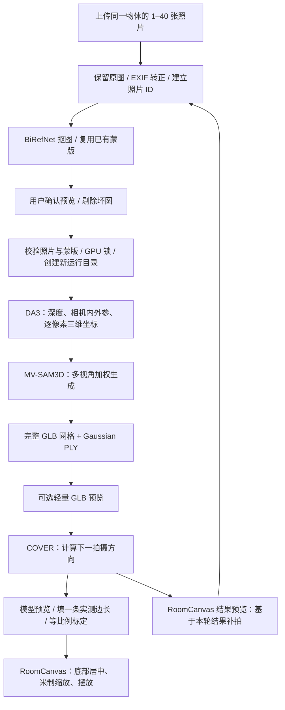

# 物体重建流程梳理

整理日期：2026-10-20；2026-10-26 按当时 `main`（`b88815f`）修正单图、补拍入口和 API 服务说明。初稿依据源码，后续分支实验的 GPU 验证另见下段。服务启动、SSH 隧道和接口清单见 [物体重建说明](OBJECT_RECONSTRUCTION.md)；场景流程与模型选型见 [场景重建流程](ROOM_RECONSTRUCTION_PIPELINE.md)、[重建与材质调研](RECONSTRUCTION_MODEL_RESEARCH.md)。

本文说明默认 MV-SAM3D 流程。2026-10-27 的 `feat/objects-trellis` 分支已验证首张确认照片调用场景侧 TRELLIS.2，再接入实测标定和摆放；可选后端与原流程的差异见 [实验记录](OBJECT_TRELLIS_EXPERIMENT.md)。

2026-10-28 曾验证 2–4 图 `trellis_multi`，因本批质量收益不稳定且耗时增加，现按用户决定停用新任务入口，保留历史结果可读；记录见 [已停用的多图实验](OBJECT_MULTIVIEW_RECONSTRUCTION_PLAN.md)。当前收敛为 [单图 TRELLIS 与 MV-SAM3D 烘焙对比](OBJECT_SINGLE_IMAGE_COMPARISON.md)。

同日增加 MV-SAM3D 的可选 `mesh_export.mode: baked_pbr`：启用原生 Gaussian 颜色烘焙，输出 UV 颜色贴图和固定材质参数，网页保留受光材质；不代表恢复了真实粗糙度／金属度。与单图 TRELLIS 的对照见 [MV 纹理烘焙实验](OBJECT_MVSAM_PBR_EXPERIMENT.md)。

2026-11-02 用户确定独立物体采用 **MV-SAM3D＋颜色烘焙＋场景实时受光**。后续计划保留几何，验证分区粗糙度、金属度与法线贴图，详见 [MV 烘焙文档的后续材质改进](OBJECT_MVSAM_PBR_EXPERIMENT.md)。受光不依赖烘焙；本次只记录方案，默认配置和正式服务尚未切换，新属性生成尚未实现。

## 1. 整体流程

RoomCanvas 的“拍照添加物体”由 `object-reconstruction/` 中的 ViewForge 服务完成。用户提供同一个物体的 1–40 张照片，多角度更好；确认抠图，等待生成模型，再填写一条实测边长，最后进入房间编辑器摆放。



ViewForge 负责照片、蒙版、重建、补拍建议、单物体预览和尺寸；RoomCanvas 编辑器负责房间、摆放、碰撞、承托与手势。

## 2. 从照片到可用模型

| 步骤 | 实际处理 | 主要实现 |
| --- | --- | --- |
| 上传 | 编辑器与 API 接受 1–40 张照片，后端接受 JPEG/PNG；照片总量上限 400 MiB。原图保留，按 EXIF 转正后另存 RGB PNG，记录照片 ID 和来源 | [`objects.py`](../object-reconstruction/scripts/objects.py)、[`import_photos.py`](../object-reconstruction/scripts/import_photos.py) |
| 抠图 | 检查每张照片的蒙版，复用有效蒙版，只对缺失项调用 BiRefNet。新蒙版与照片同尺寸，为 RGBA PNG，alpha 为 0/255 | [`prepare_masks.py`](../object-reconstruction/scripts/prepare_masks.py)、[`birefnet_worker.py`](../object-reconstruction/scripts/birefnet_worker.py)、[`mask_images.py`](../object-reconstruction/scripts/mask_images.py) |
| 人工确认 | 预览用绿色标出前景。新建时可以剔除抠错的照片，至少保留 1 张；补拍时旧照片锁定保留，至少采用一张新照片。当前没有画笔修蒙版步骤 | [`add-object-dialog.mjs`](../web/editor/add-object-dialog.mjs) |
| 输入校验 | 检查照片和蒙版是否配对、尺寸是否相同、alpha 是否非空。确认记录保存路径、文件大小、修改时间；开始重建时检查是否与预览一致 | [`objects.py`](../object-reconstruction/scripts/objects.py)、[`run.py`](../object-reconstruction/scripts/run.py) |
| 准备运行 | 取得共享 GPU 锁，创建全新运行目录；按稳定序号 `000001…` 建立照片/蒙版软链接，保存输入清单、配置和代码版本 | [`run.py`](../object-reconstruction/scripts/run.py) |
| 深度与相机 | DA3 同时读取本轮选中的照片，估计深度、相机内参和外参，再把深度反投影成 pointmap，即每个像素对应的三维坐标 | [`run_da3.py`](../object-reconstruction/scripts/run_da3.py) |
| 生成模型 | 将照片、蒙版和 DA3 pointmap 交给 MV-SAM3D，执行两阶段多视角加权生成，解码出网格和 Gaussian | [`run_reconstruction.py`](../object-reconstruction/scripts/run_reconstruction.py)、[`run_inference_weighted.py`](../object-reconstruction/run_inference_weighted.py) |
| 预览与建议 | 尝试生成轻量 GLB，再运行 COVER 计算补拍方向。完整模型成功后，预览简化或 COVER 失败不使重建整体失败 | [`preview_glb.py`](../object-reconstruction/scripts/preview_glb.py)、[`run_cover.py`](../object-reconstruction/scripts/run_cover.py) |
| 尺寸与摆放 | 从完整模型计算显示坐标下的包围盒，按一条实测边长统一缩放。编辑器再将底部置于地面、水平居中，进入摆放流程 | [`dimensions.py`](../object-reconstruction/scripts/dimensions.py)、[`object-import.mjs`](../web/editor/object-import.mjs) |

编辑器、API 和底层推理均支持单视角。补拍时原照片加新照片总数仍受 40 张上限约束。旧 ViewForge 独立首页已归档，不是当前正式入口。

## 3. MV-SAM3D 内部做了什么

这是带生成先验的三维重建：模型综合多个视角推断完整形状和外观，未拍到的部分也可能被生成。DA3 提供几何条件；最终进入编辑器的真实尺寸仍由用户实测标定。

1. **逐视角预处理**：将蒙版合入图像 alpha，把外部 DA3 pointmap 转换到推理坐标系，分别准备结构阶段和外观阶段的输入。运行包装器关闭内置深度模型，复用已算出的 DA3 数据。
2. **Stage 1：生成稀疏结构（SS）**。先短暂预热，采集各视角的注意力，依据注意力熵计算权重，再加权融合各视角的扩散预测，生成物体的稀疏结构。随后解码物体位姿；第一张照片的 pointmap 缩放与偏移参与位姿解码，因此补拍时保留首图作为锚点。
3. **Stage 2：生成结构化潜变量（SLAT）**。在第一阶段的稀疏坐标上，结合各视角图像生成包含细节和外观的潜变量，同样使用多视角加权融合。
4. **解码与导出**：同时解码 mesh 和 Gaussian。当前调用启用顶点色，关闭网格后处理和纹理烘焙；默认 GLB 的颜色主要由顶点色承载。

权重按空间位置区分，核心规则是注意力熵越低，该视角权重越高；它是模型内部的融合依据，不是实测精度。两个阶段都包含权重采集和正式采样。

当前默认配置来自 [`configs/default.yaml`](../object-reconstruction/configs/default.yaml)：

| 配置 | 默认值 | 含义 |
| --- | --- | --- |
| `seed` | 42 | 推理随机种子 |
| DA3 模型 / 处理分辨率 | `da3-nested-giant-large` / 504 | 深度与相机估计配置 |
| Stage 1 | 50 步；熵加权开启；第 9 层；alpha 30 | 稀疏结构生成 |
| Stage 2 | 25 步；`entropy`；第 6 层、第 0 步；alpha 30 | 结构化潜变量生成 |
| GPU 空闲显存门槛 | 22 GiB | 启动前检查阈值，不是实测峰值显存 |

底层还支持 `visibility` / `mixed` 权重、多个物体、位姿优化及与 DA3 场景合并；当前 ViewForge 默认调用使用单物体、熵加权，没有开启这些额外选项。核心实现见 [`inference_pipeline.py`](../object-reconstruction/sam3d_objects/pipeline/inference_pipeline.py) 的 `run_multi_view()`、[`multi_view_weighted.py`](../object-reconstruction/sam3d_objects/pipeline/multi_view_weighted.py) 和 [`latent_weighting.py`](../object-reconstruction/sam3d_objects/utils/latent_weighting.py)。

## 4. 补拍如何形成闭环

补拍入口已接入 **RoomCanvas 的物体结果／尺寸预览 → 补拍**。结果中显示橙色方向箭头，可切到推荐视角；没有建议时也能直接补拍。旧 ViewForge 首页及查看器已归档到 `legacy/`。

1. 重建完成后，COVER 读取 Gaussian、模型位姿、DA3 相机和本轮照片记录，统一坐标，并执行已有视角的投影检查。
2. 在物体周围建立 **24 个方位 × 3 个仰角（0°/20°/40°）** 的候选相机，排除与已拍方向小于 5°以及没有有效物体投影的候选。
3. 用固定版本的 COVER 指标评分，选择最低分，输出预览中的相机箭头和推荐取景。评分失败时不显示占位建议，模型仍可预览；独立重试评分仍可通过底层工具执行。
4. 用户补拍并上传后，保留父运行全部照片及其顺序，新照片追加到后面；已有有效蒙版继续复用。
5. **DA3 和 MV-SAM3D 使用“旧照片 + 新照片”全量重跑**，生成新的运行目录，再计算下一次补拍建议。这里没有从上次模型继续训练或局部更新。

每轮 `inputs.json` 记录 `parent_run_id`、`anchor_image_id`、`new_image_ids` 和触发本轮的推荐 ID；原照片和旧运行结果保留。COVER 衡量覆盖情况，不能直接当成模型精度或质量提升证明。算法来源与限制见 [COVER 说明](../object-reconstruction/docs/COVER.md)。

## 5. 真实尺寸怎样确定

[`dimensions.py`](../object-reconstruction/scripts/dimensions.py) 读取**完整 `result.glb`**，应用节点变换及显示变换后，计算轴对齐包围盒；轻量 `preview.glb` 不参与尺寸基准计算。

用户选择 X/Y/Z 轴，填写对应包围盒边长的实测值，后端按下式统一缩放三个方向：

```text
缩放系数 = 实测长度（米） / 该轴模型包围盒长度
其他轴实际长度 = 其他轴模型包围盒长度 × 缩放系数
```

例如：模型 X 轴长度是 2 个单位，实测宽度 0.8 米，则统一乘以 0.4。它能校准整体大小；模型原有长宽高比例若不准确，单轴标定不会修正比例。

后端支持 mm/cm/m；RoomCanvas 添加物体界面填写米。用户标定轴 X/Y/Z 对应显示坐标的 +X/-Z/+Y，即 Z 是高度。标定写入运行目录的 `dimensions.json`，原始模型保持不变；米制导出另存 `scaled-<版本>.glb`。

编辑器读取资产的 `base` 和 `calibration`，按“显示变换 → 水平居中及底部对齐 → 米制缩放”应用矩阵，再交给房间摆放系统。

## 6. 入口、调度与结果文件

编辑器链路为：

```text
浏览器的添加物体对话框
  → web/scripts/serve.py 同源代理
  → 本机 7865 SSH 隧道（默认）
  → GPU 服务器 scripts/web.py（Starlette / Uvicorn API，不加载旧 Gradio 界面）
  → import_photos → prepare_masks.py → run.py
  → run_da3.py → run_reconstruction.py → run_cover.py
```

API 顺序为 `POST /viewforge/objects/create` → `masks` → `reconstruct`；补拍则为 `capture` → `masks` → 带 `parent` 的 `reconstruct`，后端要求保留父运行照片。抠图和重建任务通过 `GET /viewforge/objects/jobs/<id>` 轮询。完成后通过 `/viewforge/assets/` 读取资产，通过 `/viewforge/dimensions/` 保存标定。完整接口与启动命令见 [物体重建说明](OBJECT_RECONSTRUCTION.md)。

抠图、重建和独立 COVER 作业共用 `VIEWFORGE_GPU_LOCK`；单个作业只使用 `CUDA_VISIBLE_DEVICES` 指定的一张授权 GPU。编辑器 API 提交的任务会等锁；底层命令默认非阻塞取锁，直接执行时锁冲突可能报忙。正式服务已不使用 Gradio 串行队列。

任务进度显示排队、准备、DA3、重建、COVER 和已用时，没有按推理步数计算的真实百分比。API 任务号保存在服务内存中，服务重启后失效；运行结果仍在磁盘，可从物体目录读取。浏览器会记住重建任务号以便恢复跟踪。

环境、权重、照片和结果均在 `VIEWFORGE_ROOT` 指向的外部目录，主要结构如下：

```text
$VIEWFORGE_ROOT/
├── data/inputs/<物体>/
│   ├── originals/                   原始上传
│   ├── images/                      EXIF 转正的 RGB PNG
│   ├── masks/                       RGBA 蒙版
│   └── imports/                     照片来源记录
├── cache/mask_previews/<任务>/       人工确认用抠图预览
├── logs/masks/<任务>/                抠图记录与日志
└── runs/<日期>_<物体>_<尝试>/
    ├── inputs.json                  本轮照片顺序、来源及父运行
    ├── config.yaml                  本轮配置快照
    ├── result.json                  状态、阶段返回码、耗时与版本
    ├── input/{images,masks}/         本轮所选输入的稳定序号软链接
    ├── da3/da3_output.npz            深度、pointmap、内外参及照片顺序
    ├── reconstruction/
    │   ├── result.glb               完整网格
    │   ├── result.ply               Gaussian 表示
    │   ├── params.npz               物体位姿等参数
    │   ├── preview.glb              可选轻量网格，默认目标约 1.2 万面
    │   └── preview-glb.json         可选轻量模型生成记录
    ├── cover/
    │   ├── result.json              COVER 状态；成功时包含评分与推荐
    │   ├── preview.json             查看器资产与显示变换
    │   └── attempts/                每次 COVER 尝试的检查和记录
    ├── dimensions-base.json         完整模型的尺寸基准缓存
    ├── dimensions.json              用户保存后生成的标定
    └── logs/{da3,reconstruction,cover}.log
```

`run.py` 将完整 GLB 和 Gaussian PLY 都存在且非空作为重建产物检查。输入软链接意味着运行目录并非完全独立的数据副本。预览若没有变小或简化失败可以缺省，COVER 成败单独记录在 `cover_status`；定位重建错误先看 `result.json` 的失败阶段，再读对应日志。

## 7. 与房间内物体生成的关系

场景重建本身也包含“生成物体资产”这项任务；本目录的 ViewForge 是独立拍照入口，默认后端仍使用 MV-SAM3D，可选的单图 `trellis` 复用场景侧 TRELLIS.2 模块。房间主流程没有直接调用 ViewForge API。仓库另有 LiteReality 房间重建及小物件替换流程，入口和数据来源不同：

| 路线 | 输入与目的 | 生成方式与尺寸来源 |
| --- | --- | --- |
| ViewForge 拍照添加物体（本文主流程） | 单独拍摄某个物体，加入已有房间 | BiRefNet → DA3 → MV-SAM3D；用户实测边长标定 |
| LiteReality 房间重建中的物体建模 | 房间扫描、布局和参考图，重建房间内家具 | Agent 选择建模路线，包含程序化、TRELLIS、门窗等专用流程；依赖房间布局约束 |
| author 后的小物件替换 | 已有 `Room.blend` 中的简化小物件，改善外观 | Astra 看证据决定舍弃/保留程序化/TRELLIS；TRELLIS 路线为证据图 → gpt-image-2 参考图 → TRELLIS，按原位置、高度与朝向放回 |

后两条路线见 [房间重建说明](ROOM_RECONSTRUCTION.md)，它们与 ViewForge 的职责、输入和模型关系见 [场景流程第 5 节](ROOM_RECONSTRUCTION_PIPELINE.md#5-与独立物体重建的交汇点)。不能把房间小物件的 gpt-image-2 / TRELLIS 步骤当作 ViewForge 多视角重建的默认步骤。
