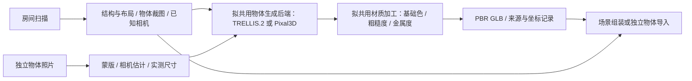

# 重建流程统一与可重光照材质调研

调研日期：2026-10-26。项目现状以 `main` 的 `b88815f` 为基线；外部能力核对官方代码、论文与 API 文档。本次未安装候选模型、未调用付费 API、未运行 GPU 对照；下述优先级是工程建议，不是质量实测排名。

后续记录：现有 TRELLIS.2 的单图接入与 GPU 验证见 [实验记录](OBJECT_TRELLIS_EXPERIMENT.md)，2026-10-28 的官方多图能力核对、采样融合和 Pixal3D 相机适配方案见 [多图重建方案](OBJECT_MULTIVIEW_RECONSTRUCTION_PLAN.md)。

同日完成 [MV-SAM3D 原生颜色烘焙与 TRELLIS 对照](OBJECT_MVSAM_PBR_EXPERIMENT.md)：同一 MV 几何分别比较原显示、顶点色受光、烘焙颜色 PBR。受光收益明显，烘焙没有恢复粗糙度／金属度，不能用原默认不受光结果直接代表 MV 的材质上限。

2026-11-02 用户确定独立物体主线采用 MV-SAM3D 颜色烘焙，导入场景后开启受光；后续在固定 MV 几何上验证分区粗糙度／金属度与法线贴图。预期收益、优先顺序、输出要求与对照方法已记录在 [MV 烘焙文档的后续改进](OBJECT_MVSAM_PBR_EXPERIMENT.md)，目前未实施。本文原有候选优先级保留为当时的调研建议，不代表已决定替换 MV 几何流程。

## 1. 当前结论与项目主线

RoomCanvas 的核心是“扫描房间 → 生成可分件、可布置的三维房间 → 拍照补充物体 → 按真实尺寸摆放”。`web/` 负责编辑、手势和光照，`android-app/` 提供移动端查看；本轮重点是两条重建流程和它们的资产质量。

**建议先统一物体生成接口和材质产物，再验证共用模型。** 当前两条流程不是两个可以直接互换的单一模型：场景侧还有扫描结构、尺度、布局、程序化建模和关节。六个候选中未找到已经证明能一次性满足这些要求的整屋替代品。

**材质是值得优先验证的瓶颈，但还不能认定是唯一原因。** 现有房间已支持 PBR；独立物体的默认颜色路径有明确缺口，拍摄光照残留仍需实物对照确认。先用固定几何的材质对照判断收益，再决定是否替换几何生成模型，能避免把形状、光源、曝光和材质变化混在一起。

### 两条流程已经实现到哪里

| 项目 | 场景重建 | 独立物体重建 |
| --- | --- | --- |
| 入口与输入 | `room-reconstruction/server/run_room.py`；RoomPlan／LiDAR、RGBD、相机与布局 | ViewForge API；1–40 张物体照片，确认蒙版，可补拍 |
| 核心流程 | 解析与布局 → 逐物体分类 → TRELLIS.2／程序化／门窗 → 组装 → Astra author → 检查发布；完整运行默认另跑可动部件 | BiRefNet → DA3 → MV-SAM3D → GLB + Gaussian → COVER → 实测标定 |
| 尺度与位置 | 房间扫描布局约束，保持物体分组、姿态及关节 | 用户实测一条边长，进入编辑器后摆放 |
| 当前材质 | 程序化与生成材质混合，已有 PBR 贴图及部分 Physical 扩展 | 默认关闭纹理烘焙、使用顶点色；导入受光实验可转换／保留 PBR |
| 详细文档 | [场景流程](ROOM_RECONSTRUCTION_PIPELINE.md)、[运行说明](ROOM_RECONSTRUCTION.md) | [物体流程](OBJECT_RECONSTRUCTION_PIPELINE.md)、[API 与运行说明](OBJECT_RECONSTRUCTION.md) |

场景的后处理有小物件替换和可动部件切分，不能归入 ViewForge 默认流程。当前完整重建的可动部件结果在 `articulate/room_preview/`；publish／simulate 使用的仍是之前的房间版本。

## 2. 不真实可能来自哪里

### 2.1 本次可直接确认的资产与代码事实

2026-10-26 直接解析当前两份 `Room.glb` 的 JSON 材质和网格属性，未解码或上传私人图片：

| 资产 | 材质数 | unlit | 有基础色贴图 | 有金属／粗糙度贴图 | 有法线贴图 | 缺少几何法线的 primitive |
| --- | ---: | ---: | ---: | ---: | ---: | ---: |
| `samples/room3` | 48 | 0 | 26 | 19 | 7 | 98 / 185 |
| `samples/office` | 84 | 0 | 58 | 49 | 44 | 0 / 1239 |

这是文件定义数量，不是运行时材质实例、绘制次数或纹理正确率。room3 与 [早期光影审计](../web/README.md#光影调研) 的数值不同，本表仅代表当前文件。法线缺失已有加载时补算，但不能替代真实表面细节。

源码能确认的另外两个问题：

- [`run_inference_weighted.py`](../object-reconstruction/run_inference_weighted.py) 默认 `with_texture_baking=False`、`use_vertex_color=True`。没有恢复独立粗糙度／金属度等表面参数，就难以区分布料、木材、金属和漆面。
- [`import-materials.mjs`](../web/editor/import-materials.mjs) 默认 `original` 模式新建 Basic 材质，仅使用顶点色；它不会完整保留候选模型的贴图。`pbr` 实验模式才保留 Standard／Physical 的参数和贴图，或将其他材质转为粗糙度 0.75、金属度 0 的 Standard。**仅让后端产出 PBR GLB，仍不足以保证当前默认导入效果正确。**

另一个接入缺口在 [`preview_glb.py`](../object-reconstruction/scripts/preview_glb.py)：需要减面的网格会先把纹理转为顶点色，再构造新的简化网格，不能保留完整的 UV／PBR 材质。未触发减面的网格不走该转换。新后端要么适配能保留材质的预览生成，要么在材质对照中明确使用完整模型，不能用当前轻量预览评价 PBR 质量。

### 2.2 需要分开验证的四层

| 层次 | 缺口 | 换成更好的重建模型能改善什么 |
| --- | --- | --- |
| 几何与法线 | 轮廓错误、缺面、表面鼓包、法线不连续 | 改善遮挡、阴影轮廓和高光连续性；法线贴图不能修正错误轮廓 |
| 材质／光照分离 | 基础色里已有阴影和高光，粗糙度／金属度猜错 | 去除拍摄光照、预测较合理的表面参数，减少二次打光 |
| 渲染与照明 | 当前主光、顶灯、环境反射与真实房间不一致，缺少局部反射或间接光 | 材质模型不能补齐场景 GI 或真实灯位；须独立评价 |
| 资产接入 | PBR 贴图丢失、色彩空间或通道打包错、顶点色重复相乘 | 需要导出与加载适配；模型质量再好也会被接入问题掩盖 |

PBR 是材质表达方式，不是测量精度证明。单图中的暗区可能是深色材料，也可能是阴影；生成模型会猜未观察到的表面。高分辨率、贴图锐利和微表面细节，也不自动意味着可正确换光。当前时段光照与调色已经存在，本轮应先固定它们，不能把调色后的观感提升当作材质还原成功。

## 3. “用一个模型”可以统一到什么程度

| 统一层级 | 可行性判断 | 仍需保留的部分 |
| --- | --- | --- |
| 共用资产规范、任务接口和日志 | 最先做，收益明确；目前是建议 | 分别保留输入准备、尺度来源和失败回退 |
| 共用物体几何／材质生成模型 | 值得验证 TRELLIS.2／Pixal3D：房间裁出的家具和用户独立拍摄物体可进入同一后端 | 场景布局／壳体、独立物体相机估计与标定、程序化和关节流程 |
| 共用固定几何的材质增强步骤 | 直接对应光影诉求；优先测试 LumiTex／SUPRA-Tex | 几何、UV、尺度、节点、照片相机对齐；不保证输入两个来源质量相同 |
| 同一端到端网络生成完整场景和单物体 | 有相关研究，但本次未找到满足 RoomCanvas 全部要求的已验证替代品 | 米制尺度、墙与开口、可分件资产、完整背面、关节、碰撞和真实材质仍需逐项证明 |

这是建议架构，当前没有实现。以同一模型系列处理不同入口，也不等于只需要一份权重：Pixal3D 官方多视角入口使用独立多视角权重。

本次也核对到了官方权重库的 [`pipeline_mv.json`](https://huggingface.co/TencentARC/Pixal3D/blob/main/pipeline_mv.json)，其引用独立的 `*_mv` flow 模型；权重可获取不等于本项目已经完成相机适配。

### 场景模型方向的补充核对

- **SAM 3D Objects**：官方明确面向物体形状、纹理与布局，现有仓库已经在它的多视角扩展上工作。可研究用场景逐实例掩码、深度和位姿组合复用这一后端；官方能力说明不能证明已恢复米制完整房间和可重光照 PBR。[官方仓库](https://github.com/facebookresearch/sam-3d-objects)
- **MIDI**：同时生成多个实例及其空间关系，是“物体与场景共用生成表示”的直接研究样例。官方纹理场景流程还需分割图和 MV-Adapter，并提示约 30 GB 显存；不符合当前单张 24 GB 卡的直接部署预算，也未据此证明 PBR／尺度／关节可替代现流程。[官方仓库与使用说明](https://github.com/VAST-AI-Research/MIDI-3D)

这两项说明统一方向有研究基础；短期推荐的工程路径仍是共享物体／材质模块。六个用户候选主要解决物体资产或贴材质，不能因名字里有“3D reconstruction”就归为完整室内扫描方案。

## 4. 用户候选与现有基线对照

表中的“公开”指本次能找到官方代码或权重入口，不等于所有组件都允许任意商业部署。“单图／多图”均指同一物体，不是完整房间多帧重建。

| 候选 | 主要输入 → 输出 | 最相关的改善 | 公开与部署状态 | 对 RoomCanvas 的位置 |
| --- | --- | --- | --- | --- |
| [TRELLIS.2 基线](https://github.com/microsoft/TRELLIS.2) | 单物体图；另有 shape-conditioned texturing → 几何及基础色、粗糙度、金属度、透明度 | 已有 PBR 生成与材质路线 | 代码／权重 MIT，依赖另有条款；官方 Linux、至少 24 GB，性能表来自 H100 | 已在场景侧使用，先做共用后端基线 |
| [Pixal3D，TRELLIS.2 版](https://github.com/TencentARC/Pixal3D) | 单图，或带相机的多视图 → PBR GLB | 像素与表面对应、局部细节及形状忠实度 | 代码 MIT，权重公开；有 `--low_vram`，不代表所有分辨率都能在 3090 稳定运行 | 共用物体生成后端的优先候选 |
| [SUPRA-Tex](https://github.com/Supra-3D/SUPRA-Tex) | 图片 → PBR GLB；或几何＋相机＋参考视图材料观测 → 贴材质 | 文字、图案和材质边界对齐，补全未见面 | 代码与 3D completion 权重 MIT，材料 adapter 含 Qwen Research 非商业限制；官方已有 3090 CPU offload 验证 | 优先比较固定几何材质增强，也可测完整生成 |
| [LumiTex](https://github.com/LumiTexPBR/LumiTex) | 网格＋参考图 → PBR 材质 | 利用光照上下文改善材料分解和重打光 | 代码 Apache-2.0，模型公开；FLUX／Hunyuan 渲染依赖有非商业限制；需编译组件 | 与去除拍摄光照问题最贴近的实验候选 |
| [UltraTex](https://github.com/yiboz2001/UltraTex) | 几何条件的多视图缓冲＋参考图 → 高分辨率多视图外观／MR 预测 | 2K 多视图纹理清晰度、效率 | 代码 MIT，LoRA／decoder 公开；另下 FLUX 基座，许可随基座 | 后续纹理细节阶段，需补导出链路 |
| [Meshy 7.1](https://docs.meshy.ai/en/api/multi-image-to-3d) | 1–4 图 → mesh＋可选 PBR 贴图 | 商业资产生成质量对照 | 商业 API；本次未找到完整模型源码／权重，不能据此规划自托管 | 付费质量上限对照，不替代场景管理 |
| [Rodin Gen-2.5](https://docs.hyper3d.ai/en/api-specification/rodin-gen2-5) | 1–5 图或文字 → mesh＋可选材质 | 复杂几何、微表面与 PBR；明确区分烘焙材质 | 商业 API；本次未找到完整模型源码／权重，私有部署须另询供应商 | 商业对照，可测试去光照选项 |

### 4.1 Pixal3D：最值得检查的多视角后端替换

当前官方仓库的 TRELLIS.2 实现与论文版 Direct3D-S2 不同，不能把论文全部指标直接套给当前代码。README 的版本表称最新为 `main`，本次网页与文件链接实际解析到 `master`；实验应锁定实际 commit、配置与权重 revision。[官方版本与用法](https://github.com/TencentARC/Pixal3D)

多视角并非直接上传一组无位姿图片：[`inference_mv.py`](https://github.com/TencentARC/Pixal3D/blob/master/inference_mv.py) 需要 `transforms.json`、camera-to-world、水平 FOV，首视图以规范正面为基准。**建议验证**将 DA3／扫描相机转换到这一约定，连同裁图后的内参、坐标规范化和尺度一起处理；不能只把 DA3 文件改名。官方低显存模式默认 1024，常规默认 1536，质量和显存必须在同设置下记录。

替换还会影响 COVER：现有补拍评分读取 Gaussian、DA3 相机及 SAM3D 位姿；候选仅提供 GLB 时，旧评分不能直接沿用。先保留 MV-SAM3D 全链路对照，再决定是否增加另一种覆盖度／下一视角方法。

### 4.2 SUPRA-Tex：对齐细节好，但已有网格入口也需要准备

它的已有几何入口需要相机、RGBA 图、参考视图的 albedo／MRA，以及内部几何表示；[`texturing.py`](https://github.com/Supra-3D/SUPRA-Tex/blob/main/texturing.py) 会检查这些输入。不能把任意 GLB 当作唯一输入直接运行。保留旧网格时仍需做相机配准、几何转换和导出一致性检查。

官方 GPU 文档记录了 **RTX 3090 24 GB + CPU offload** 的完整单视图及部分贴材质验证；这比只列 Linux 要求更具体，但不是本项目实测。没有据此证明任意 40 张照片或完整房间都能运行。安装基线为 Linux、CUDA 12.4、PyTorch 2.6。[GPU 兼容说明](https://github.com/Supra-3D/SUPRA-Tex/blob/main/docs/gpu_compatibility.md)

原始代码与 completion 的 MIT 条款不能覆盖 Qwen 材料 adapter 和所有外部模型；商用研究应按所选 pipeline 核对完整依赖链。[第三方说明](https://github.com/Supra-3D/SUPRA-Tex/blob/main/THIRD_PARTY_NOTICES.md)

官方 README 提供公开权重入口，但本次浏览工具未能直接读取该 Hugging Face 权重目录，因此不声称已验证全部文件可匿名下载；部署前要核对完整清单与访问条件。[官方发布说明](https://github.com/Supra-3D/SUPRA-Tex)

### 4.3 LumiTex：先跑完整材料分支，避免只比基础色

它以已有网格和参考图为输入，适合隔离材质收益；官方环境示例为 Python 3.11、PyTorch 2.7／CUDA 12.8，并需编译 Hunyuan 渲染器。本次未找到足以确认 RoomCanvas 单张 3090 峰值显存的官方数字。[安装与权重](https://github.com/LumiTexPBR/LumiTex)

**默认示例只启用 AL（基础色）**：`infer_mode_list = ["AL"]`，MR 及相应 LoRA 配置被注释。实验必须确认 AL、metallic／roughness 分支、权重和导出均生效；只运行默认命令不能声称已得到完整 PBR。[官方入口源码](https://github.com/LumiTexPBR/LumiTex/blob/main/inference.py)

官方权重目录实际列有 AL、MR 两份 LoRA 和 LVSM 权重，MR 并非只有论文描述；本次只核对文件清单，未下载运行。[官方权重目录](https://huggingface.co/Jingzhi03/FLUX-MV-Shaded/tree/main)

它与 SUPRA-Tex 应使用同一网格对照，观察阴影／高光是否残留，以及换灯后表面响应是否合理。分离材质与照明是研究目标，仍需用项目实拍样本验证。

### 4.4 UltraTex：细节增强与成品资产导出要分开

官方有 FLUX.1 和 FLUX.2 分支，默认预测 albedo，FLUX.2 的 `--task mr` 使用独立 MR LoRA。基座和 VAE decoder 需要匹配，9B LoRA 不能直接加载到 4B 模型。[官方配置说明](https://github.com/yiboz2001/UltraTex)

检查到的 [`inference_flux2.py`](https://github.com/yiboz2001/UltraTex/blob/main/inference_flux2.py) 使用 position 等缓冲条件，保存多视图预测图片／对照图；不是项目可直接使用的 GLB 导出接口。仍需完成视图准备、投影融合、UV 烘焙、通道打包与接缝验收。仓库演示的加速比例也不能换算为 3090 的本项目耗时。

UltraTex 的 MIT 代码不改变基础模型条款：当前 [FLUX.1-dev](https://huggingface.co/black-forest-labs/FLUX.1-dev) 与 [FLUX.2-klein-base-9B](https://huggingface.co/black-forest-labs/FLUX.2-klein-base-9B) 模型卡均标注非商业许可。不要把其他 FLUX 变体的许可套到当前 9B 路线。

### 4.5 Meshy／Rodin：作为商业对照的明确参数

Meshy 应固定 `ai_model="meshy-7.1"`、`should_texture=true`、`enable_pbr=true`；PBR 默认关闭。多图最多 4 张，不能把 ViewForge 全量照片直接发送；要固定选图规则和首图。输出纹理存在也不保证已去除拍摄光照。[官方多图 API](https://docs.meshy.ai/en/api/multi-image-to-3d)

Rodin 要显式指定 Gen-2.5 的 `tier`；官方说明省略时可能落到旧代。换光实验选 `material="PBR"`，不选 `Shaded` 或含烘焙基础色的 `Hybrid`，并可独立对比 `texture_delight`。最多 5 图，导出面数也要控制到网页预算。[官方 Gen-2.5 API](https://docs.hyper3d.ai/en/api-specification/rodin-gen2-5)

二者的计费、条款和模型版本可能变化，启动实验时记录具体请求和当时价格；本次不估算未核实的单次成本。商业实验先用公开或获准上传的物体图，私人房间照片继续留在原工作流。

## 5. 接入必须先约定的产物

以下是拟定契约，尚未实现。已有模型输出不能只以“能打开 GLB”为验收条件。

| 项目 | 最低要求 |
| --- | --- |
| 几何与坐标 | 完整显示网格、几何法线、UV；记录单位、模型到显示／房间的变换、原点与尺度来源；材质加工不得静默改变几何和尺寸 |
| 材质 | 尽量不带拍摄光照的基础色、roughness、metallic；可选 normal、opacity、occlusion；玻璃、清漆、发光保留适当扩展或单独处理 |
| glTF 编码 | 基础色按 sRGB；metallic／roughness 为线性数据，粗糙度 G、金属度 B；AO 如共图用 R，但需相应引用；不要把不同模型的 MRA／ORM 原样误接 |
| 顶点色 | 明确是否参与最终基础色乘法；重建纹理之后残留的拍摄颜色可能再次压暗，需清除或中性化，不能盲目同时开启 |
| 可编辑性 | 保留稳定物体 ID、节点、关节／动画、承托与碰撞关联；材质分块不应被误当成多个独立家具 |
| 完整版与预览 | 两份都应能显示同样的关键材质；现有简化器对减面网格改存顶点色，需要改造或回退到完整模型。实测尺寸仍以完整模型为准 |
| 来源与能力 | 保存模型／权重 revision、配置、随机种子、输入视角、材料分支、是否去光照、是否包含 Gaussian；不支持的 COVER 等功能显式标明 |

glTF 通道和色彩约定依据 [Khronos glTF 2.0 材质规范](https://registry.khronos.org/glTF/specs/2.0/glTF-2.0.html#metallic-roughness-material)。微表面 normal 不等于几何 normal；普通金属度／粗糙度模型也不能表达所有玻璃、漆层和布料效果。

网页第一项接入工作应是：在候选资产实验中使用现有 `pbr` 模式保留材质，验证缩略图、预览、选择高亮、摆放和回退，避免默认 Basic 路径把新贴图抹掉。正式默认行为是否改变，等待真实资产对照结果。

## 6. 建议实验与决策顺序

### 6.1 先验证材质，再验证统一后端

| 次序 | 实验 | 隔离的问题与通过依据 |
| --- | --- | --- |
| P0 | 真实新增物体的原显示／现有 PBR 适配／房间原有材质基线 | 确认材质没有被丢弃、法线和色彩路径正确；固定相机、曝光、时段及调色，得到后续对照基线 |
| P1a | 同一 MV-SAM3D 网格分别用 LumiTex、SUPRA-Tex 加工；补一个房间内家具样本 | 固定几何、尺度、碰撞及布局，只看去光照与材料参数改善；先确认单卡可运行与完整材料分支 |
| P1b | 同一组照片运行 MV-SAM3D、现有 TRELLIS.2、Pixal3D 单／多视角 | 评价输入忠实度、遮挡补全、形状比例、PBR 和成本；单图比较与多图比较分开，输入数量和相机估计耗时都记录 |
| P2 | 在同一网格上比较 TRELLIS.2 材质基线和 UltraTex | 前者已有 shape-conditioned 入口；后者优先看纹理清晰度、跨视图接缝与烘焙成本，避免重复建设已有能力 |
| P2 | Meshy 7.1／Rodin Gen-2.5 少量商业对照 | 判断自托管质量与付费产物的差距；不因宣传图直接切换生产后端 |
| P3 | 一个房间里多件家具接入共同后端／材质加工 | 同时保住结构尺度、ID、关节、布局和浏览器性能，再讨论扩大范围 |

P1a 与 P1b 是两种独立问题，不预设 LumiTex／SUPRA-Tex 一定获胜。若 PBR 适配已解决主要视觉问题，则先修资产接入；若照片中的明暗仍固化，就继续去光照；若主要是轮廓／比例失真，再优先替换几何模型。

### 6.2 最小样本与光照矩阵

建议从 6 类实物开始：布料／织物、哑光塑料、木纹、裸露金属、黑漆／清漆、带文字图案的包装。玻璃和薄片另列困难样本。每件保留同组多视角与一条实测边长，至少有独立物体和房间裁图两种来源。

固定几何的实验中，完整网格不变；若候选转换不可避免地重建网格，记录顶点／面及表面差异，不能继续称为纯材质对照。几何实验做统一刚体／尺度对齐，同时记录原始长宽高比例误差，避免非均匀拉伸掩盖错误。

使用中性环境、方向相反的两组主光、暖／冷色光和较暗室内环境；同一光照行固定曝光、白平衡和调色。观察：高光是否随灯光／视角移动，原阴影是否仍钉在表面，布料是否像金属，接缝和背面是否自洽。能补拍时另取不同真实光照的留出照片；仅与输入图相似不足以证明可重光照。现有通用环境不能用来苛求物体精确反射出本房间的窗户。

| 评价维度 | 记录内容 |
| --- | --- |
| 几何 | 轮廓、多视角一致性、长宽高比例、薄结构及未见面；有参考扫描时才报告几何误差 |
| 重光照 | 固定渲染的全景／近景盲评、材质误判、残留高光和阴影；无真值时不宣称物理参数准确率 |
| 资产与编辑 | 贴图／通道／UV、GLB 与预览体积、实测标定、摆放碰撞、关节、缩略图；COVER 可用性单独验收 |
| 计算与成本 | 单张授权 GPU 的峰值显存、系统内存、准备／推理／导出耗时、失败率、API 费用；首次编译和热启动分开 |
| 网页运行 | 贴图尺寸与数量、实际帧耗、内存和加载时间；高分辨率训练／预测不代表网页应默认使用 4K／12K |

所有 GPU 结果写新目录，一次只用一张空闲卡，遵循项目已有锁与数据规则。两张 3090 不能直接视为单个 48 GB 的推理预算。

## 7. 本轮交付与下一步

本轮完成流程梳理、当前 GLB 材质静态审计、六个候选及 TRELLIS.2 基线的官方资料核对；未部署模型，也未证明任何候选已提升本项目效果。

下一步建议先取一件真实重建物体，通过现有 PBR 实验验证加载链路，再在保留几何的前提下做 LumiTex／SUPRA-Tex 对照；同时以 Pixal3D 多视角的相机转换、单卡资源和 COVER 替代成本判断共用后端是否值得推进。这是待验证方向，尚未选定生产替代模型。
