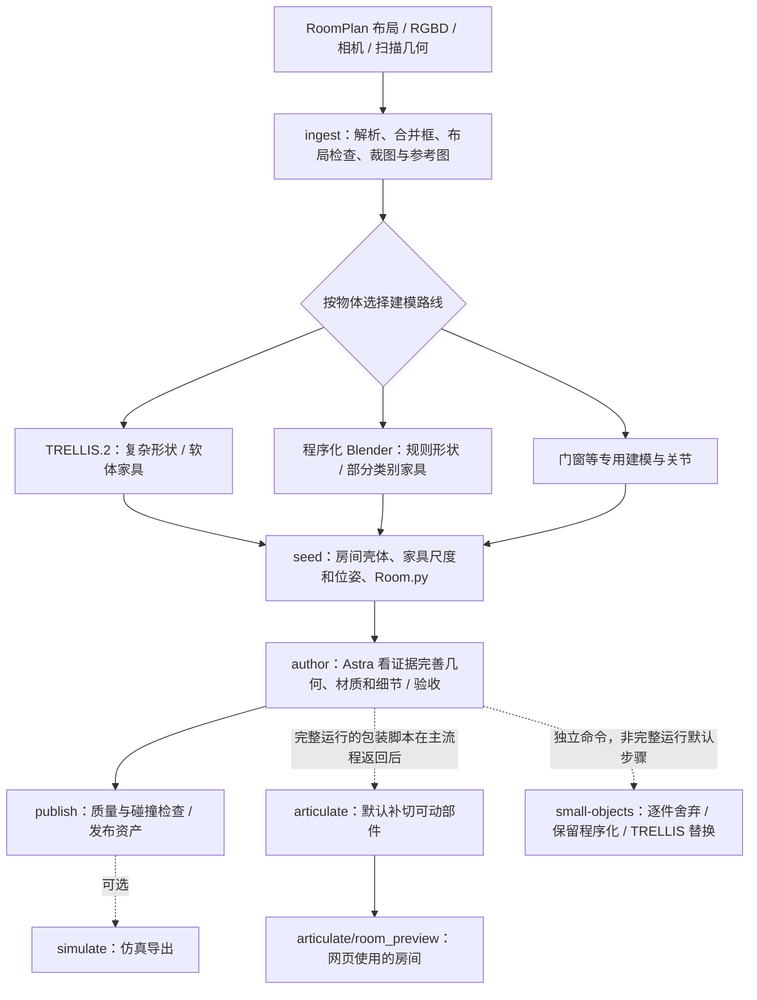

# 场景重建流程梳理

更新：2026-10-27。流程基线为本仓库 `main` 的 `dcc8edc`，依据源码检查；后续分支实验的 GPU 验证另见下段。运行命令见 [房间重建](ROOM_RECONSTRUCTION.md)，物体流程见 [物体重建流程](OBJECT_RECONSTRUCTION_PIPELINE.md)，模型统一与材质选型见 [重建与材质调研](RECONSTRUCTION_MODEL_RESEARCH.md)。

本文描述主线的默认流程。`feat/objects-trellis` 已新增独立物体调用场景 TRELLIS.2 的可选后端，并完成单图 GPU 及浏览器验证，见 [实验记录](OBJECT_TRELLIS_EXPERIMENT.md)；主线默认 MV-SAM3D 流程尚未替换。

## 1. 场景重建实际包含什么

RoomCanvas 的场景重建由 `room-reconstruction/` 的 LiteReality + Astra 流程完成。输入是带 RoomPlan 布局、RGB／深度帧、相机位姿和扫描几何的房间扫描，不是任意一张室内照片。输出需要同时满足：房间尺度可信、家具独立可移动、结构和物体可区分、能摆放和碰撞检测，并尽量恢复照片里的外观。

因此，“场景模型”不是一个独立神经网络：它包含扫描解析、布局修正、逐物体建模、Blender 场景组装、外观完善、检查与导出。Astra 是审图及生成建模操作的 Agent；TRELLIS.2 是其中一条物体建模路线。



`articulate` 不属于 LiteReality 内部的 `STAGES`。包装脚本在主流程返回后另跑它，读取 author 房间；publish／simulate 不会自动改用补切之后的资产。`small-objects` 也应单独指定输入和新输出目录，不能假定两项后处理已经串联。

## 2. 主流程与源码对应

正式阶段表为 `ingest → reconstruct → seed → author → publish → simulate`，最后一项非必需，见 [`stages.py`](../room-reconstruction/src/litereality_agent/pipeline/stages.py)。

| 阶段 | 当前行为与约束 | 关键源码 |
| --- | --- | --- |
| ingest | 解析 RoomPlan 的墙、地面、物体、门窗；读取扫描几何、帧与相机；合并重复／拆分检测框，修正布局并要求通过布局检查；按物体裁证据图、生成干净参考图，对椅子分组 | [`scene_init/flow.py`](../room-reconstruction/src/litereality_agent/pipeline/scene_init/flow.py)、[`extract_scene.py`](../room-reconstruction/src/litereality_agent/pipeline/scene_init/ingest/extract/extract_scene.py)、[`layout/`](../room-reconstruction/src/litereality_agent/pipeline/scene_init/layout/) |
| reconstruct | Agent 按几何特性分类；TRELLIS 路线读取参考图生成带材质 GLB，规则物体与门窗走程序化／专用路线；纯墙和地面不交给 TRELLIS | [`reconstruct/flow.py`](../room-reconstruction/src/litereality_agent/pipeline/scene_init/reconstruct/flow.py)、[`models/trellis/inference.py`](../room-reconstruction/src/litereality_agent/models/trellis/inference.py)、[`models/object_generation/`](../room-reconstruction/src/litereality_agent/models/object_generation/) |
| seed | 按布局组装壳体和物体，生成可编辑 `Room.py`、`scene.json`，可编译预览；物体生成后的规范化坐标需要转换回房间尺度及朝向 | [`seed.py`](../room-reconstruction/src/litereality_agent/pipeline/scene_init/seed.py)、[`room_ops/`](../room-reconstruction/src/litereality_agent/room_ops/) |
| author | Astra 看房间、物体和表面证据完善场景；检查完成状态并做验收。服务器包装器将视觉返工轮数默认设为 1，不能把进程返回 0 等同于视觉质量已通过 | [`author/__init__.py`](../room-reconstruction/src/litereality_agent/pipeline/realism_authoring/author/__init__.py)、[`acceptance.py`](../room-reconstruction/src/litereality_agent/pipeline/realism_authoring/acceptance.py) |
| publish / simulate | 发布前质量／碰撞检查与编译；仿真是独立可选输出，不是网页加载必需条件 | [`room_qc/publish/`](../room-reconstruction/src/litereality_agent/pipeline/room_qc/publish/)、[`simulate/`](../room-reconstruction/src/litereality_agent/pipeline/simulate/) |

参考图是生成结果，可能修改原照片中的形状和颜色；它有助于生成完整资产，但不能视作实测几何或材质真值。房间的尺寸／位姿依据扫描布局，生成的局部比例仍须检查。

## 3. 两项后处理

| 后处理 | 改善什么 | 已实现的边界 |
| --- | --- | --- |
| `--small-objects` | 用更合适的形状和贴图替换 author 的简化小物件 | Astra 依据证据三选一；TRELLIS 前生成参考图，再按原位置、高度、朝向放回；存在非金属材质修正。不会自动解决全部家具的材质，也不是完整运行默认步骤 |
| `--articulate` | 给已有家具补出可开的盖、抽屉、屏幕等 | Astra 判范围和运动，Blender 切面、建关节，再审图；失败部件不保留。历史试验曾出现薄部件碎裂、照片裁偏及漏判；当前入口与验收见 [可动部件说明](ROOM_RECONSTRUCTION.md#可动部件) |

可动部件会改变网格与层级，材质增强需要明确在切分前还是切分后执行，并验证 UV、节点、动画与关节仍正确。仅重新生成一件家具，通常不能保留原来的关节定义。

## 4. 运行、产物与网页边界

服务器入口 [`run_room.py`](../room-reconstruction/server/run_room.py) 配置当前 checkout、外部环境、权重、GPU 锁和日志。它与 ViewForge 使用各自的 Python 环境；共用模型后端的方案尚未实现。

| 产物 | 用途 |
| --- | --- |
| `<运行>/pipeline/<场景>/…` | LiteReality 主流程、参考图、逐物体资产、author 房间及检查记录；具体子路径由 pipeline context 管理 |
| author 的 `room_preview/Room.blend`、`Room.glb`、`room_layout.json` | 可继续编辑的源场景、可显示模型与布局；也是独立后处理的依据 |
| `<运行>/articulate/room_preview/` | 完整运行默认新增的可动部件版本，网页应从这份生成清单 |
| `room_objects.json` | 由 [`web/scripts/room_objects.py`](../web/scripts/room_objects.py) 生成的物体分组、角色、关节信息；不是重建模型直接输出的全部内容 |
| 网页房间目录与 `web/rooms.json` | 发布到编辑器的展示资产及目录登记；网页不直接运行 LiteReality |

普通运行、单独后处理、接入网页的命令保留在 [操作说明](ROOM_RECONSTRUCTION.md)。本次没有验证远端任务、性能或费用；旧实验记录不能当作当前每个房间的耗时保证。

## 5. 与独立物体重建的交汇点

**场景重建包含物体建模子任务，而 `object-reconstruction/` 是项目中另一条独立的物体重建流程。两者目前没有共用同一个推理后端。**

“物体重建”在这里有两种含义：一是广义的技术任务——把椅子、沙发等变成三维资产；二是具体的 ViewForge 功能——用户拍照添加新物体。场景侧也在做前一种任务，但没有直接调用后一套服务。

### 5.1 TRELLIS.2 在场景里负责什么

从扫描帧裁出某件家具的证据后，流程通常先生成干净的单物体参考图，再交给选定的建模路线：

- 软体、曲面或复杂形状，如沙发和椅子，主要走 TRELLIS.2：参考图 → 单物体网格与材质。
- 规则桌柜、箱体和家电等可走 Agent 驱动的 Blender 程序化建模：参考图＋尺寸／类别约束 → 几何与材质，并可按规则建立关节。
- 墙、地面和房间开口依据扫描结构处理；门窗另有专用流程。TRELLIS.2 不负责还原整屋布局，也不负责全部物体。

随后场景层把这些资产按扫描约束缩放、定位、组装，完善外观并检查。author 之后的可选小物件替换也可能调用 TRELLIS.2；可动部件处理则是切分已有网格并添加运动，不是再次执行 TRELLIS 推理。

### 5.2 独立物体流程负责什么

用户单独拍一件物体，通过 ViewForge 执行：

```text
照片 → BiRefNet 抠图 → DA3 深度与相机 → MV-SAM3D 生成
     → GLB + Gaussian → COVER 补拍建议 → 填实测边长 → 导入已有房间
```

它使用照片、蒙版和 DA3 pointmap 直接约束生成，当前默认链路不经过场景侧的参考图生成，也不调用 TRELLIS.2。DA3 负责几何条件，MV-SAM3D 负责生成物体，COVER 负责建议下一拍摄方向，三者职责不同。补拍仍是全部照片重跑，不是增量更新模型。

例如，同一把椅子若已经在扫描房间里，走“扫描帧裁图 → 参考图 → TRELLIS.2 → 放回原位置”；若是后来想买／搬进来的椅子，当前拍照入口走“用户照片 → DA3 + MV-SAM3D → 实测标定 → 用户摆放”。两者都得到椅子资产，但输入依据与生成方法不同。

### 5.3 两条物体建模路线的对照

真正重叠的是“生成物体资产”；房间结构、布局和场景管理属于场景层：

| 项目 | 房间里的家具 | 独立拍照物体 |
| --- | --- | --- |
| 照片 | 从扫描帧按房间相机和框裁出，常有遮挡；通常再生成单物体参考图 | 用户围绕物体拍照，BiRefNet 确认蒙版，默认不生成替代参考图 |
| 几何生成 | TRELLIS.2、程序化和专用建模并存 | DA3 pointmap + MV-SAM3D |
| 尺度／位姿 | 扫描布局约束、房间内定位 | 实测一条边长标定，用户摆放 |
| 外观 | 程序化材质／TRELLIS PBR／author 材质 | 当前默认导出以顶点色为主 |
| 可编辑性 | 稳定物体 ID、分组、结构、关节 | 单资产导入，尺寸与承托／碰撞接入 |
| 服务关系 | LiteReality 内部运行建模模块 | 独立 ViewForge API；当前没有被房间主流程直接调用 |

### 5.4 后续统一的对象

优先研究的是让“场景里的物体建模”和“独立拍照物体”共用生成后端或材质增强步骤；房间扫描解析、结构、布局、组装、关节和检查仍由场景层负责。即使两个入口都使用 TRELLIS.2，也仍然需要不同的输入准备和尺度处理，不会因此成为相同的完整流程。

共用后端还需验证多视角输入、PBR 材质、相机与尺度转换，以及 Gaussian／COVER 的兼容性。具体候选和验证顺序见 [模型调研](RECONSTRUCTION_MODEL_RESEARCH.md)。
