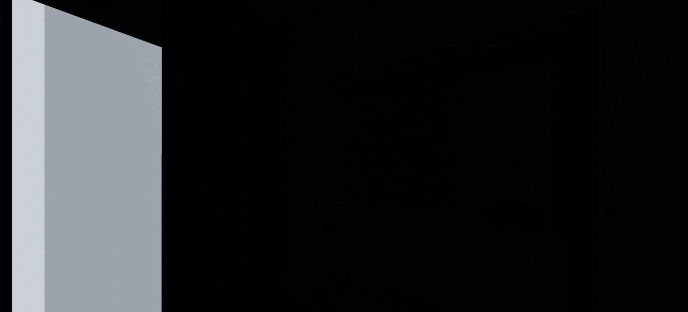
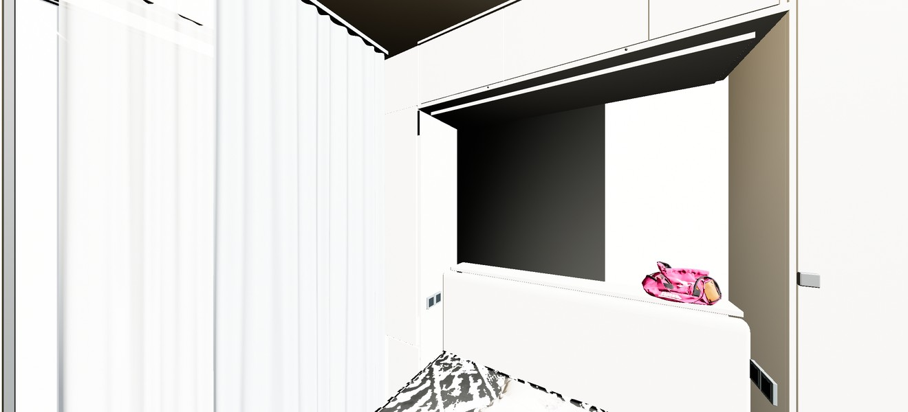
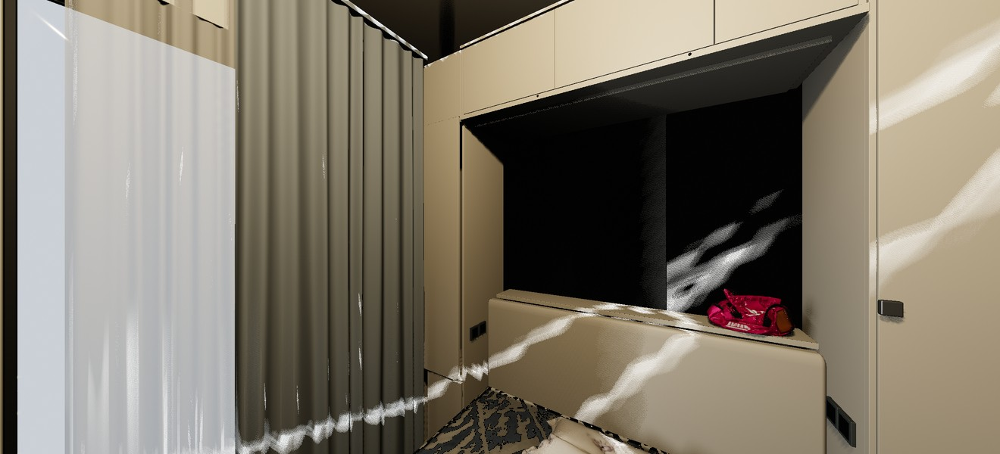
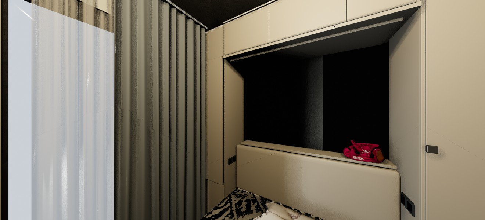

# 阶段 2 · Android 场景迁移到 Windows Filament

> 依据《光影渲染性能优化方案2（当前新方案）》第 5 章执行。
> 目标：在桌面端加载原项目模型、纹理、材质，逐步恢复灯光、阴影、后处理，形成与 Android 端尽可能接近的完整场景。
> 日期：2026-11-08。

---

## 0. 结论

1. **场景已在桌面端完整复现**：`room.glb`（63.5 MiB，158 个 renderable）通过 gltfio 加载，PBR 材质、内嵌纹理、HDR IBL 全部正常；灯光、阴影、SSAO、Filmic、FXAA 按 Android 配方逐项恢复。
2. 桌面端源码为自建 C++ 程序 `room_viewer.exe`（[src/main.cpp](../src/main.cpp)、[src/CMakeLists.txt](../src/CMakeLists.txt)），链接 Filament v1.68.2 静态库，Vulkan 后端确认使用 RTX 4050。
3. 按方案 §5.2 的五步顺序做了**增量验证**：仅模型+IBL → +灯光 → +阴影 → +后处理；每一步都保留了 2640×1200 截图（见第 4 节）。
4. 相机位姿、FOV、曝光、灯光参数与 Android 端一致；`room.glb` 不含 glTF 灯具，确认走的是 `PhysicalRoomLighting` 的自动布光路径（与 A0 日志 `lights=3` 一致）。
5. **关键发现**：Filament 1.68.2 的 PCSS 在桌面 Vulkan 上出现亮色点状/斜向漏光（窗帘、床头、衣柜边缘）；同一场景 DPCF/PCF 干净，与手机 A0 观感一致。因此阶段 2 的视觉验收采用 DPCF；阶段 3 将对 PCSS 与 DPCF 分别计时，详见 §5.2。
6. 当前 `SUMMARY` 输出的是 CPU 提交间隔，**不是 GPU 帧时间**，只用于确认程序连续渲染；阶段 3 会改用 `Renderer::getFrameInfoHistory()` 等接口采集有效指标。

---

## 1. 验收标准对照

方案 §5.2 要求按五步恢复，§“阶段 2 完成标准”要求“能够加载原项目的主要模型、纹理和材质，并逐步恢复灯光、阴影及后处理效果，最终形成与 Android 端尽可能接近的完整渲染场景”。

| 要求 | 状态 | 证据 |
|---|---|---|
| 加载主要模型/纹理/材质 | ✅ | 158 renderables；gltfio 0.37–0.39 s 完成纹理加载 |
| 恢复环境光（IBL） | ✅ | `studio_small_09_2k.hdr`，强度 0.25 |
| 恢复日光 + 局部灯 | ✅ | SUN + POINT + FOCUSED_SPOT，参数逐项移植 |
| 恢复实时阴影 | ✅ | 4 级 1024 日光阴影 + 512 局部阴影；PCSS/DPCF 可切换 |
| 恢复后处理 | ✅ | SSAO、Filmic、FXAA |
| 与 Android 观感接近 | ✅（DPCF） | 与 `A0-acceptance.png` 构图/色调一致；PCSS 例外，见 §5.2 |

---

## 2. 工程结构与资源

### 2.1 目录

```text
D:\FilamentDesktop\                 # 工作目录（不进仓库）
├── filament\                       # Filament v1.68.2 源码与构建产物
├── assets\
│   ├── room.glb                    # 房间模型（ASCII 路径）
│   └── studio_small_09_2k.hdr      # HDR 环境
├── scene\
│   ├── src\main.cpp                # 桌面端场景程序（副本已入库）
│   ├── CMakeLists.txt
│   └── out\room_viewer.exe         # 构建产物
├── tools\build_room_viewer.bat
├── shots\                          # 2640×1200 截图
└── benchmark\                      # 阶段 3 CSV（待生成）

<仓库>\FilamentDesktop\
├── src\main.cpp                    # 源码同步副本
├── src\CMakeLists.txt
├── tools\build_room_viewer.bat
├── docs\                           # 阶段文档
└── README.md
```

### 2.2 资源校验

| 资源 | 来源 | 大小 | MD5 |
|---|---|---:|---|
| `room.glb` | 工作区根目录 `.tmp_room_model.glb` | 66,543,536 B | `191ae750c8bbc0e508f4819fe83deb96` |
| `studio_small_09_2k.hdr` | `AndroidApp/app/src/main/assets/environments/` | 6,313,169 B | `88ae004a9e9a5ff9ee1df2b6fa65bff6` |

两份桌面副本与源文件 **MD5 完全一致**，未做转码或重新打包，纹理/材质与 Android 端同源。

> Filament 的 `utils::Path` 在 Windows 上不转换 UTF-8 到宽字符，因此资源统一复制到纯 ASCII 的 `D:\FilamentDesktop\assets\`。

### 2.3 构建

```bat
:: D:\FilamentDesktop\tools\build_room_viewer.bat
call "...\VS2019\Community\VC\Auxiliary\Build\vcvars64.bat"
cmake -S D:\FilamentDesktop\scene -B D:\FilamentDesktop\scene\out ^
      -G Ninja -DCMAKE_BUILD_TYPE=Release
cmake --build D:\FilamentDesktop\scene\out --config Release
```

- 运行库 `/MT`（Filament 以 `USE_STATIC_CRT=ON` 构建）。
- 链接 48 个 Filament 静态库，顺序与官方 `gltf_viewer` 的链接行一致；额外补 `ws2_32`、`shlwapi` 以解析 `ntohl/ntohs/PathIsRelativeA`。
- 编译选项：`/utf-8 /EHsc /MP /W3 /O2 /Zi`。

---

## 3. C++ 场景搭建

### 3.1 资源加载（gltfio）

```text
NameComponentManager
  → createUbershaderProvider(engine, UBERARCHIVE_DEFAULT_DATA, ...)
  → AssetLoader::create({engine, materials, names})
  → createAsset(bytes)
  → ResourceLoader(engine, gltfPath) + stb/ktx2 TextureProvider
  → loadResources(asset)
  → asset->releaseSourceData(); engine->flushAndWait()
```

日志：

```text
[load] glb D:/FilamentDesktop/assets/room.glb (63.5 MiB)
[load] gltfio assets ready in 0.37s (renderables=158)
```

- 每个 renderable 显式设置 `castShadows=true`、`receiveShadows=true`（对应 `PhysicalRoomLighting` 的 `isShadowCaster/isShadowReceiver`）。
- 未使用自定义 `.mat/.filamat`，全部由 gltfio 运行时生成材质变体。

### 3.2 包围盒与房间外壳

- 逐 renderable 取局部 AABB，乘世界变换后合并。
- 房间外壳只统计名称以 `wall` / `floor` / `ceiling` 开头的部件（对应 `RoomLightLayout` 的做法，避免窗帘、daylight card 等辅助物撑大房间）。

日志：

```text
[bounds] model center=(-0.35, -0.12, -0.30) size=(4.64, 2.77, 4.79)
```

### 3.3 相机

| 参数 | 值 | Android 对应 |
|---|---|---|
| 眼高 | `minY + 1.6 m` | `VrWalkthroughActivity.kt` |
| 水平位置 | 包围盒中心 X/Z | 同上 |
| 初始 yaw | X 尺寸 < Z 尺寸 → 0° | `sizeX >= sizeZ ? 90° : 0°` |
| 竖直 FOV | 80° | `VERTICAL_FOV_DEG = 80` |
| near / far | 0.05 / 100 m | 同左 |
| 曝光 | f/0.7、1/125 s、ISO 100 | `setExposure(0.7, 1/125, 100)` |

日志：

```text
[camera] eye=(-0.35, 0.10, -0.30) yaw=0.0 fov=80 near=0.05 far=100
```

### 3.4 灯光（逐项移植 `PhysicalRoomLighting` + `RoomLightLayout`）

日光 SUN：

| 参数 | 值 |
|---|---|
| 方向 | 高度角 40°、旋转角 35°：`(-cosE·sinR, -sinE, -cosE·cosR)` |
| 强度/色温 | 2500 lux / 6500 K（`Color::illuminantD`） |
| 太阳角半径 | 1.5° |
| 阴影 | mapSize 1024、4 级级联、`stable=true` |

顶灯 POINT：

| 参数 | 值 |
|---|---|
| 触发 | 名称以 `ceiling` 开头 |
| 位置 | 该部件包围盒中心，`min.y - 0.05 m` |
| 功率/色温 | 60 W / 4700 K（`EFFICIENCY_LED`） |
| 衰减/灯泡半径 | 房间对角线 × 1.5 = **10.83 m** / 0.05 m |
| 阴影 | 512；Filament 1.68 不支持点光实时阴影，请求无效（与手机一致） |

窗灯 FOCUSED_SPOT：

| 参数 | 值 |
|---|---|
| 触发 | 名称以 `window` 开头，排除 `drape/sheer/curtain/blind`；同编号窗框合并 |
| 位置 | 窗包围盒中心向房间内侧 0.08 m |
| 方向 | 指向房间中心，含 -0.35 向下分量 |
| 锥角 | 内 45°、外 85° |
| 功率/色温 | 20 W / 6500 K |
| 灯泡半径/阴影 | 0.20 m / 512（`shadowFar = falloff`） |

最多 4 盏局部灯；本房间实际 1 盏顶灯 + 1 盏窗灯：

```text
[lights] sun=1 local=2 falloff=10.83m room=4.64 x 2.77 x 4.79
```

> `room.glb` 不含 `KHR_lights_punctual`，因此按配方自动布灯。这与 A0 日志
> `lights=3 shadowRequests=3 ceiling=1 window=1 gltfLights=false` 一致，可确认桌面复现的是同一条布光路径。

### 3.5 View 画质

| 项目 | 值 |
|---|---|
| 阴影 | `setShadowingEnabled(true)` |
| 阴影过滤 | `ShadowType::PCSS / DPCF / PCF` 可切换（对应 Android 的 PCSS 基线） |
| 软阴影 | `penumbraScale = 1`、`penumbraRatioScale = 1` |
| SSAO | 开，radius 0.35 / intensity 0.65 / resolution 0.5 / MEDIUM ×3 |
| 抗锯齿 | FXAA |
| 色调映射 | `ColorGrading::Builder().toneMapper(&FilmicToneMapper)` |

**关于 Filmic**：`ColorGrading::Builder().toneMapper(new FilmicToneMapper())` 与已废弃的枚举
`ColorGrading::ToneMapping::FILMIC` 输出不同，后者明显更暗；ACES 也与 A0 观感不符。
桌面端使用新 API 的 `FilmicToneMapper`，与 SceneView 2.3.4 的内部行为一致（阶段 0 已核实：
Android 端 `View.setToneMapping(ACES)` 没有 native 实现，实际色调映射来自 SceneView 的 ColorGrading + Filmic）。

### 3.6 截图

- 主循环 `beginFrame → render → endFrame`，在运行 1.5 s 后调用一次
  `Renderer::readPixels(0, 0, w, h, PixelBufferDescriptor(RGBA/UBYTE))`；
- 回调中用 `stb_image_write` 写 PNG，保证截图与窗口/离屏交换链分辨率一致。

---

## 4. 增量恢复结果（2640×1200）

所有截图使用同一相机位姿、分辨率 2640×1200（与手机横屏 316.8 万像素一致），运行 3 s、第 1.5 s 截图。

命令示例：

```bat
room_viewer.exe --headless --no-input --preset=p4 --shadow-type=dpcf ^
  --duration=3 --width=2640 --height=1200 --gpu-hint=NVIDIA ^
  --screenshot=D:/FilamentDesktop/shots/stage2_p4_dpcf_2640.png
```

### 4.1 第一步 + 第二步：模型、材质、IBL（`p1c`）



只有 IBL（强度 0.25）时房间整体很暗，几何轮廓可见——说明环境光本身不足以照亮室内，与 Android 配方“日光/局部灯为主、IBL 为辅”的预期一致。

### 4.2 第三步：恢复灯光（`p2c`，无阴影）



加入灯光后大面积过曝、无遮挡关系——这是关闭阴影+SSAO 的中间态，用于确认灯光强度与位置正确，同时说明阴影对画面成立是必需的。

### 4.3 第四步：恢复实时阴影（`p3c`）

DPCF（与手机观感一致）：


PCSS（桌面 Vulkan 出现漏光）：



### 4.4 第五步：恢复全部后处理（`p4`，DPCF）



与手机基线
[`A0-acceptance.png`](../../项目文档/手机端软件开发/光影渲染性能基线/阶段0/A0-acceptance.png)
对照：窗帘、衣柜凹槽、床头、红色包、床品的构图与明暗关系一致，色调接近；手机截图带有 UI 覆盖层（方向键、提示条、菜单按钮），桌面端不渲染这些 UI。

---

## 5. 关键发现

### 5.1 Filmic 是唯一正确的色调映射

| 方案 | 结果 |
|---|---|
| `ColorGrading::ToneMapping::FILMIC`（废弃枚举） | 整体明显偏暗，与 A0 不符 |
| `ColorGrading::ToneMapping::ACES` | 对比度和色相不符 |
| `FilmicToneMapper`（新 API） | 与 A0 色调一致 ✅ |

### 5.2 PCSS 在桌面 Vulkan 上的漏光

现象（见 §4.3 右图）：

- 亮白色点状/斜向条纹，沿窗帘褶皱、床头板边缘、衣柜凹槽边界分布；
- 只在 `ShadowType::PCSS` 下出现；`DPCF`、`PCF` 干净；
- 把日光阴影图从 1024 提到 **4096** 后条纹更锐利但仍存在 → **不是分辨率走样**；
- `--sun-lux=0` 关闭日光后消失 → 由日光阴影驱动；
- 手机 A0 同一场景、同一 PCSS 配置没有该现象。

已排查的差异：桌面 Vulkan 与手机 GLES 的着色器路径不同。Filament 在
`libs/filamat/src/shaders/CodeGenerator.cpp` 中对 Vulkan/桌面 GL 无条件定义
`FILAMENT_HAS_FEATURE_TEXTURE_GATHER`，而 GLES FEATURE_LEVEL_1 使用
`texelFetchOffset` 回退路径（`shaders/src/surface_shadowing.fs:228`）。PCSS 在
scissor 边界处 `textureGather` 的 2×2 采样足迹可能读到钳制区域外的纹素，形成亮斑；
该假设尚未用 RenderDoc/Nsight 在着色器层验证。

处理决定：

- **阶段 2 视觉验收以 DPCF 为准**，它与 A0 观感一致；
- 不修改 Android 工程配置；
- 阶段 3 的 PC-03 同时测 **PCSS 与 DPCF** 两组，量化两者开销并保留证据；
- 若后续需要在桌面端长期使用 PCSS，再评估材质变体或着色器层修复。

### 5.3 纹理提供者的生命周期（崩溃修复）

程序在完成全部渲染与资源销毁后仍以退出码 139 结束。逐段加日志定位到：
`StbProvider`/`Ktx2Provider` 是 `run()` 的局部 `unique_ptr`，在函数返回时才析构；
而 `StbProvider::~StbProvider()` 会调用 `mEngine->getJobSystem().release(...)`
（`libs/gltfio/src/StbProvider.cpp:274-277`），此时 Engine 已被销毁 → 访问已释放内存。

修复：在 `engine->destroy(&engine)` 之前显式 `stbDecoder.reset(); ktx2Decoder.reset();`。
修复后进程稳定以 0 退出，阶段 3 的自动化脚本可直接依赖退出码判定成功。

### 5.4 性能数据的有效性边界

`SUMMARY` 目前统计的是 `beginFrame → endFrame` 的 CPU 提交耗时（例如 p4 场景
p50 0.46 ms、avg_fps 765），不能当作 GPU 帧时间或真实 FPS。阶段 3 将：

- 使用 `Renderer::getFrameInfoHistory()` 的 `gpuFrameDuration` / `cpuFrameDuration`；
- 记录显存占用与长时间运行稳定性；
- 用固定时长、预热后采样，输出 CSV。

---

## 6. 与 Android 端的差异与已知限制

| 项目 | 说明 |
|---|---|
| UI / AR | 不迁移 AR Engine、相机背景、方向键/菜单等 UI（按阶段 0 约定） |
| 场景动画 | GLB 内含 8 条门窗动画；桌面端当前播放默认姿态，不驱动 Animator |
| PCSS | 桌面 Vulkan 有漏光，视觉基线用 DPCF，见 §5.2 |
| 动态分辨率 | 手机基线本就关闭（scale=1.0），桌面不实现 |
| 渲染后端 | 手机 GLES vs 桌面 Vulkan，驱动差异属于本实验要观察的变量 |
| 帧率上限 | headless 交换链无 vsync；阶段 3 需明确 vsync 策略并记录 |

---

## 7. 程序参数

```text
--ibl=<path.hdr>        HDR 环境（默认 studio_small_09_2k.hdr）
--preset=p1|p2|p3|p4    功能级别（默认 p4）
--api=vulkan|opengl     后端（默认 vulkan）
--gpu-hint=<substr>     Vulkan 设备提示（默认 NVIDIA）
--width / --height      分辨率（默认 1280×720）
--duration=<s>          运行 N 秒后退出
--csv=<path>            追加一行统计结果
--screenshot=<path>     预热 1.5 s 后写一张 PNG
--sun-lux=<lux>         日光强度覆盖（诊断）
--no-sun-shadow         关闭日光阴影（诊断）
--sun-map=<px>          日光阴影图尺寸（默认 1024）
--shadow-type=pcss|dpcf|pcf
--headless              隐藏窗口 + 离屏交换链
--no-input              禁用键盘/鼠标相机
```

预设与阶段 3 测试组的对应：

| 预设 | 局部灯 | 阴影 | SSAO | Filmic | FXAA | 用途 |
|---|:---:|:---:|:---:|:---:|:---:|---|
| `p1` | ✗ | ✗ | ✗ | ✗ | ✗ | PC-01 模型+IBL，无色调映射 |
| `p2` | ✓ | ✗ | ✗ | ✗ | ✗ | PC-02 +灯光 |
| `p3` | ✓ | ✓ | ✗ | ✗ | ✗ | PC-03 +阴影 |
| `p4` | ✓ | ✓ | ✓ | ✓ | ✓ | PC-04 完整场景 |
| `p1c/p2c/p3c` | 同 p1/p2/p3 | | | ✓ | | 仅用于视觉对照（多一项色调映射） |

---

## 8. 阶段 2 完成标准

- [x] 桌面端加载原项目模型、内嵌纹理与 PBR 材质；
- [x] 恢复 HDR IBL（强度 0.25）；
- [x] 恢复日光、顶灯、窗灯，位置/强度/衰减与 Android 配方一致；
- [x] 恢复日光级联阴影与局部灯阴影，PCSS/DPCF 可切换；
- [x] 恢复 SSAO、Filmic、FXAA；
- [x] 固定入口相机位姿、80° FOV、三参数曝光，2640×1200 出图；
- [x] 与 `A0-acceptance.png` 对照，DPCF 下构图/色调一致；
- [x] 程序可重复启动并以退出码 0 结束，可进入阶段 3 自动化。

**阶段 2 已完成。** 下一步：阶段 3 的 PC-01 ~ PC-04 性能测试，见方案第 6 章。
