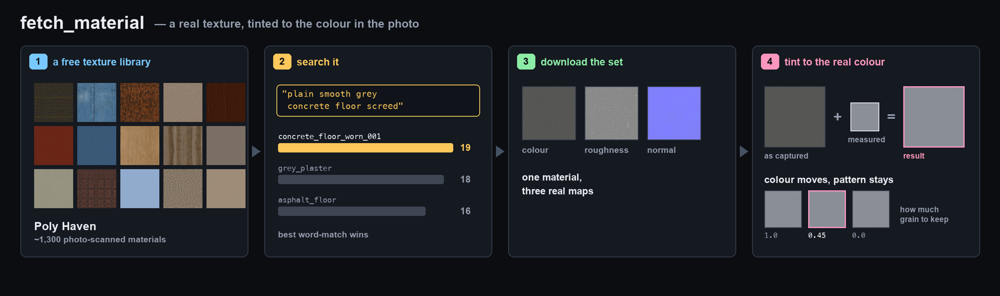

# Fetch material

The `fetch_material` capability tool searches Poly Haven for a PBR texture,
downloads diffuse/roughness/OpenGL normal maps, and optionally recolours the diffuse.

## Parameters

| Parameter | Meaning |
|---|---|
| `query` | Material description, including the material type |
| `name` | File slug and texture recipe key |
| `color_hex` | Optional target colour |
| `pattern_strength` | Pattern contrast; default 1.0, clamped to 0.05–1.0 |
| `res` | Texture resolution; default `1k`, with `2k` also supported |

The [tool](../../src/litereality_agent/agent/tools/fetch_material/tool.py) writes
maps to the room's `materials/` directory and merges recipes into `textures.json`.
It returns file paths, selection details, a diffuse preview, and a Blender wiring
snippet. The
[texture materializer](../../src/litereality_agent/room_ops/compile/fetch_textures.py)
caches downloads, checks MD5 values, and can recreate maps from the recipe.
Recolouring shifts the diffuse in LAB space while preserving its pattern.

## Selection and limits

Search uses whole-word matches over names, tags, and categories. Material words
have extra weight; an asset matching no requested material word scores zero.
Matching placement terms are boosted, and conflicting placement terms are penalized.

A `WEAK match` warning means the selected asset's categories do not support the
requested material. Inspect the preview before applying it. Use a procedural
material when the library lacks a suitable surface.
