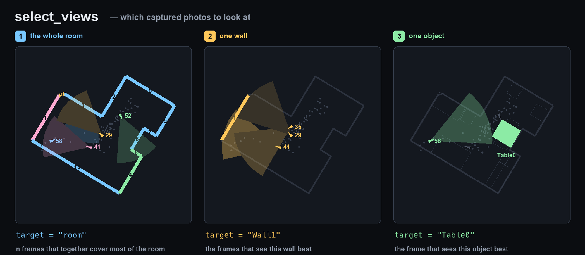

# Image selection

The [select_views tool](../../src/litereality_agent/agent/tools/select_views/tool.py)
selects capture frames using geometry and visibility.

| Target | Selection method |
|---|---|
| `room` | Greedy wall-area coverage, with diverse wide views for top-up |
| `Wall<N>` | Wall projection area and visibility from capture camera poses |
| Object ID | Visibility scores in a render manifest; requires a prior room render |

`Floor0` and `Ceiling0` use room coverage when no projected wall target exists.
The result contains `frames` with frame indices and scores.
Room/wall selection uses a frame-index separation of
`max(3, len(per_frame) // 15)`; this is a diversity heuristic, not a measured
camera-distance constraint.

## Surface references

[surface_views.py](../../src/litereality_agent/agent/tools/shared/image_selection/surface_views.py)
selects sharp frames covering walls, floors, and ceilings. It reports blur and
coverage, and skips walls below its area/side thresholds.
Sparse coverage or blurry evidence limits what can be inferred from the capture.

See [shared image selection](../../src/litereality_agent/agent/tools/shared/image_selection/README.md)
for surface geometry and orthographic comparison, and
[rendering](rendering_and_compare.md) for paired render/photo images.
