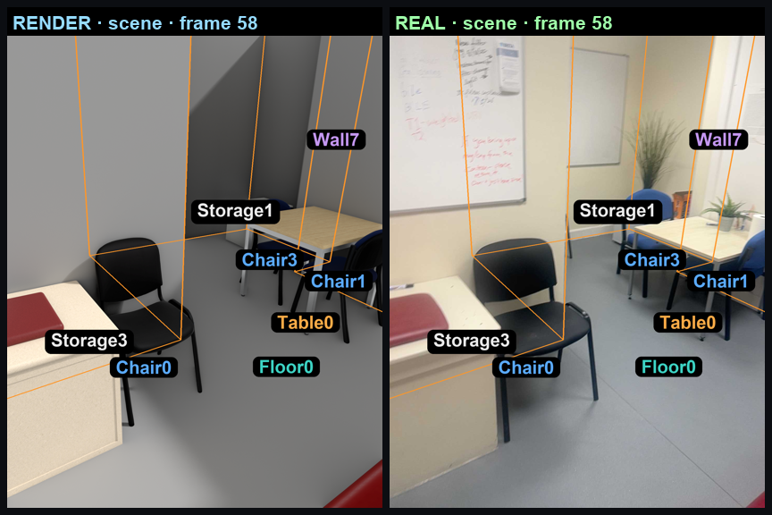
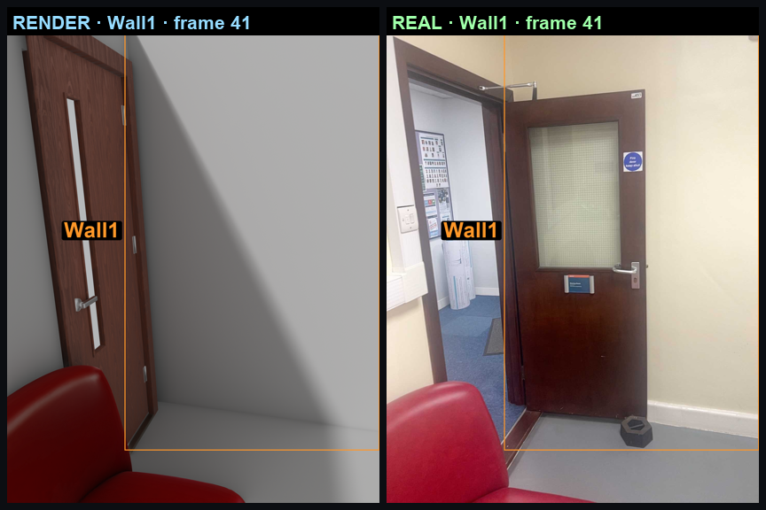
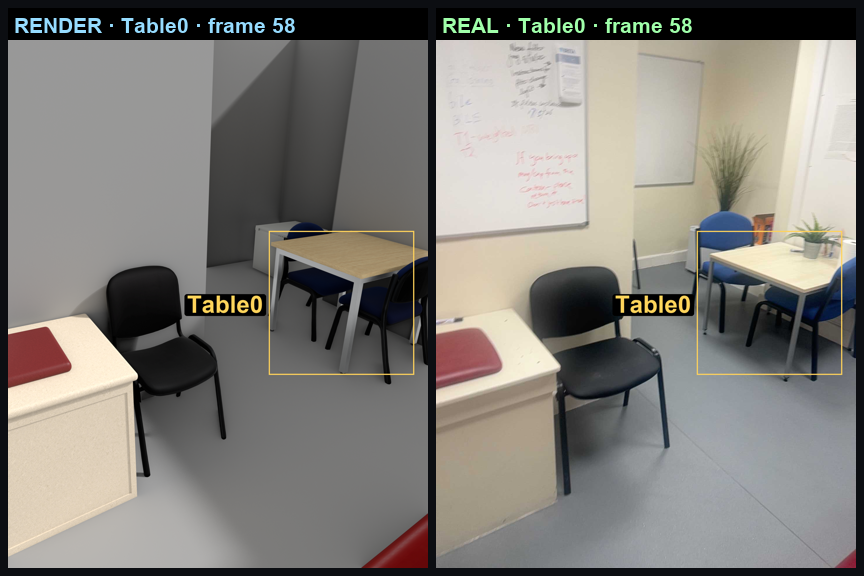

# Rendering and comparison

The [render tool](../../src/litereality_agent/agent/tools/render/tool.py) compares
the current room with real capture frames at matching ARKit camera poses.

| Target | Annotation |
|---|---|
| `room` | Visible object labels |
| `Wall<N>` | The selected wall outline |
| Object ID | The selected object's bounding box |

When `frames` is omitted, [select_views](image_selection.md) chooses them and
returns selection scores alongside the images.

## Surface comparison

For walls, floors, and ceilings, the tool can add an orthographic render beside
the rectified capture stitch. If no orthographic render is available, it may
return the real stitch alone. Very small stitch images are omitted.

## Build freshness

The tool recompiles when `Room.py` is newer than the last successful compile
and reports a build error if recompilation fails. It also attempts to rebuild
and repack procedural objects whose `object.py` is newer than the packed GLB.
That object synchronization is best-effort; inspect the output if an edit is absent.

`critic` is a separate tool that grades images against a goal.
Rendering itself does not produce an acceptance verdict.

For Python calls, CLI modes, and prerequisites, see the
[render engine](../../src/litereality_agent/agent/tools/render/source/README.md).
