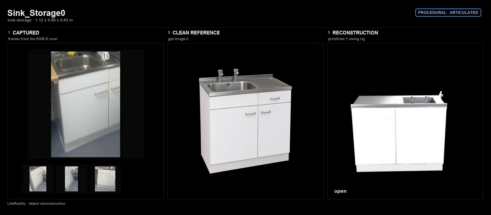
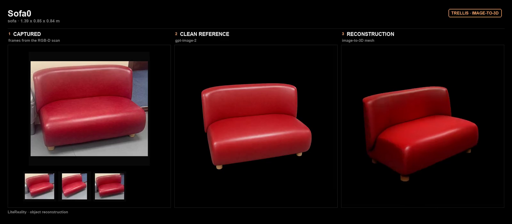

# Object reconstruction routes

The
[complexity router](../../src/litereality_agent/pipeline/scene_init/reconstruct/classify/classify_complexity.py)
selects a reconstruction route per object using scan evidence and a clean reference image.

| Route | Suitable geometry | Output characteristics |
|---|---|---|
| Procedural Blender build | Regular furniture and appliances | Editable build code, dimensions, materials, optional articulation |
| TRELLIS.2 | Irregular or detailed shapes | Textured mesh fitted into the room's measured placement |

## Procedural generation

[Object generation](../../src/litereality_agent/models/object_generation/README.md)
combines category specifications, RoomPlan dimensions, and reference images.
Agent sessions default to Codex / `gpt-6-astra`.
Moving parts carry articulation extras and animation; static categories do not
require joints. The rebuild recipe remains in `object.py`.

## TRELLIS

[models/trellis/inference.py](../../src/litereality_agent/models/trellis/inference.py)
runs TRELLIS.2 on object-only references. Its default preprocessing uses the
near-black background as alpha instead of invoking the RMBG model.
Runtime selection supports [Modal](../../deploy/modal/README.md) or
[local GPU inference](../../deploy/local-gpu.md).
The Modal TRELLIS deployment permits one container.

## Checks and additional passes

[mesh_qc](../../src/litereality_agent/pipeline/scene_init/reconstruct/mesh_qc/)
checks generated assets before room assembly.
[Room validation](../QC/collision_check.md) checks the assembled result.

RoomCanvas also provides a small-object pass and an articulated-part pass on
authored rooms. A neural mesh can therefore receive cut-out moving parts later;
see the [project workflow](../../../docs/ROOM_RECONSTRUCTION.md).
